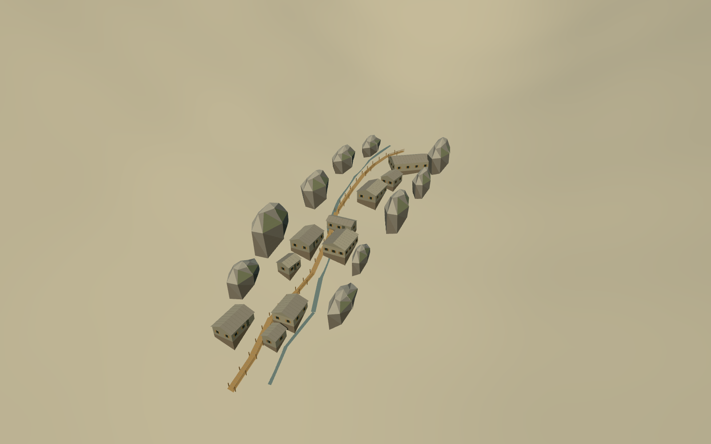

# Franja Partisan Hospital

Franja’s timber field hospital huts, weathered roofs and linked public footway in the Pasice gorge as pictured just before the 2007 flood.

Authoring state: **review-in-qa.json**. Current completion evidence is in [qa.json](qa.json) and the [completion ledger](../../../../qualla-structures/batches/qualla-003.PROGRESS.md).

- [Franja Partisan Hospital](https://qualla.com/franja-partisan-hospital/)

The placement shows the documented pavilion exteriors in the pre-flood preserved site. The hospital had fourteen named cabins; the model covers the nine structures with mapped footprints and the adjoining visible walk.

The surviving map mostly records the reconstructed site. Exact pre-flood footprints, the small ledges under the huts and the historical stream bed are approximate.

The two photos document a preserved appearance from 2006–2007, several decades after the hospital operated. Current flood repair is outside this historical placement.

Build: `node content/worldgen/source/places/u2/u21/franja_partisan_hospital/models/generate-franja-partisan-hospital.mjs`. Add `--check` to verify exact regeneration. 3526 triangles; 6 materials; no embedded photographs.
