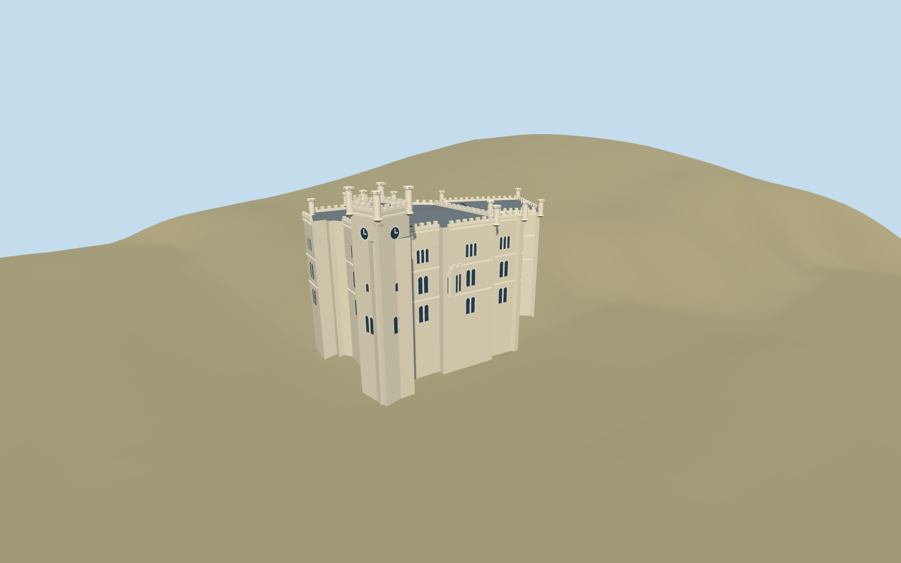

# Miramare Castle

Ivory Istrian stone Miramare Castle: angled eastern and taller western crenellated wings, recessed stair hall, paired/triple round-headed windows, projecting sea-side bay and square southwest clock tower with four corner turrets.

## Evidence and reconstruction

Published dimensions and reconstructed details are separated in spec.json. Primary references:

- [Reference](https://miramare.cultura.gov.it/en/the-castle/)
- [Reference](https://www.movio.beniculturali.it/pmfvg/viverelottocentoatrieste/it/8/lo-stile-architettonico)
- [Reference](https://www.movio.beniculturali.it/pmfvg/viverelottocentoatrieste/it/101/galleria-fotografica)
- [Reference](https://miramare.cultura.gov.it/concorso-art-bonus-il-restauro-della-torretta-del-castello-la-costruzione/)
- [Reference](https://miramare.cultura.gov.it/wp-content/uploads/2020/09/CS_25-SETTEMBRE-2020.pdf)
- [Reference](https://www.openstreetmap.org/way/361092895)

No third-party geometry, photograph or bitmap texture is embedded. Shared surface graphs come from the central library; vertex tints carry model colors. Glazing uses PBR materials; transparent surfaces are declared per model.

## Model and axes

9,918 triangles; 29,754 vertices; 3 material groups; 1,192,508 bytes. Native bounds: -31.515, -5.236, -17.657 to 31.106, 36.200, 17.657. Source hash: `sha256:e1cdf8fce5b324f87672329372771c9c76588ad5243d771a9050c43b4bfe470a`.

{"up":"+Y","longitudinal":"+X almost east,0.478 degrees north of east","front":"-Z landward parterre; +Z sea terrace; square clock tower at southwest(-X,+Z)","origin":"Site anchor; Y0 standard PMTiles working datum."}

The inspected aerial picture confirms the ivory angled crenellated wings, recessed entrance, sea-side bay and southwest square clock tower with four corner turrets. Standard viewer PMTiles and the retained building outline set approximate coastal location and signed orientation. Coarse inland ground rises above the anchor sample; a reconstructed7.2m working rise clears it, with bounded castle foundations extending below the sampled slope. This is approximate fit, not a surveyed sea/terrace datum. Anchor 13.712453245,45.702528846; heading 0.008338727695; standard PMTiles datum 3.7358245453613077m. Floors are reconstructed and foundations extend below the coarse sampled ground.

## Reproduce

Run `node packages/worldgen/scripts/generate-signature-towers.mjs --ids=miramare_castle` (or add `--check`). The generator preserves manually edited masters by checking their baseline hashes. Import through the standard authored-model workflow with optimization disabled; then capture all QA cameras, including shared-surface views.

## Pending work

- Approximate current exterior based on inspected picture and standard viewer PMTiles; no bespoke survey or precise terrace/sea elevation conversion.
- Original detailed architectural master/recipe preserved; independent derivative fits working datum and bounded foundation bottoms.
- Angled ivory wings, southwest four-turret clock tower, paired/triple arched windows, recessed hall and bay preserve identity. Fine stone carving and openings are reconstructed.
- Castle building footprint only. Park, Castelletto, terrace retaining walls, jetty, full coastal cliff and interiors excluded. No artificial terrain cutout.
- Two shared material graphs and local opaque glass; zero embedded images. Physical-device timing pending.

This bundle follows the medium-fi standard. Medium-fi appearance and geographic fit are reviewed separately. Hash-bound visual acceptance is recorded separately after capture inspection.

## Additional geographic data

© OpenStreetMap contributors, ODbL-1.0. Italian Ministry of Culture / Miramare Museum primary photographs and architectural notes used as research only.
