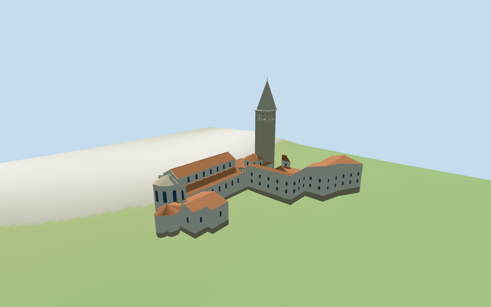

# Euphrasian Basilica

Euphrasian Basilica complex: raised red-tiled nave/clerestory and lower aisles,polygonal east apse,west triple windows/selected mosaic bands,open atrium arcades/courtyard,octagonal baptistery,separate square bifora belfry/steep stone spire and northern episcopal ranges/chapels.

## Evidence and reconstruction

Published dimensions and reconstructed details are separated in spec.json. Primary references:

- [Reference](https://www.istria-culture.com/en/euphrasian-basilica-i4)
- [Reference](https://commons.wikimedia.org/wiki/File:Basilica,_eufrasiana,_campanile.jpg)
- [Reference](https://commons.wikimedia.org/wiki/File:Euphrasian_Basilca_Western_Facade_Seen_from_the_Attrium_1.JPG)

Five existing256-square raw/weathered limestone,plaster,tile and wood graphs shared across seven roles; selected mosaic bands use linear vertex tints in the common stone material. Metric UVs,flat glass,no embedded images.

## Model and axes

10,524 triangles; 31,572 vertices; 7 material groups; 1,267,160 bytes. Native bounds: -57.751, -2.289, -51.234 to 27.246, 50.920, 9.810. Source hash: `sha256:4345630ee1e22098a7790c08920a329925f571a247e6a2f767268403ee50c498`.

{"x":"east along nave toward apse","y":"up","z":"south/inland away from episcopal palace"}

Standard viewerDEM datum2.562043m; estimated level floor1.0m clears sampled footprint peak0.682m and perimeter-1.94..0.68m. Foundations follow coarse terrain. No independent floor/height survey; exact courtyard thresholds,stairs and terrain/town joins unverified.

## Reproduce

Run `node packages/worldgen/scripts/generate-additional-landmarks.mjs --ids=N0341` (or add `--check`). The generator preserves manually edited masters by checking their baseline hashes. Import through the standard authored-model workflow with optimization disabled; then capture all QA cameras, including shared-surface views.

## Pending work

- No height values are present on the selected standard map controls, and retained height/width/length facts have no published measurements. All vertical dimensions are picture-led estimates: main nave13.6m eave/16.2m ridge,aisles7.8..10m,polygonal apse11.8..14.6m,baptistery8.4..11.2m,tower28m shaft/33m belfry/49m spire plus1m cross,atrium4.4..6.3m and palace9..14m. These dimensions and interior division are approximate, not independently measured.
- Standard viewerDEM datum2.562043m; estimated level floor1.0m clears sampled footprint peak0.682m and perimeter-1.94..0.68m. Foundations follow coarse terrain. No independent floor/height survey; exact courtyard thresholds,stairs and terrain/town joins unverified.
- Octagonal baptistery inferred within the mapped rectangular joining envelope. Arcade piers,windows,selected mosaic bands/capitals,roofs and palace range roles approximate. Exact mosaic figures/tesserae,sculpture,full interiors,excavations,seawall/town and certified walking excluded. Physical phone/laptop timings pending.
- Skyline retains compound/atrium void,coarse nave/apse,baptistery and closed belfry/mean roofs. District adds textures,flat windows,mosaic bands,recessed closed door and actual atrium arches. Street adds actual belfry/clerestory apertures,columns,selected roof bands and cross. Closeup refines capitals/window frames and arch segmentation; detail changes remain visible.

This bundle follows the medium-fi standard. Medium-fi appearance and geographic fit are reviewed separately. Hash-bound visual acceptance is recorded separately after capture inspection.

## Additional geographic data

©OpenStreetMap contributors; Protomaps; Mapzen/USGS terrain tiles.
