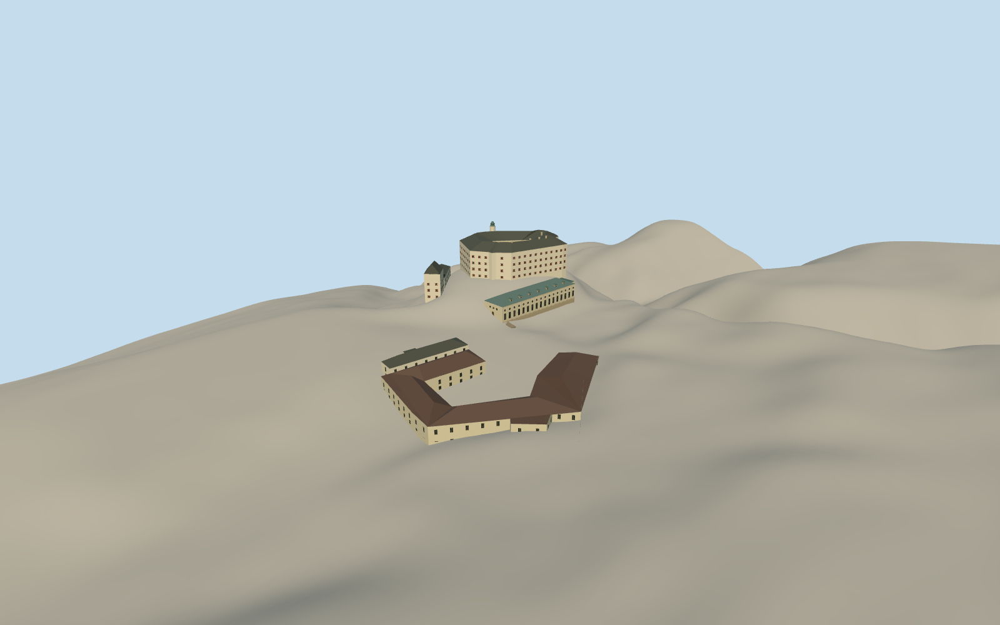

# Ambras Castle

Ambras Castle in Innsbruck, including the white Upper Castle and red-and-white shutters, the Spanish Hall and its circular windows, the Lower Castle and two western ranges.

Authoring state: **review-in-qa.json**. Current completion evidence is in [qa.json](qa.json) and the [completion ledger](../../../../qualla-structures/batches/qualla-003.PROGRESS.md).

- [Ambras Castle](https://qualla.com/ambras-castle/)

The model depicts the standing hilltop complex. The upper court and lower ranges follow their mapped plans. Individual rooms, old grotto interiors and outlying landscape structures are outside the model scope.

Roof pitches, wall sections, floors, patterning, the measured exterior oculus rhythm and masonry relief are architectural estimates tied to the public-domain exterior photographs and documented hall dimensions.

The two structural levels and connecting approaches use the original DEM and the established hill geometry. Hidden foundation details and terrace elevations are approximate.

The ground rises along the southern side of the Lower Castle. The section heights follow that rise approximately while keeping the open inner court and unmodified elevation samples.

Build: `node content/worldgen/source/places/u2/u22/ambras_castle/models/generate-ambras-castle.mjs`. Add `--check` to verify exact regeneration. 10745 triangles; 6 materials; no embedded photographs.
