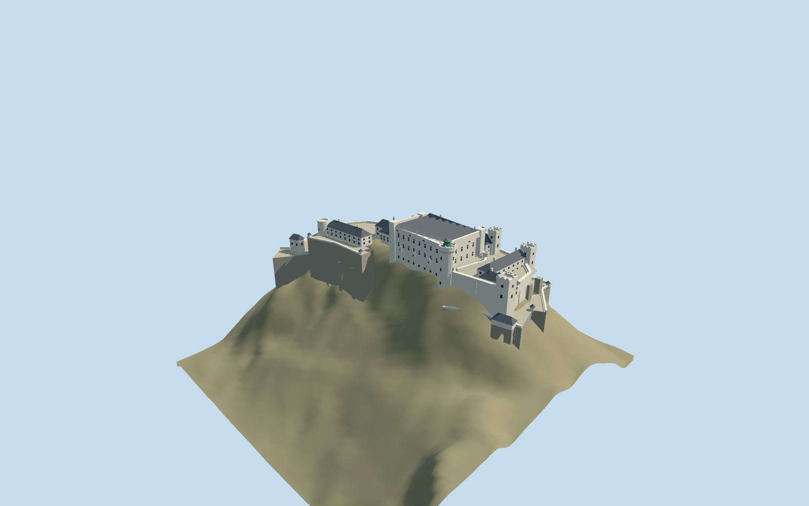

# Hohensalzburg Fortress

Salzburg hilltop fortress: broad white high palace under eight shallow parallel roofs, green Krautturm lantern, chapel spire, open courts and stepped artillery bastions.

## Evidence and reconstruction

Published dimensions and reconstructed details are separated in spec.json. Primary references:

- [Reference](https://www.festung-hohensalzburg.at/en/the-fortress)
- [Reference](https://www.stadt-salzburg.at/festung-hohensalzburg)
- [Reference](https://sammlung-online.salzburgmuseum.at/detail/collection/f0ee88fa-68c2-4ced-bde8-b4c337e1c59c)
- [Reference](https://hdbg.eu/burgen/detail/burgschloss-hohensalzburg/237?lang=de&p=1)
- [Reference](https://www.openstreetmap.org/way/58379993)

No third-party geometry, photograph or bitmap texture is embedded. Shared surface graphs come from the central library; vertex tints carry model colors. Glazing uses PBR materials; transparent surfaces are declared per model.

## Model and axes

5,419 triangles; 16,257 vertices; 5 material groups; 653,520 bytes. Native bounds: -133.627, -56.899, -72.000 to 131.100, 35.000, 85.608. Source hash: `sha256:a87d74e043874076ac8396386b3d10cd0c903eae4d45ca103e87d9e5a5a8a86e`.

{"up":"+Y","longitudinal":"+X east-northeast","front":"-Z north-northwest toward old town","origin":"Site anchor; Y0 standard PMTiles working datum."}

Appearance checked against courtyard and aerial pictures; placement uses standard viewer Protomaps/Mapzen PMTiles. Anchor 13.04787405,47.7952134 and heading 0.255395266735 retain the signed east-northeast palace/chapel frame. Y0 is the PMTiles sample at the site anchor, 540.3154652179358m. Main court is reconstructed5m above this coarse working ground; foundations extend below the hillside. Gate height is adjusted to PMTiles at the west approach. Individual wings and terrace floors remain approximate.

## Reproduce

Run `node packages/worldgen/scripts/generate-signature-towers.mjs --ids=hohensalzburg_fortress` (or add `--check`). The generator preserves manually edited masters by checking their baseline hashes. Import through the standard authored-model workflow with optimization disabled; then capture all QA cameras, including shared-surface views.

## Pending work

- Picture and PMTiles exterior fit, not surveyed geometry or thresholds.
- Original detailed source recipe is preserved unchanged; reviewed derivative shifts the architecture to the working terrain datum and extends bounded foundations.
- The current eight palace roof ridges, white walls, green lantern and chapel spire supply identity. Window rhythm, secondary towers, roof shapes and internal terrace divisions remain approximate.
- No artificial mountain, interiors, distant outerworks or vegetation. Coarse terrain can intersect narrow approaches; no navigable paths are claimed.
- Four shared material graphs and local opaque glass; no embedded bitmap textures. Physical-device timing and continuous-motion shimmer remain pending.

This bundle follows the medium-fi standard. Medium-fi appearance and geographic fit are reviewed separately. Hash-bound visual acceptance is recorded separately after capture inspection.

## Additional geographic data

© OpenStreetMap contributors, ODbL-1.0; owner, city and museum references used as research.
