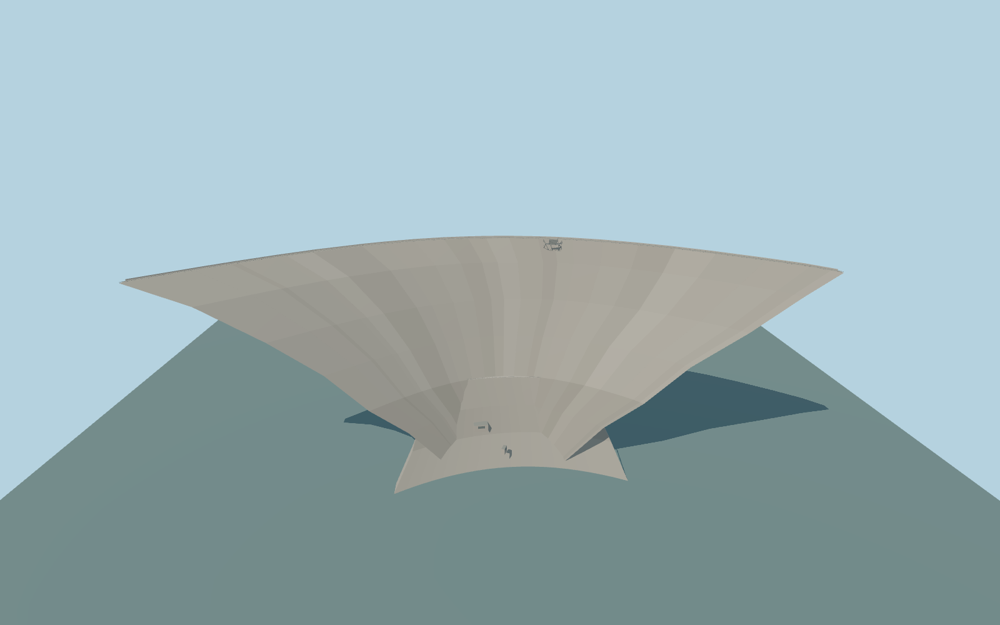

# Kölnbrein Dam

Kölnbrein Dam’s 626 m double-curved arch, 70 m downstream reinforcement, mapped inspection cabins and the cantilevered steel-and-glass Airwalk.

Rebuild: `node packages/worldgen/scripts/generate-kolnbrein-dam.mjs`;append `--check` for exact source bytes. Select import/LOD/placement with `--ids=kolnbrein_dam`. Detailed source and four browser tiers are separate ignored GLB outputs.

The signed vertical origin is 1892.17406225 m. The modeled crest is approximately 1906.2 m and foundation 1706.2 m. The review compares 1902 m full pool with the sampled 1892.80 m reservoir stage. The Galgenbichl forebay uses 1701.30 m in both fixtures.

The 607.79 m mapped crest road controls the arch, with short tangential extensions into both shoulders to reach 626 m. Crest grade and the shape of the lower concrete sections are exterior approximations.

The Airwalk plan follows the mapped ring and stair lines. The section, steel connections and depth of the glass deck are approximated from ordinary reference views.

The terrain remains native at both shoulders and over the lower support. The full and sampled pool stages differ by 9.20 m, reflecting different water-level fixtures. No operating releases are modeled.

Original geometry:repository license. Map:© OpenStreetMap contributors,ODbL-1.0;Protomaps. Standard terrain:terrain-grid.json. Ordinary pictures stay local and are not redistributed or used as textures. Current acceptance:qa.json.
