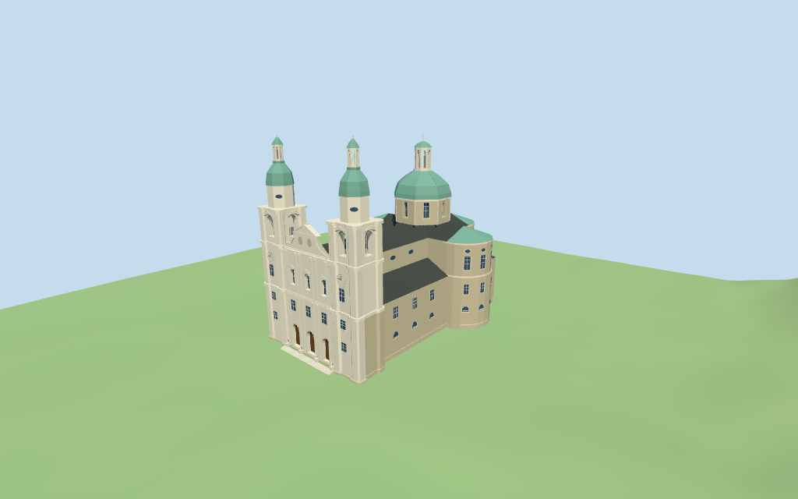

# salzburg_cathedral — Salzburg Cathedral review

Reviewed 2026-10-14 against current source/runtime bytes. Accepted for the recorded medium-fi exterior and approximate geographic scope.

## Built result

Inspected all 11 final portable/source-terrain views. Individual staged twin west towers, clocks, open belfries, green cupolas/lanterns/crosses, three closed recessed entrance portals, layered pale facade with selected pilasters/windows/pediments/figures, long dark nave/aisles, three rounded eastern/transept arms and central octagonal drum/green dome/lantern are present. Corrected the foreground wall that hid lower facade details, moved lower glazing onto the actual outer masonry envelope and replaced dark crest placeholders with stone-colored fields. Figures, crests and clocks are simplified geometry.

Individual medium-fi exterior from two useful inspected pictures and standard viewer PMTiles/DEM. Mapped parts control 28m aisle/service roofs,41m nave/rounded-arm tops,52m tower bodies with 23/40/53m cornices,69m cupolas,78m tower lanterns plus 79m tips,63m central dome and 79m central lantern top. Eaves, drum/roof subdivisions, facade profile, openings, figures, clocks and steps are picture-led estimates. Side/rear/oval glazing uses selected surface panels. Exact sculpture, carved reliefs/inscriptions, full interiors, adjacent arcades/palace wings, plaza monuments and certified walking excluded. Physical phone/laptop timings pending.

## Shared materials and placement

Inspected all 11 final shared-material/geographic views. Four existing 256-square graphs provide weathered/raw limestone, standing-seam metal and wood. Dark roofs and copper domes share one graph with linear tints; UVs are metric and glazing is flat blue-gray. Each graph reads once. Unloading leaves zero live model geometries and restores ground. Flat placement checks the signed mapped footprint; source heightmap views complement coarse terrain contact. Ground colors are diagnostic.

Retained exact-QID way239345806 and 35 current PMTiles controls preserve the approximately 103x69m plan and principal part heights. Native-X faces Domplatz and the twin-tower/three-door west facade, native+X the eastern rounded sanctuary, at heading -0.084741338579rad. Raw transforms match exactly without rescaling. Duplicate service rectangles are retained as evidence without duplicate geometry. Separate arcades, palace wings, columns and roads remain outside the model replacement. Standard DEM datum 424.198882m and estimated 0.8m floor clear sampled footprint peak 0.372m; plaza/portal thresholds and exact walking fit remain approximate.

Inspected all 27 final Earth-lighting views: Economy/High, noon/late, three distances, silhouette, six details, four matched whole-model levels and four transitions. Skyline preserves twin stepped towers, cupolas/lanterns, rounded arms, nave, dome and curved central facade. District adds shared textures, recessed closed portals, flat upper windows, selected frames/pilasters/clocks/figures and side glazing. Street opens belfry/lantern arches and recesses upper facade/drum glazing; closeup adds curved-profile and mullion detail. Four matched cameras retain the full model; closer detail/street cameras crop intentionally. Detail changes remain visible. Italian-palazzo neighbors are synthetic context, not local mapped buildings.

## Browser budgets

| Level | Triangles | Bytes | Draws |
| --- | ---: | ---: | ---: |
| skyline | 926 | 94900 | 1 |
| district | 3401 | 291352 | 5 |
| street | 14682 | 1343320 | 5 |
| closeup | 21774 | 2023688 | 5 |

Skyline plus district: **386252 bytes** of geometry. Source master: **2616208 bytes / 21774 triangles**. Four shared graphs cached separately; no embedded images. Initial geometry excludes graph definitions/texture generation. Separate POSITION/NORMAL streams have equal CPU/GPU buffer totals. Physical device timings pending.

## Verification

- Exact targeted source reproduction with --ids=salzburg_cathedral --check; current source/import/derivative/review hashes match.
- Six GLBs pass Khronos with zero errors, warnings or embedded images. Four browser levels meet triangle/draw/download budgets.
- All 35 raw map controls, retained exact-QID outline, signed frame and standard DEM match. All six outputs retain the mapped 79m top above the floor.
- **307 imported probes** pass: nave/aisle/rounded-arm roofs, central dome/lantern roof and floor, both belfry floors/cupola roofs/lantern roofs and floors; closed portal recesses, front/outer-aisle glazing; street+upper facade/drum recesses and eight belfry plus 24 lantern apertures. Glass probes sample between mullions.
- Four material graphs read once; unloading disposes geometry and restores ground.
- Source inventory/schema, map-frame and medium-fi readiness bindings pass.
- Scene validation and 30-tick simulation pass: sha256:5a54b532e39b64c08b99a4ebed3d91950ce0da752692a63b84985d1d2b20ad02.
- Inspected **49 current frames**: 11 portable,11 shared/placement,27 medium-fi. Reports retain cameras,paths and hashes; bulk views remain local/ignored.

Source hash: sha256:452227c5249e8dc5aa2a4e4d875b56bc21f3b91c01f246a03637d3bb9dc4eaa2. Runtime hash: sha256:f07894565f38404b7e92a7d49aa9b7b37db0d564c63e11944e8fc4142cb380c6. Input hash: sha256:e97897b0ea7fc9bd6a01043584b3e145cbb8a354c075519105f43d55cff1c17b.

Commands: targeted generate/import/LOD; capture-structure-models.mjs --ids=salzburg_cathedral --reflections --antialias --fit-shadows; capture-landmark-library.mjs --ids=salzburg_cathedral --reflections --adaptive-clipping --bounded-placement; capture-medium-fi.mjs --ids=salzburg_cathedral --reflections; molen validate; molen sim run --ticks 30 --hash. No repository-wide engine suite/audit or full source rebuild repeated; next routine source checkpoint follows transfiguration_cathedral.

## Limits

- Current parent gives the approximately 103x69m cathedral plan. Contained mapped parts give 28m aisle/service roofs,41m nave/crossing/rounded-arm tops,52m tower bodies with23/40/53m cornices,69m cupolas,78m tower lanterns plus79m cross tips,63m central dome and79m central lantern top. Photo-led internal estimates distinguish22m lower walls,36.5m nave/rounded-arm eaves,41..52m central drum,52..63m central dome,63..75.5m lantern and79m cross. Tower cupola stages53..61m and61..69m are inferred. Openings,roof profiles,facade bands,statues and floors are approximate;map heights are not a survey.
- Standard DEM datum 424.198882m;estimated floor 0.8m clears sampled footprint peak 0.372m and perimeter -0.43..0.37m. Foundation follows coarse terrain. Exact plaza/portal thresholds remain approximate;no independent survey or certified walking.
- Individual exterior approximation from two useful inspected pictures and standard map/terrain. Selected figures/crest fields and clocks are simple geometry;exact sculpture,reliefs,inscriptions,full interiors,adjacent arcades/palace wings and plaza monuments excluded. Side/rear and oval glazing uses selected surface panels;certified walking and physical phone/laptop timings pending.
- Skyline retains stepped twin towers, green cupolas/lanterns, three rounded arms, high nave, dome and curved central facade. District adds shared graphs, recessed closed front portals, flat upper windows, selected frames/pilasters/clocks/figures and side glazing. Street opens actual belfry/lantern arches and recesses upper facade/central drum glazing; closeup refines curved profiles, mullions and trim. Visible detail changes remain.

Readiness accepts this exterior scope. The 1,000-candidate goal remains incomplete.
