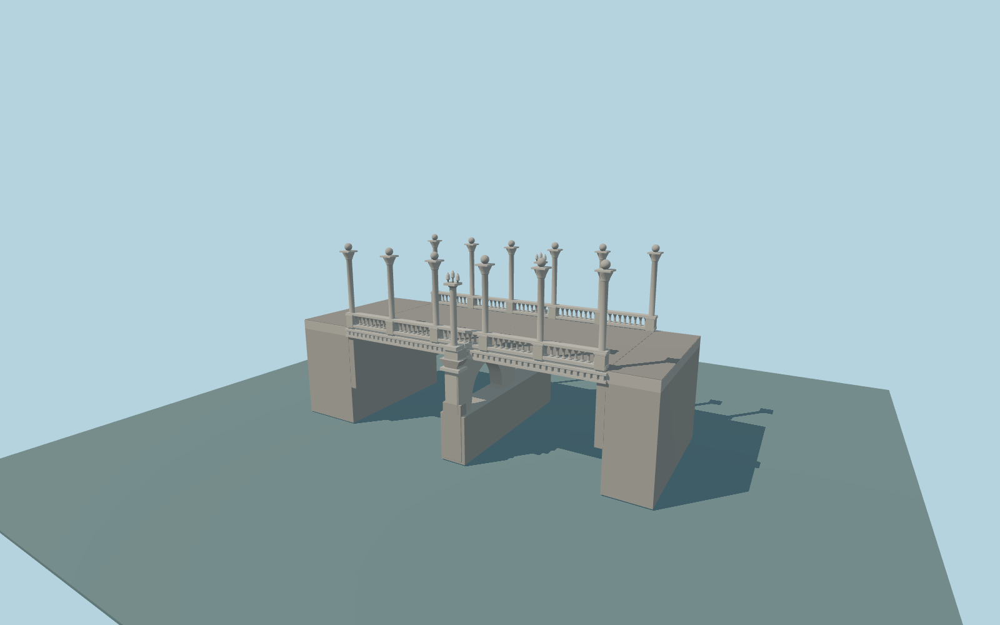

# Cobblers’ Bridge

Cobblers’ Bridge exterior: broad deck, five balustrade bays on either side, six pairs of tall orb columns, two shorter triple-lamp columns, geometric cornice, long central pier with two open bays and end bearings. Short quay landing aprons connect the full-width platform to the mapped bank paths.

Rebuild: `node packages/worldgen/scripts/generate-cobblers-bridge.mjs`;append `--check` for exact source bytes. Select import/LOD/placement with `--ids=cobblers_bridge`. Detailed source and four browser tiers are separate ignored GLB outputs.

Fixed 279 m model datum and approximate 284.6 m deck. The unmodified standard viewer samples 278.480 m water. Deck height, carved details, foundations and retaining interfaces are ordinary-photo approximations.

Deck elevation and sculptural dimensions are ordinary-photo approximations. The candidate’s 273 m length is inconsistent with the retained 23.591 m crossing and is deliberately not used.

Standard urban terrain is coarse and affected by surface returns. Production approach grading and native replacement behavior have not yet been verified.

Carved capitals and balusters are stylized; lamps are static, with no lighting simulation.

The production road replacement and native approach fit are reviewed separately; this source generation does not establish readiness.

Landing slabs and short retaining faces approximate the photographed quay interface and fit the native bank paths. The underlying coarse urban terrain is not a surveyed quay model.

Original geometry:repository license. Map:© OpenStreetMap contributors,ODbL-1.0;Protomaps. Standard terrain:terrain-grid.json. Ordinary pictures stay local and are not redistributed or used as textures. Current acceptance:qa.json.
