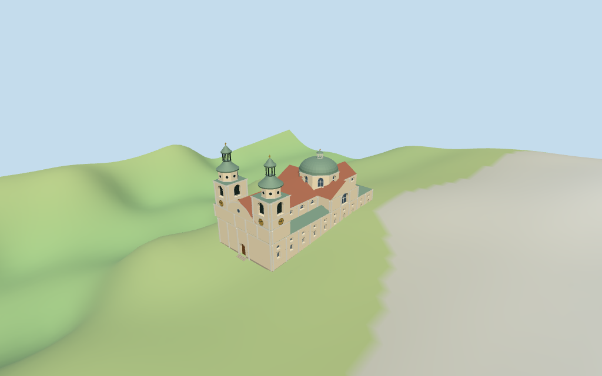

# ljubljana_cathedral — Ljubljana Cathedral review

Reviewed 2026-10-15 against current source/runtime bytes. Accepted for this medium-fi exterior and approximate geographic/terrain scope.

## Built result

Inspected all11 current portable/source-terrain frames. Individual Ljubljana cathedral with paired western square clock/belfry towers, large arched louver fields, octagonal round-window crowns, tiered green copper caps, open dark lanterns and gold finials. A broad faceted green dome sits on the eastern octagonal arched-window drum with a smaller open pale lantern. Red tiled nave/crossing/choir gables, lower green roofs, cream walls, pale pilasters/cornices, large side transept windows, sparse glazing bars, curved west pediment/round decorative window and closed wood entries form the exterior. First captures exposed duplicate overlapping wall sections that blocked panes and flickered. Replaced them with main lower walls, a joined upper-church outline and separate upper tower bands; imported window recess/backing checks now pass. Lower front detail is deliberately sparse where references are obscured. No exact sculpture/door reliefs, lettering/icons, full interiors or certified walking.

Medium-fi exterior from two inspected elevated/north pictures and standard viewer PMTiles/DEM only. The retained OSM note explicitly says heights estimated. Dome/cap curves, lantern bottoms, wall/roof divisions, window/pilaster rhythms, entry positions, front details and ornament are picture estimates. The west lower front is partly obscured and kept restrained. Round ocelli are flat decorative discs; glazing/louvers/wood entries are closed, lantern gaps open. Exact bronze reliefs, sculpture, clock numerals, sundial/text/icons, neighboring market/town buildings, full interiors and certified walking are excluded. Coarse street/door contact and physical laptop/phone timings remain unverified.

## Shared materials and placement

Inspected all11 current shared-material/geographic frames. Five existing256-square lime plaster, flat tile, copper, granite and plain wood graphs serve eight material groups. Cream walls, pale trim, muted red tile and pale-green copper use linear tints and metric UVs. Flat blue-gray glass, dark louvers and restrained gold accents need no bespoke images. No embedded images, baked shadows, soot or weathering. Every graph reads once; unload disposes model geometry, leaves zero live model geometries and restores the ground. Flat placement view checks signed plan alignment. The flat ground partly hides below-datum door geometry; source-terrain views show the estimated entries and steps. Ground colors are diagnostic.

Retained exact-QID way176486012/Q1236564 matches current main35184548574844. Eleven current unscaled main/part controls retain raw height tags and absent min_height values. Anchor[14.508252023,46.050763304], heading0.15942023578998998rad; west paired towers sign the current longest-edge frame, close to the retained0.161221809679rad axis. Main11m and retained roof:height5m guide nave eave/ridge11/16m. Raw dome drum17m, lantern23m, square towers19m and octagonal crowns25m are tagged estimates; subdivisions and ornament above those stages are picture estimates. Joined upper wall plans reproduce union of the main high masses, and lower aisle roofs reproduce subtraction from the retained envelope. All90 actual viewer footprint checks cover eleven controls while preserving three unrelated neighbors and a small west-front patch across six outputs. Standard DEM datum304.007768m, display offset0.4m and perimeter terrain-2.82..2.29m. Foundations follow terrain; west/north door thresholds use local DEM+0.22m and short estimated steps. Exact thresholds, interiors/absolute altitude, cut/fill and certified walking remain unverified. No road replacement or terrain flattening.

Inspected all27 current Earth-lighting frames: Economy/High, noon/late, three distances, silhouette, six detail crops, four matched whole-model LODs and four transitions. Skyline retains paired tiered towers, open lanterns, crossing dome and red/green roof silhouette at826 triangles. District adds shared textures, flat glazing/louvers/clock faces and upper ocelli. Street adds facade/drum recesses, sparse mullions/louver bars, pilasters and short steps. Closeup/master refine arch/dome/cap facets and clock marks. Matched whole-model views retain both tower tips and the complete church; selected close crops intentionally omit other portions. Height-band terrain colors and Swedish-cottage neighbors are synthetic diagnostics, not actual Ljubljana snow/geology or mapped town buildings.

## Browser budgets

| Level | Triangles | Bytes | Draws |
| --- | ---: | ---: | ---: |
| skyline | 826 | 84080 | 1 |
| district | 2468 | 242972 | 8 |
| street | 12282 | 1188112 | 8 |
| closeup | 16400 | 1563508 | 8 |

Initial skyline plus district: **327052 bytes** of geometry. Master: **2032100 bytes / 16896 triangles**. Five cached shared graphs; zero embedded images. Initial geometry excludes graph definitions/texture generation. Separate POSITION/NORMAL streams with equal CPU/GPU totals. Physical device timings pending.

## Verification

- Targeted byte reproduction: generate-additional-landmarks.mjs --ids=ljubljana_cathedral --check. Source/import/LOD/input/review hashes match.
- Six GLBs pass Khronos with zero errors/warnings/images; four browser budgets pass.
- Eleven raw map controls, signed approximate frame, wall union/aisle subtraction, raw tags and standard DEM match.
- **1,444 imported geometry probes** and **90 actual viewer footprint checks** pass.
- Source inventory/schema, recipe index, hash-bound placement/medium-fi reviews and shared graph read-once/unload pass.
- Scene validation and30-tick simulation pass: sha256:41117ea05b27e335add9dab87bd51889e3201823b2d9cc2e0f8ce82584442f7c.
- Inspected **49 current frames**:11 portable,11 shared/placement,27 medium-fi. Reports retain cameras/paths/hashes; bulk images remain local and ignored.

Source hash:sha256:a9d372d4c330ede15017cfdc7b991f3a61bcb9456ac0ed1c5b96f39aed81f235. Runtime hash:sha256:3fe01e790b8e0a4b9a5616624188ccf527ecb8a5a26f551bedcfef6cf6068e39. Input hash:sha256:de61fc9f9c4d204269f3bd1b3f731f6635cc4c7210c5b1733f52352d069e004f.

Commands: targeted generate/import/LOD/register-landmark-previews --ids=ljubljana_cathedral; capture-structure-models.mjs --ids=ljubljana_cathedral --reflections --antialias --fit-shadows; capture-landmark-library.mjs --ids=ljubljana_cathedral --reflections --adaptive-clipping --bounded-placement; capture-medium-fi.mjs --ids=ljubljana_cathedral --reflections; molen validate; molen sim run --ticks 30 --hash. Next full source checkpoint covers ljubljana_cathedral–saint_sophia_cathedral_in_polotsk.

## Limits

- Retained exact-QID OSMway176486012/Q1236564 matches current main35184548574844. Eleven unscaled main/part controls retain all raw tags. The main11m tag and retained roof:height5m guide nave eave/ridge11/16m. Tower square19m, octagonal crown25m, dome drum17m and small dome lantern23m are raw total-height tags without min_height. Wall/eave subdivisions, low aisle roofs, dome curves, lantern bottoms and ornament above tagged stages are explicit picture estimates. The retained OSM note says heights estimated; no surveyed heights claimed.
- Standard DEM datum304.007768m; display datum offset0.4m and perimeter terrain-2.82..2.29m. Wall foundations follow terrain. West/north entry bottoms use local standard DEM plus0.22m, with short approximate steps; they are exterior visualization thresholds, not surveyed interior floors. No flattening, absolute-altitude certification, bespoke survey or certified walking.
- Medium-fi exterior from two inspected elevated/north pictures and standard viewer PMTiles/DEM. Lower front is partly obscured. Exact profiles, ornaments, doorway positions, bronze reliefs, clock numerals, sundial/text/icons, market/urban neighbors, interiors and certified walking excluded or approximate. Physical laptop/phone timings pending.
- Skyline keeps the paired tiered towers, three open lanterns, crossing dome, red gables and low green ranges. District adds shared textures, flat glazing/louvers/clocks and upper ocelli. Street adds facade/drum recesses, sparse mullions/louver bars, pilasters and steps. Closeup/master refine curve/arch facets and clock marks. Ocelli remain flat decorative discs, not interior openings. Synthetic context neighbors are not mapped Ljubljana buildings.

Readiness accepts this exterior scope. The 1,000-candidate goal remains incomplete.
