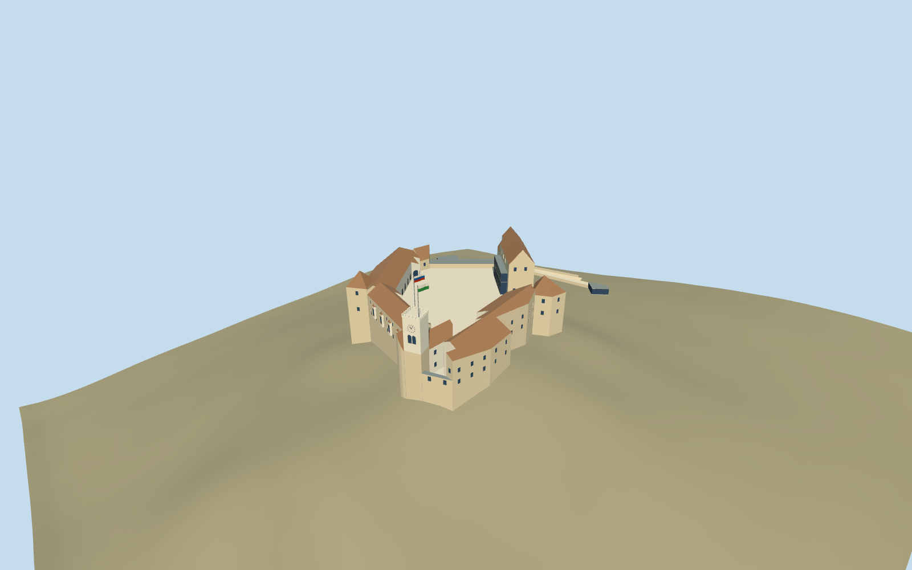

# Ljubljana Castle

Complete current castle exterior: fifteen actual mapped building parts, irregular open courtyard, white clock/viewing tower, round and pentagonal towers, brown pitched roofs, projecting bays, chapel, modern glazed halls and mapped eastern entrance/bridge.

## Evidence and reconstruction

Published dimensions and reconstructed details are separated in spec.json. Primary references:

- [Reference](https://api.openstreetmap.org/api/0.6/map?bbox=14.5068,46.0477,14.5106,46.0500)
- [Reference](https://www.ljubljanskigrad.si/en/)
- [Reference](https://www.ljubljanskigrad.si/en/map/)
- [Reference](https://www.ljubljanskigrad.si/en/experiences/viewing-tower-and-pipers-tower/)
- [Reference](https://www.ljubljanskigrad.si/en/why-to-the-castle/castle-spaces/)
- [Reference](https://www.ljubljanskigrad.si/assets/00-Vstopna-stran/Ljubljanski-grad.jpg)
- [Reference](https://www.ljubljanskigrad.si/mysite/images/map/Map-big.png)
- [Reference](https://www.ljubljanskigrad.si/assets/Uploads/Gallery/_resampled/FillWyIxNDAwIiwiNzgwIl0/STOLP-galerija-1.jpg)

Six existing shared 256-square stone/lime-plaster/roof-tile/painted-metal/timber/gravel graphs with metric repeats and linear palette tints. Flat blue-grey glass and colored flags. No new/embedded texture or downloaded mesh.

## Model and axes

5,691 triangles; 17,073 vertices; 8 material groups; 687,480 bytes. Native bounds: -47.173, -13.470, -57.420 to 70.510, 45.000, 44.181. Source hash: `sha256:7c682e98659078dbd19ccdbbf63445db4885efb41be546a90bf12ab931092474`.

{"up":"+Y","longitudinal":"Native+X east,+Z south; mapped components and passage, heading0.","origin":"Site anchor; Y0 standard PMTiles working datum."}

The inspected exterior picture supports the irregular roofed castle ring, open court, white clock/viewing tower, brown pitched roofs, rounded towers and modern glazed court additions. Retained mapped components and east passage set approximate scale and heading0. Standard viewer PMTiles supply the surrounding hill. Architecture rises2m so its reconstructed courtyard remains above the coarse crest; bounded foundation toes meet the sampled ground. Anchor 14.508474674,46.048810087; heading 0; standard PMTiles datum 356.4304543632578m. Floors are reconstructed and foundations extend below the coarse sampled ground.

## Reproduce

Run `node packages/worldgen/scripts/generate-signature-towers.mjs --ids=N0307` (or add `--check`). The generator preserves manually edited masters by checking their baseline hashes. Import through the standard authored-model workflow with optimization disabled; then capture all QA cameras, including shared-surface views.

## Pending work

- Approximate exterior and hill fit from an inspected picture and standard viewer PMTiles; no bespoke survey or exact height claims.
- Original detailed master/hash/recipe retained. Fifteen castle parts, tower terrace, flags, real entrance passage and arcade are retained; ornament and restored fixtures are interpreted.
- Six common limestone/lime-plaster/tile/painted-metal/wood/aggregate graphs plus explicit glass and flag colors; no embedded images or broad duplicate hill.
- Interiors, collision and physical-device timing excluded; footprint replacement remains off.

This bundle follows the medium-fi standard. Medium-fi appearance and geographic fit are reviewed separately. Hash-bound visual acceptance is recorded separately after capture inspection.

## Additional geographic data

© OpenStreetMap contributors; Ljubljanski grad / Ljubljana Castle and its credited photographers.
