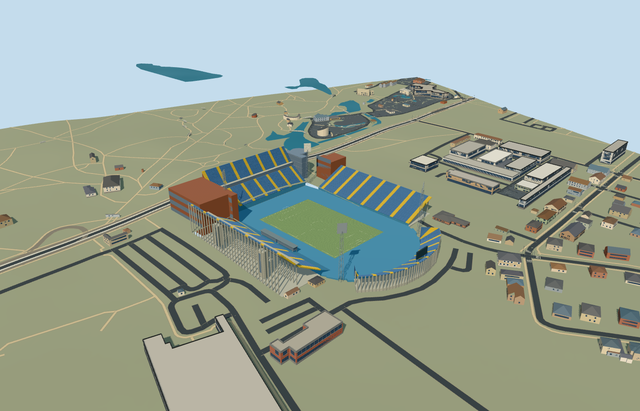

# stadion_maksimir — Stadion Maksimir

Reviewed2026-10-20 in one author/build/inspect/fix pass.

## Appearance

Inspected48 final current source, shared-material, medium-fi and native views. Specific four separate native blue stands: tall two-bank west/north, lower single-bank east and curved south; yellow access aisles/closed club belts/blue retained athletics apron/sloped western toe/open neutral football pitch/goals. Northern rust-colored service wings/street glazing/rounded glass stair tower, two western access towers, low press galleries/canopies, four lattice floodlights and supported southern neutral display retain the asymmetric skyline. Fitted the northern rear-office roof beneath the seating, closed office foundations to their occupied floors and moved structural rakers below each bank during one continuous author/build/inspect/fix pass. No copied seat lettering/crest/sponsor graphics, crowd or hidden furnished rooms.

## Shared surfaces and browser budgets

Five existing256px graphs: concrete_plain, metal_painted, metal_standing_seam, window_grid and fabric_canvas. Concrete/rust facades, blue seating/yellow aisles/frame, small press roofs, glazing, apron and field reuse the library. Five near draws/one skyline draw; no new graph, embedded image or private atlas. Each graph read once; separate POSITION/NORMAL streams and equal CPU/GPU accounting. Shared opaque glazing and non-emissive lamp faces approximate real optics.

| Level | Triangles | Bytes | Draws |
| --- | ---: | ---: | ---: |
| skyline | 796 | 65884 | 1 |
| district | 3430 | 313052 | 5 |
| street | 12664 | 1139196 | 5 |
| closeup | 60728 | 5624436 | 5 |

Four authored browser levels retain four independent stands/open corners, northern mass/glazed corner, blue apron and corner light silhouettes. Fine rows/yellow aisles, lattice braces/lamp faces, glazing bands, press boxes and field marks appear near. Levels 796/3430/12664/60728triangles; initial skyline plus district378936bytes, below3MB phone/6MB laptop initial asset targets. Physical ordinary-laptop/phone/tablet and dense-city timings remain pending.

## Approximate native placement

Retained Q723603/named native Stadion Maksimir POI35184401663086 and eight individual mapped stand/service/apron records establish identity; no exact-QID native tag. Pitch35184401663480 crosses two tiles; its union supplies104.725872x66.996782m field axis. Own north/west/east polygons and southern curved stand, attached northern office/tower/corner-wing and blue apron controls define the specific plan, with open corners and independent training facilities retained. Anchor[16.017979237548957,45.81869090395216]/heading0/native east-south/internal X[0.30246397593688085,0.9531608171029976]/Z[-0.9531608171029976,0.30246397593688085]. Positive internal X is predominantly south and positiveZ west. Fine20degree/2m facing remains approximate. Production helper replaces only eight integrated individual stand, northern office/tower/wing and blue-apron records. All359 independent resident records of367 originals/all807 wider independent records of815 remain unchanged, including training facilities, utilities, streets and park/lakes. Original6m samples, native roads and38934.03418971482square metres water unchanged. Fourteen actual PMTiles13/14/15 cases pass, including all owned detailed fragments. Detailed ownership uses99.5percent coverage; generalized complexes bounded area clipping. Failure retains367 originals; every level unload restores original terrain/water/zero live model geometry. Original standard6m Mapzen grid, roads, park lakes and every independent native building remain unchanged. Field datum119.33497473008786m; owned boundary samples span-2.419374569209978..11.237246285949723m. Partitioned blue apron/neutral field/stand floors avoid overlapping caps; bounded ground opening follows occupied floors. Each stand support, tower, press post and display support reaches original sampled grade. Only eight integrated records are replaced with99.5percent detailed ownership coverage; generalized complexes use bounded area clipping. No whole precinct/training-ground slab or terrain flattening. Failure/unload retains/restores original context.

## Limits

Five ordinary club photographs actually viewed on the GNK Dinamo stadium page: whole nighttime stadium and separate west/east/north/south stand photographs. These establish the post2011 blue-apron configuration, separate bank profiles/yellow aisles, northern orange wings/glazed tower, low press cover and four lattice lights. Undated images do not certify current condition. The club states the east stand is closed since2020 earthquake; its mapped geometry is retained without spectator-access or operation claim. Proposed replacement, copied artwork and furnished hidden rooms excluded. Photographs viewed only/no copied pixels. No qualified native architectural height for the eight stadium records. Working fieldY0 uses original datum119.33497473008786m. Picture-led north/west lower banks6..20m and upper24..40m/club belt20..24m, east3..20m/south3..14m, northern wings28..34m/sloping rear-office roof26..38m/rounded glazed tower33m/western access towers27m, western press boxes4.2..7.8m/canopies8.05m, lattice masts48m/lamp heads45..55m and southern display17..24m. Fine row/brace/lamp/office-floor inventory and optical materials are approximate. Undated official club photographs establish the post2011 blue-apron configuration; they do not certify current physical condition, engineering, access or furnished hidden rooms. The club explicitly says the east stand is closed since2020; proposed new stadium excluded.

## Selected checks

Six Khronos files: zero errors/warnings.1484 actual geometry/material/contact checks,48 current inspected views,14 actual native map-level cases. Selected source/import/placement/strict medium-fi/scene validation/lint pass. Sim30 hashe6e3eedf9d7b3bc9c8e0e155c19eb7d21d97d870f87723db7a57c86e52223abd.

Source sha256:b06ee9e7c0f23985127789e8089bb14faf648f6a43138c0b6635cbaecd8dfb93

Runtime sha256:c9398a2ff2918bfc9385214fb7daa2c532ed0a23c0474ae4b750e4a5ce453a83

Input sha256:76ef90c83df1454dcc744b12014bacc5ee77883aa2dde5b96a2cd2bc384dc04f

Rebuild: node packages/worldgen/scripts/generate-additional-landmarks.mjs --ids=stadion_maksimir; node packages/worldgen/scripts/import-structure-models.mjs --ids=stadion_maksimir; node packages/tooling/scripts/generate-landmark-lods.mjs --ids=stadion_maksimir --force.

## Ordinary picture references

https://www.gnkdinamo.hr/en/club/stadium — https://www.gnkdinamo.hr/images/stadion/stadion.jpg; GNK Dinamo Zagreb; individual photographer not listed; Copyright retained; viewed only/no copied pixels. Viewed only/no copied pixels.

https://www.gnkdinamo.hr/en/club/stadium — https://www.gnkdinamo.hr/images/stadion/stadion-zapad.png; GNK Dinamo Zagreb; individual photographer not listed; Copyright retained; viewed only/no copied pixels. Viewed only/no copied pixels.

https://www.gnkdinamo.hr/en/club/stadium — https://www.gnkdinamo.hr/images/stadion/stadion-istok.png; GNK Dinamo Zagreb; individual photographer not listed; Copyright retained; viewed only/no copied pixels. Viewed only/no copied pixels.

https://www.gnkdinamo.hr/en/club/stadium — https://www.gnkdinamo.hr/images/stadion/stadion-sjever.png; GNK Dinamo Zagreb; individual photographer not listed; Copyright retained; viewed only/no copied pixels. Viewed only/no copied pixels.

https://www.gnkdinamo.hr/en/club/stadium — https://www.gnkdinamo.hr/images/stadion/stadion-jug.png; GNK Dinamo Zagreb; individual photographer not listed; Copyright retained; viewed only/no copied pixels. Viewed only/no copied pixels.
