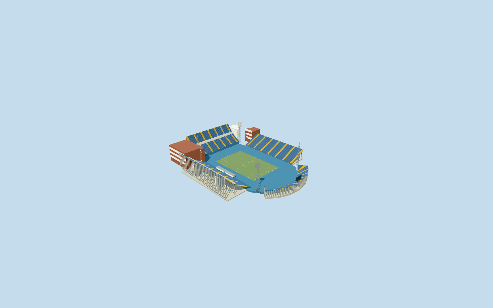

# Stadion Maksimir

Specific existing Stadion Maksimir with four separate native blue stands: tall two-bank west/north, single east and curved low south, yellow access aisles, blue retained athletics apron/sloped west toe, open neutral football pitch/goals. Northern rust-colored service wings/street glazing/native rounded glass stair tower/two western access towers, low western press boxes/canopies, four original-contact lattice floodlight towers and supported neutral southern display retain the asymmetric open skyline. No continuous bowl or speculative stadium roof. No copied seat lettering, crests, sponsor art, crowds or private textures. Separate training facilities/utilities/streets/park and lakes remain native. Proposed replacement is excluded; club states east stand closed since2020 earthquake, so no spectator-access or operation claim.

## Evidence and reconstruction

Published dimensions and reconstructed details are separated in spec.json. Primary references:

- [Reference](https://www.gnkdinamo.hr/en/club/stadium)

Specific existing Stadion Maksimir with four separate native blue stands: tall two-bank west/north, single east and curved low south, yellow access aisles, blue retained athletics apron/sloped west toe, open neutral football pitch/goals. Northern rust-colored service wings/street glazing/native rounded glass stair tower/two western access towers, low western press boxes/canopies, four original-contact lattice floodlight towers and supported neutral southern display retain the asymmetric open skyline. No continuous bowl or speculative stadium roof. No copied seat lettering, crests, sponsor art, crowds or private textures. Separate training facilities/utilities/streets/park and lakes remain native. Proposed replacement is excluded; club states east stand closed since2020 earthquake, so no spectator-access or operation claim.

## Model and axes

60,728 triangles; 182,184 vertices; 5 material groups; 7,290,788 bytes. Native bounds: -128.523, -3.119, -138.252 to 115.594, 55.013, 123.182. Source hash: `sha256:b06ee9e7c0f23985127789e8089bb14faf648f6a43138c0b6635cbaecd8dfb93`.

{"x":"east","y":"up","z":"south"}

The geographic proposal uses exact-QID OpenStreetMap evidence. Map-derived orientation and estimated architectural details require real-site visual review; preview eligibility is distinct from geographic/fidelity approval. Map attribution: © OpenStreetMap contributors, ODbL-1.0.

## Reproduce

Run `node packages/worldgen/scripts/generate-additional-landmarks.mjs --ids=stadion_maksimir` (or add `--check`). The generator preserves manually edited masters by checking their baseline hashes. Import through the standard authored-model workflow with optimization disabled; then capture all QA cameras, including shared-surface views.

## Pending work

- Specific existing Stadion Maksimir with four separate native blue stands: tall two-bank west/north, single east and curved low south, yellow access aisles, blue retained athletics apron/sloped west toe, open neutral football pitch/goals. Northern rust-colored service wings/street glazing/native rounded glass stair tower/two western access towers, low western press boxes/canopies, four original-contact lattice floodlight towers and supported neutral southern display retain the asymmetric open skyline. No continuous bowl or speculative stadium roof. No copied seat lettering, crests, sponsor art, crowds or private textures. Separate training facilities/utilities/streets/park and lakes remain native. Proposed replacement is excluded; club states east stand closed since2020 earthquake, so no spectator-access or operation claim.
- Retained Q723603/named native Stadion Maksimir POI35184401663086 and eight individual mapped stand/service/apron records establish identity; no exact-QID native tag. Pitch35184401663480 crosses two tiles; its union supplies104.725872x66.996782m field axis. Own north/west/east polygons and southern curved stand, attached northern office/tower/corner-wing and blue apron controls define the specific plan, with open corners and independent training facilities retained. Anchor[16.017979237548957,45.81869090395216]/heading0/native east-south/internal X[0.30246397593688085,0.9531608171029976]/Z[-0.9531608171029976,0.30246397593688085]. Positive internal X is predominantly south and positiveZ west. Fine20degree/2m facing remains approximate.
- No qualified native architectural height for the eight stadium records. Working fieldY0 uses original datum119.33497473008786m. Picture-led north/west lower banks6..20m and upper24..40m/club belt20..24m, east3..20m/south3..14m, northern wings28..34m/sloping rear-office roof26..38m/rounded glazed tower33m/western access towers27m, western press boxes4.2..7.8m/canopies8.05m, lattice masts48m/lamp heads45..55m and southern display17..24m. Fine row/brace/lamp/office-floor inventory and optical materials are approximate. Undated official club photographs establish the post2011 blue-apron configuration; they do not certify current physical condition, engineering, access or furnished hidden rooms. The club explicitly says the east stand is closed since2020; proposed new stadium excluded.
- Original standard6m Mapzen grid, roads, park lakes and every independent native building remain unchanged. Field datum119.33497473008786m; owned boundary samples span-2.419374569209978..11.237246285949723m. Partitioned blue apron/neutral field/stand floors avoid overlapping caps; bounded ground opening follows occupied floors. Each stand support, tower, press post and display support reaches original sampled grade. Only eight integrated records are replaced with99.5percent detailed ownership coverage; generalized complexes use bounded area clipping. No whole precinct/training-ground slab or terrain flattening. Failure/unload retains/restores original context.

This bundle follows the medium-fi standard. Medium-fi appearance and geographic fit are reviewed separately. Hash-bound visual acceptance is recorded separately after capture inspection.
