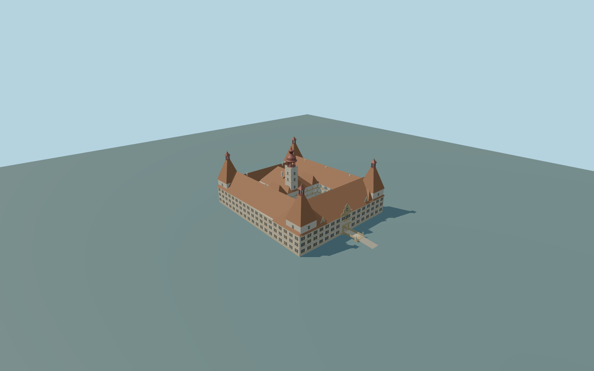

# Eggenberg Castle, Graz

Complete principal palace exterior:actual irregular perimeter and central roofed range,main front/two rear open courts,three-level arcaded galleries,four square corner towers/steep red tile roofs/open red lanterns,central ochre-white clock tower/red cupola,front gable/dormers/balcony/open gateway,shuttered windows/chimneys,back passage and both actual mapped bridges with original moat-wall/statue cues. Park,detached neighbors,furniture crowds and detailed optical interiors excluded.

Rebuild: `node packages/worldgen/scripts/generate-eggenberg-castle-graz.mjs`;append `--check` for exact source bytes. Select import/LOD/placement with `--ids=eggenberg_castle_graz`. Detailed source and four browser tiers are separate ignored GLB outputs.

Complete principal palace exterior:actual irregular perimeter and central roofed range,main front/two rear open courts,three-level arcaded galleries,four square corner towers/steep red tile roofs/open red lanterns,central ochre-white clock tower/red cupola,front gable/dormers/balcony/open gateway,shuttered windows/chimneys,back passage and both actual mapped bridges with original moat-wall/statue cues. Park,detached neighbors,furniture crowds and detailed optical interiors excluded.

Full actual outer parent and T-shaped native void plus independent central roofed range3. The range occupies the rear stem of the void,leaving the main front court and two smaller rear courts. Native28/29 are clipped parent fragments,not duplicate palaces. Internal roof/court associations are original map/picture interpretation,not a surveyed floor plan.

Native11m parent is a generalized eave/base envelope. Original picture-proportional sections use11.2m eave,22.2m main roof ridge,16m corner wall/35.3m lantern finial and39.5m central clock finial. These are approximate original envelopes,not surveyed as-built heights. Ground floor1.1m above371m datum clears the coarse field;front/rear bridge aprons adapt to host terrain rather than claiming surveyed historic grades.

Original exterior interpretation from four ordinary pictures and standard map/global terrain. Fine roof intersections,bay/window/chimney/dial/crest/statue inventories and site grades approximate. One unchanged129x129/2m field covers256m,371m datum;western hill rises outside palace. Structural footings/courtyard terraces and original bridge aprons adapt to field without flattening. Exact accessibility/threshold/moat levels unmeasured. No copied sculpted reliefs,inscriptions,private photographs/textures,night lighting or full optical interiors. Physical device timings unmeasured.

Seven existing256px plaster,limestone,ceramic tile,copper,window-grid,painted wood andpainted metal graphs;metric UVs/linear vertex colors. No private/new/embedded images or copied art. Three open courts and roof junctions are original map/picture interpretation. Actual gallery openings and soffits are geometric;simple structural ceilings omit exact groin vaults and detailed optical interiors. Static clock hands are decorative,not live time. Fine statue/crest/window/chimney inventories approximate. Far preserves court voids,towers,bridges and open lanterns with solid simplified gallery edges;district aggregates bays and omits shutters;street simplifies profiles;close-up retains denser frames,arches and ornament;source adds seams/shutter slats. Error estimates4/2/1/.35m are not measured mesh distances. Physical phone/laptop/dense-city timings remain unmeasured.

Original geometry:repository license. Map:© OpenStreetMap contributors,ODbL-1.0;Protomaps. Standard terrain:terrain-grid.json. Ordinary pictures stay local and are not redistributed or used as textures. Current acceptance:qa.json.
