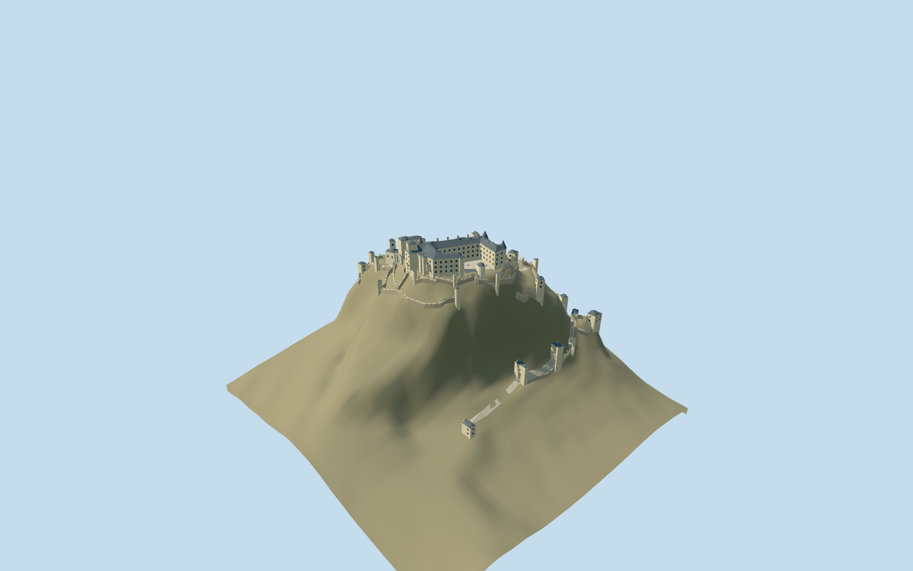

# Hochosterwitz Castle

Complete architectural fortification draft: summit U-shaped castle and open court, slate roofs/round turrets and square entry tower, church/chapel,14 individually mapped gates with open passages,watchtowers and stepped defensive walls on provisional terrain levels.

## Evidence and reconstruction

Published dimensions and reconstructed details are separated in spec.json. Primary references:

- [Reference](https://api.openstreetmap.org/api/0.6/map?bbox=14.448,46.7538,14.456,46.7585)
- [Reference](https://www.burg-hochosterwitz.com/en/castle/)
- [Reference](https://www.burg-hochosterwitz.com/en/castle/hochburg/)
- [Reference](https://www.burg-hochosterwitz.com/en/castle/14-gates/)
- [Reference](https://www.burg-hochosterwitz.com/burganlagen/die-14-tore-der-burg-hochosterwitz/)
- [Reference](https://www.burg-hochosterwitz.com/en/castle/church/)
- [Reference](https://www.burg-hochosterwitz.com/wp-content/uploads/2018/06/Burg-Hochosterwitz-West-hd.jpg)
- [Reference](https://www.burg-hochosterwitz.com/wp-content/uploads/2018/06/Hochosterwitz-adv-11-cont-©-Alex-Devora.jpg)
- [Reference](https://www.burg-hochosterwitz.com/wp-content/uploads/2018/06/Burganlage-aus-der-Luft-BA.jpg)
- [Reference](https://www.burg-hochosterwitz.com/wp-content/uploads/2018/06/Aufgang-zur-Burg-aus-der-Luft-BA.jpg)
- [Reference](https://www.burg-hochosterwitz.com/wp-content/uploads/2018/06/Aufgang-zur-Burg-aus-der-LuftBA.jpg)
- [Reference](https://www.burg-hochosterwitz.com/wp-content/uploads/2018/06/Burgkirche-mit-Aufgang-und-Rosengarten-BA.jpg)
- [Reference](https://www.burg-hochosterwitz.com/wp-content/uploads/2018/06/Aufnahme-Burganlagen02-BA.jpg)
- [Reference](https://www.burg-hochosterwitz.com/wp-content/uploads/2018/06/Eingang-zum-Burghof-BA.jpg)
- [Reference](https://www.burg-hochosterwitz.com/wp-content/uploads/2018/06/Burgkirche-Hochosterwitz-1.jpg)

Five shared256-square graphs and linear tints,flat glass,metric repeats. No embedded/new photo texture or downloaded mesh. Numerical hill heightmap is an isolated preview fixture; runtime architecture has no embedded terrain.

## Model and axes

16,286 triangles; 48,858 vertices; 6 material groups; 1,958,060 bytes. Native bounds: -124.961, -100.530, -135.147 to 78.341, 25.554, 59.589. Source hash: `sha256:a077e82001ec7afeba6b09d3ac363da713b0ffab1b150831f71fa585a13200f0`.

{"up":"+Y","front":"West-facing main front; all map bearings baked into native +X east/+Z south","longitudinal":"Summit long wing runs approximately NNE/SSW; authoring plan axis is not facade approval","origin":"Site anchor; Y0 standard PMTiles working datum."}

The inspected aerial picture supports pale summit wings, dark slate roofs, round turrets, entry tower and descending walls/gates. Retained east/south map geometry sets approximate location, scale and orientation. Standard viewer PMTiles supply the hill; the derivative translates the old611.9699m first-gate study datum to the703.9600882109237m anchor datum, uses one retained PMTiles sampler for walls/routes at every level and raises reconstructed gate/summit floors only enough to clear coarse ground. No terrain mesh is embedded in the architecture. Anchor 14.452350896,46.755908856; heading 0; standard PMTiles datum 703.9600882109237m. Floors are reconstructed and foundations extend below the coarse sampled ground.

## Reproduce

Run `node packages/worldgen/scripts/generate-signature-towers.mjs --ids=N0301` (or add `--check`). The generator preserves manually edited masters by checking their baseline hashes. Import through the standard authored-model workflow with optimization disabled; then capture all QA cameras, including shared-surface views.

## Pending work

- Approximate exterior and hillside fit from inspected picture and standard viewer PMTiles; no bespoke survey or exact thresholds.
- Detailed original master/hash/recipe preserved. Fourteen mapped gate masses/openings, church, summit and walls are interpreted; individual ornamental/archaeological detail, interiors and collision excluded.
- Five common graphs plus explicit glass color slot, zero embedded images. Host terrain supplies the hill; vegetation, water simulation and terrain cutouts excluded.
- Footprint replacement remains off; physical-device timing unmeasured.

This bundle follows the medium-fi standard. Medium-fi appearance and geographic fit are reviewed separately. Hash-bound visual acceptance is recorded separately after capture inspection.

## Additional geographic data

© OpenStreetMap contributors; Burg Hochosterwitz/Alex Devora/August Zoebl; Mapzen/AWS open elevation provider.
