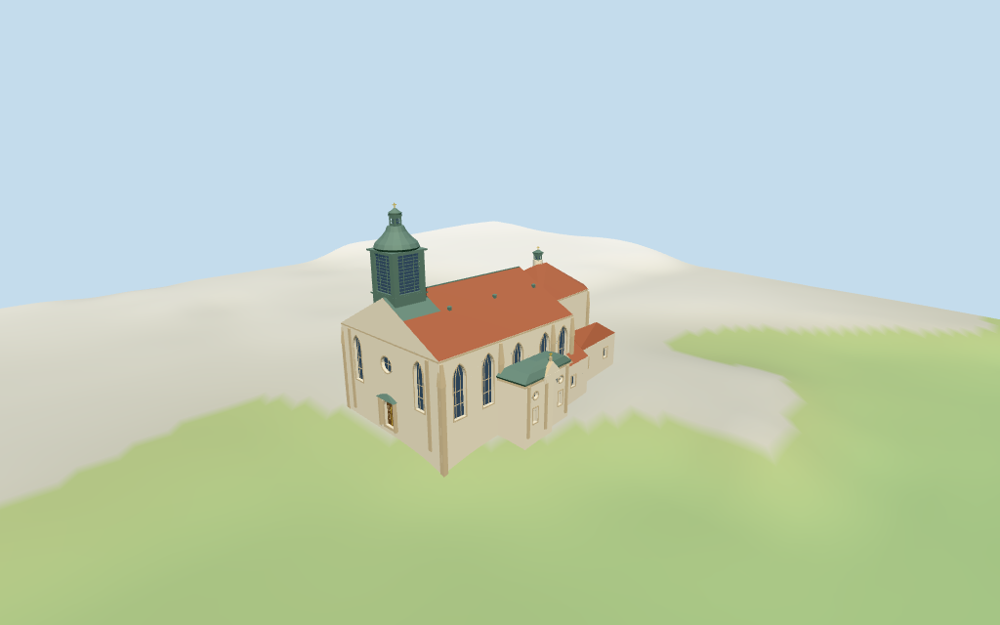

# N0393 — Graz Cathedral review

Reviewed 2026-10-16 against current source/runtime bytes. Accepted for medium-fi exterior and approximate horizontal placement. Height-stage interpretation and exact host-ground contact remain unverified.

## Built result

Inspected 11 current portable/source-terrain frames. Pale Gothic hall, polygonal eastern choir and broad red tile roofs, large western green copper roof lantern with faceted onion/upper stage/finial, small eastern turret, west round window/deep timber portal, tall recessed pointed bays/stone buttresses, projecting southern Baroque chapel and lower attached ranges. Corrected overly shallow main lantern crown, chapel pediment direction, overlapping west-window buttresses, chapel panel positions and the lantern skirt where it joins the pitched roof. Faceted Gothic openings have selected mullions/transoms; chapel has simple pilasters/round lights/blind panels. Fine sculpture, fresco art/lettering, glass patterns, hidden bays and interiors excluded or simplified.

Medium-fi exterior from actually inspected Pedro J Pacheco 2014 western/southern street oblique and Marion Schneider/Christoph Aistleiter 2009 elevated roofscape, plus standard viewer PMTiles/DEM only. No bespoke surveys/plans or redistributed reference images. Roof lantern/onion profile, broad red roof, pale Gothic hall and projecting Baroque chapel carry individual identity. Separate neighboring mausoleum dome/tower excluded. Faceted roof profiles, window rhythm/tracery, door/chapel details and all sculpture are approximate; no fresco artwork or complete interior. Current finish, upper-height interpretation, hidden elevations and precise host-ground joins unverified.

## Shared surfaces,placement and levels

Inspected 11 current shared/geographic frames. Five existing cached 256-square lime-plaster, continuous limestone, ceramic tile, standing-seam metal and plain wood graphs serve seven merged groups; skyline uses one draw. Pale render, warm stone, red tile and muted green copper tints are linear, with metric UVs and flat architectural normals. Glazing/gold accents use local geometric PBR colors. No embedded images, bespoke facade maps, reference-photo textures or baked lighting. Actual graph reads are one each; unload leaves zero live model geometries. Tile courses, copper seams, deep window/portal recesses and lantern louvres remain visible. Native and signed geographic plan agree with retained controls.

Retained way/84579393, Q262563 and multilingual Grazer Dom identity match current whole 35184456668225. Whole 63 vertices plus west roof-part 35184960799859 four vertices retain 67 current raw points, properties, height 18/34 m; earlier 72 distinct points and roof: height 8 m, roof_tiles/gabled tags remain source controls. Anchor[15.442365227, 47.071980059], heading 0.053289634225rad unchanged; native+X east choir, -X west portal/main lantern, +Z southern chapel. No horizontal rescale. Eave 18/ridge 26 interpret roof tags; 34 m part controls main lantern stage top with estimated 42.4 m onion/upper-stage/finial from pictures, not a mapped total-height claim. Part datum/scope and lower masses/roof partitions remain estimates. Forty-eight actual viewer-footprint checks cover both controls and retain adjacent mausoleum/castle/university, west street and south square. Standard DEM datum 362.580399 m, raw perimeter-3.04..1.07 m, estimated floor 0.4 m. Footings crossY=0 and extend below samples; no flattening, host DEM change or road replacement. Exact pavement/door joins, base clipping, absolute altitude and walking remain unverified.

Inspected 27 current Earth-lighting frames: Economy/High, noon/late, three distances, texture-free silhouette, six details, four matched whole LODs and four transitions. Skyline 744 triangles retains red nave/choir roofs, pale body, solid dark main lantern beneath green onion crown, smaller turret and lower chapel/ranges. District 2171 adds shared surfaces, selected recessed lights/portal and buttress silhouette. Street 5596 adds fuller Gothic/attached-range bays, trim/portal canopy and chapel pilasters. Closeup/master 9172 add sparse tracery/transoms, door panels, lantern louvres and roof vents. Skyline glazing remains a solid dark mass to reduce transition popping. Near/detail views may crop the upper finial; four matched whole LODs contain the 42.8 m local maximum. Regional Austrian-inn neighbors/coarse standard terrain are fixtures. Physical laptop/phone timing pending.

## Browser budgets

| Level | Triangles | Bytes | Draws |
| --- | ---: | ---: | ---: |
| skyline | 744 | 69532 | 1 |
| district | 2171 | 183716 | 7 |
| street | 5596 | 471624 | 7 |
| closeup | 9172 | 777396 | 7 |

Initial skyline plus district: **253248 bytes** of geometry. Master: **1104760 bytes / 9172 triangles**. Five shared256-square graphs;zero embedded images. Bytes exclude graph definitions/texture generation. Split POSITION/NORMAL streams,equal CPU/GPU totals. Physical-device timing pending.

## Verification

Targeted reproduction,current source/runtime/LOD/input/report pins and source/recipe inventory/schema pass. Six Khronos validations have zero errors/warnings/images. **173 actual geometry probes /48 viewer-footprint checks /49 inspected current frames** pass. Shared graph read-once/unload pass. Scene validation and30-tick simulation pass:sha256:66e9340b2dc111088ef51575f4d1539c7b743044541f6f65ec477ab68bd4d821.

Source hash:sha256:7711825d48b3b7c010735e30892e4e1f9a9614cf09151ac78998ecd83c16dce4. Runtime hash:sha256:5b3474333d03a5af7f038d1b50d7c6d0b41dda59164db8d9202efefb4311af0c. Input hash:sha256:19cad35782a0b7ef6d77746d86cefa9ae49f98f1eb2bf847bc20f631a40b4219.

Commands:targeted generate/import/LOD/register-landmark-previews --ids=N0393;generate-additional-landmarks.mjs --ids=N0393 --check;capture-next-1000-models.mjs --ids=N0393 --reflections --antialias --fit-shadows;capture-landmark-library.mjs --ids=N0393 --reflections --adaptive-clipping --bounded-placement;capture-medium-fi.mjs --ids=n0393_graz_cathedral --reflections;molen validate;molen sim run --ticks30 --hash. Bulk views remain ignored. Next routine source checkpoint:N0392–N0409.

## Limits

- Retained exact way/84579393,Q262563 and raw height18m,roof:height8m,roof:shape gabled,roof:material roof_tiles tags. Current whole height18m and west roof-part height34m retained. Nave eave18/ridge26 and west roof-lantern main stage top34m interpret those scopes above an estimated0.4m floor;the roof-part tag does not independently describe an upper roof/finial or datum. Its estimated onion roof/upper lantern/finial reaches42.4m from the pictures;this is not a mapped total-height claim. Choir ridge24.5m,small turret28.6m,chapel10.8..13.7m and lower ranges8..12m are picture-based estimates. No independent height/width/length facts or horizontal rescale. Hidden bays,stage partitions and current finish remain approximate.
- Standard viewer DEM datum362.580399m;raw perimeter-3.04..1.07m,estimated floor0.4m. Footings crossY=0 and extend below samples;no flattening,host DEM changes or road replacement. Exact pavement/door joins,base clipping,absolute altitude and walking remain unverified. Adjacent mausoleum/castle/university,streets,trees and site furniture remain host content.
- Medium-fi exterior from two actually inspected2009/2014 pictures and standard viewer PMTiles/DEM only.No bespoke surveys.The neighboring mausoleum dome/tower are excluded.Fine sculpture,exact fresco art,inscriptions,glass patterns,louvres/hidden bays,full interiors and engineering sections simplified or omitted.Current finish and exact ground joins unverified.Physical phone/laptop timing pending.
- Skyline retains main red roof/pale hall,polygonal choir,staged green western lantern,small turret and lower chapel/ranges.District adds selected deep glazing/portals and buttress silhouette.Street adds fuller windows,stone trim/portal canopy and chapel pilasters.Closeup/master add sparse tracery/transoms,door panels,lantern louvres and roof vents.Simplified partitions are estimates;all raw map controls retained.Regional context neighbors are fixtures.

This accepts only the recorded exterior/approximate horizontal scope;the1,000-candidate goal remains incomplete.
