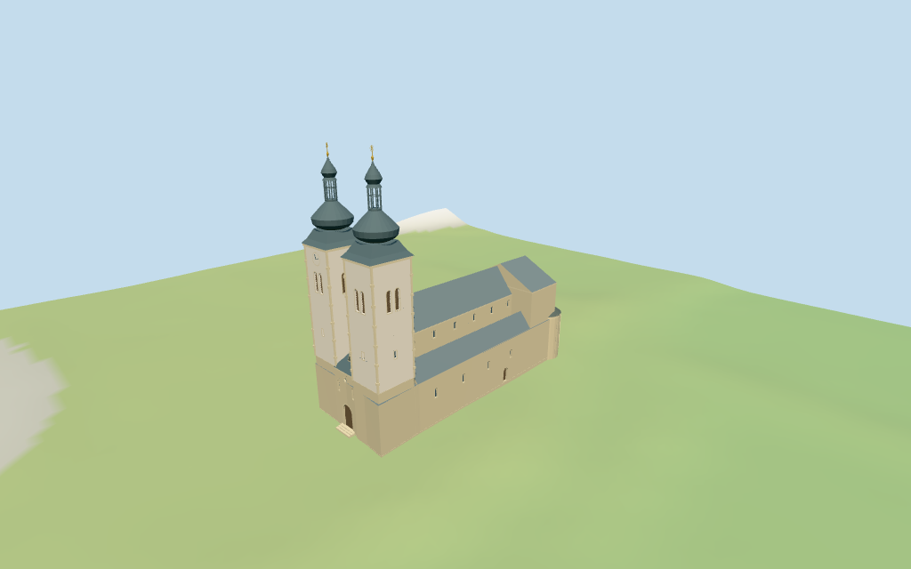

# Gurk Cathedral

Individual medium-fi Gurk Cathedral: tall twin pale shafts above the stone west block, paired belfry lights, sparse openings/quoins, a small clock, broad flared caps, two bulb stages and open lanterns/gold finials; long blue-grey roofed nave/lower aisles, broad east choir and three unequal stone apses with blind Romanesque arcades/round lights. Six shared material graphs and four browser LODs. Monastery/cemetery context excluded; all detailed profiles/heights estimated.

## Evidence and reconstruction

Published dimensions and reconstructed details are separated in spec.json. Primary references:

- [Reference](https://commons.wikimedia.org/wiki/File:Gurk_Dom_West-Ansicht_und_Hans_Kudlich-Denkmal_11042016_1408.jpg)
- [Reference](https://commons.wikimedia.org/wiki/File:Gurk_Domplatz_1_Dom_drei_Apsiden_Ost-Ansicht_22042019_6669.jpg)
- [Reference](https://commons.wikimedia.org/wiki/File:Gurk_Domstift_und_Befestigungsanlagen_06042013_771.jpg)

Six existing shared 256-square ashlar, lime plaster, sandstone, standing-seam metal, painted metal and plain wood graphs serve seven groups including local blue-grey glass. Gilded finials use vertex tint over the shared metal group. Linear tints, metric UVs and flat normals; no embedded images, unique facade photos, baked lighting or micro-carving.

## Model and axes

13,299 triangles; 39,897 vertices; 7 material groups; 1,600,112 bytes. Native bounds: -36.000, -0.805, -12.381 to 35.303, 61.100, 13.344. Source hash: `sha256:0a6c18e9bf5f5999415172dbce4b6ae9f42ef44d5d296d30611984bcff753f09`.

{"x":"east toward three apses","y":"up","z":"south toward cemetery"}

Standard viewer DEM datum 662.795152 m; selected raw perimeter -0.36 to 0.56 m. Floor 0.5 m; adaptive footings cross Y=0 and extend below retained samples. No ground cutout or flattening. Exact west parvis, cemetery edge, monastery junction, threshold/base joins, absolute altitude and walking remain unverified.

## Reproduce

Run `node packages/worldgen/scripts/generate-additional-landmarks.mjs --ids=N0404` (or add `--check`). The generator preserves manually edited masters by checking their baseline hashes. Import through the standard authored-model workflow with optimization disabled; then capture all QA cameras, including shared-surface views.

## Pending work

- Exact retained way/179181268 and Q701301 identify Gurker Dom; current standard viewer whole 35184551270100 and same-ID POI. Preserve all 21 raw outline points/properties plus earlier whole/tags. Anchor [14.293332446,46.874828182] and heading 0.510992715917 rad unchanged. Native +X points east toward three apses, -X west toward twin towers/entrance, +Z south toward cemetery. No horizontal rescale. Monastery relation 52776560524105, its courtyard, detached cemetery chapel, walls, cemetery fixtures and town buildings remain host content. Detailed tower, nave and apse partitions are picture estimates constrained by the church whole.
- No current mapped height/level tags or independent dimension facts. All heights are picture estimates above floor 0.5 m: high nave 20 m eaves / 27 m ridge, aisles 11.8 / 16 m, broad east choir 22 / 27.8 m, west entrance block 14 / 19.3 m. Twin towers have stone bases to 14 m, pale shafts to 40.2 m, flared lower caps and large bulbs to 49 m, open octagonal lanterns to 53.2 m, small upper bulbs to 57.8 m and gilded finials to 60.6 m. Central apse 17.5 m wall / 21.5 m cap; north/south apses 12.5 / 15.7 m. Every detailed sub-plan, opening, blind arcade, clock, quoin course, roof/bulb profile and entrance step is estimated.
- Standard viewer DEM datum 662.795152 m; selected raw perimeter -0.36 to 0.56 m. Floor 0.5 m; adaptive footings cross Y=0 and extend below retained samples. No ground cutout or flattening. Exact west parvis, cemetery edge, monastery junction, threshold/base joins, absolute altitude and walking remain unverified.
- Individual medium-fi cathedral from three inspected exterior pictures and standard viewer PMTiles/DEM. All heights, detailed sub-plans, openings and cap profiles are estimates. Belfry lights are recessed louver-backed panels; octagonal lanterns retain actual open air. Clock, blind arcades, quoins and finials are abstractions. Fine sculpture, faithful masonry ornament, crypt/interiors/bells, hidden monastery joins, current finish, engineering and exact west parvis/cemetery/threshold/base contact simplified, excluded or unverified. Monastery relation, courtyard, detached chapel, cemetery/walls/monument and town buildings remain host content. Synthetic Swiss chalet neighbors are style fixtures. Physical phone/laptop timing pending.
- Skyline retains twin pale shafts and double-bulb/open-lantern caps, long basilica roofs and three unequal rounded apses. District adds shared surfaces, paired belfry panels, clerestory/portal fields, clock and coarse blind apse arcades. Street adds aisle/choir lights, shaft slits, corner courses, finer arcade columns, dormer/steps and gilded sunburst abstractions. Close-up/master add finer bulb/apse sampling.

This bundle follows the medium-fi standard. Medium-fi appearance and geographic fit are reviewed separately. Hash-bound visual acceptance is recorded separately after capture inspection.

## Additional geographic data

©OpenStreetMap contributors; Protomaps; Mapzen/USGS terrain tiles.
