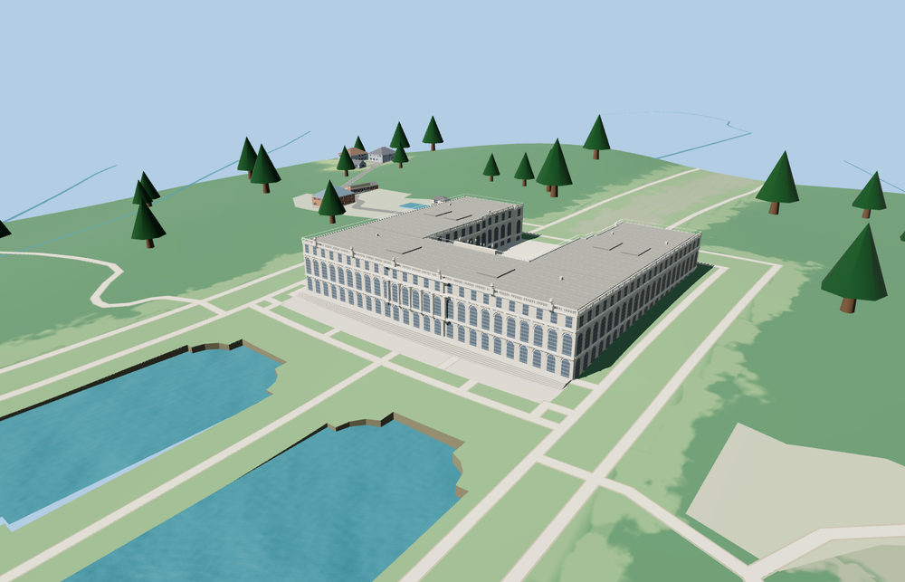

# Herrenchiemsee New Palace

The standing New Palace wraps around an open gravel court. The west garden front has the grand order, three levels of windows and a continuous balustrade with urns. The east court has a columned balcony, three arches, the clock and winged crest, and a striped stone landing.

The 24,168-triangle source rebuilds byte for byte. Skyline, district, street and close-up use 732, 3,272, 10,808, 24,064 triangles. Skyline and district total 337,212 bytes. Six GLBs validated and 36 current views were inspected.

All four tiers pass the roof, open court, stair and wall-contact probes. The viewer retains 7 independent building records, 43 transportation records, and all 6 native water records in the review area. The original palace shell remains available on failed loading.

The model covers the standing New Palace. The footprint and signed garden and court axes follow the map. The Old Palace and the formal park basins retain their separate mapped features. Façade heights, window relief, stairs, roof fixtures, balustrades and the courtyard clock group are exterior photo-based reconstructions. Fine relief and figures are simplified to suit the viewer. The local foundation and exterior terraces use standard terrain samples. Interiors, the demolished north extension and fountain animation are outside this model.

Rebuild with `node packages/worldgen/scripts/generate-herrenchiemsee.mjs`. Append `--check` to compare exact bytes. Use `--ids=herrenchiemsee` for targeted import, LOD, placement and readiness.
