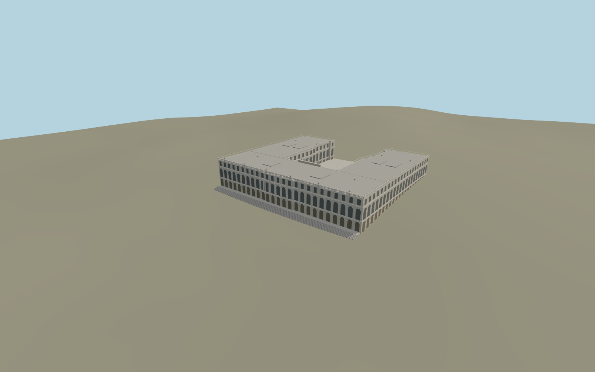

# Herrenchiemsee New Palace

The standing New Palace wraps around an open gravel court. The west garden front has the grand order, three levels of windows and a continuous balustrade with urns. The east court has a columned balcony, three arches, the clock and winged crest, and a striped stone landing.

Run `node packages/worldgen/scripts/generate-herrenchiemsee.mjs` to rebuild the source master. Append `--check` to compare the exact bytes. Use `--ids=herrenchiemsee` for targeted import, LOD generation and placement.

The model covers the standing New Palace. The footprint and signed garden and court axes follow the map. The Old Palace and the formal park basins retain their separate mapped features.

Façade heights, window relief, stairs, roof fixtures, balustrades and the courtyard clock group are exterior photo-based reconstructions. Fine relief and figures are simplified to suit the viewer.

The local foundation and exterior terraces use standard terrain samples. Interiors, the demolished north extension and fountain animation are outside this model.

Original geometry follows the repository license. Map data is © OpenStreetMap contributors under ODbL-1.0 via Protomaps. Terrain samples are described in terrain-grid.json. Ordinary pictures stay local and are not redistributed or used as textures. Current acceptance is recorded in qa.json.
