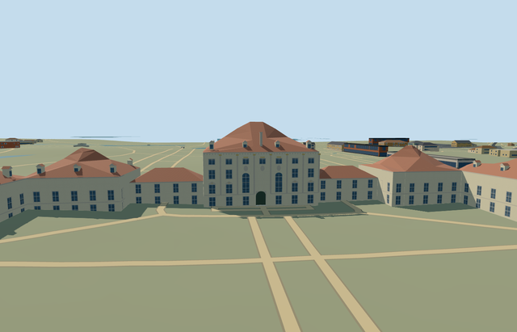

# N0761 — Nymphenburg Palace

Reviewed2026-10-22. **Completed medium-fi principal palace exterior; qualified approximate native fit.**

## Built and inspected

Principal connected Nymphenburg Palace exterior: pale central Baroque pavilion with tall round-headed central windows, crossed casements/mezzanine panes, pilasters/cornices and original blank medallion fields/ochre accents; stepped side pavilions, lower galleries and red ceramic hip roofs with dormers/stacks. Both pairs of outer ranges retain their four mapped open courts. Two mapped bridge galleries retain lower passages between reconstructed piers. Real main east door recess/curved soffit/raised threshold and short treads; west stone terrace with closed balustrade. Corrected ownership, thin leftover walls, entrance trim and southern gallery clearance within one author/inspect/fix pass.

## Shared materials and LODs

Six textured roles use five existing256px shared graphs: plaster_lime, stone_limestone_raw, tile_ceramic, storefront and metal_painted. Neutral tile graph tinted red; painted metal supplies restrained ochre/dark accents. No embedded images/new graph/private atlas. One skyline draw, at most five textured draws, separate POSITION/NORMAL streams and equal CPU/GPU accounting. Each textured native run reads each graph once; all unloads release geometry.

| Level | Triangles | Bytes | Draws |
| --- | ---: | ---: | ---: |
| skyline | 889 | 88668 | 1 |
| district | 2248 | 221700 | 5 |
| street | 13447 | 1123028 | 5 |
| closeup | 29645 | 2448372 | 5 |

Four authored LODs 889 / 2248 / 13447 / 29645 triangles; initial skyline+district geometry 310368 bytes, closeup 2448372 bytes. Six GLBs zero Khronos errors/warnings;324 actual mesh/contact probes and23 actual PMTiles13/14/15 cases (14 owned records across17 detailed tile fragments). Inspected52 current portable/shared/medium-fi/native frames. Native all-LOD/failure/unload checks preserve730 resident/1014 wider independent buildings, original201x201/6m terrain/roads/144119.737m² water and all courts/passages. Failure keeps all744 originals; unload restores ground/water and zero live geometry.

## Geographic fit

Q131631 and named parent relation2144986/native52776560278234 identify Nymphenburg Palace. Thirteen integral mapped parts, including northern/southern two-court ranges and two bridge galleries, bring explicit ownership to14 records. The exact83-vertex parent/four holes and actual part polygons supply horizontal geometry. Model origin at native[-73,4] places the main pavilion near internal[0,0]; anchor[11.50330081793603,48.15825002838863]. InternalX south along the ranges, internalZ east toward the front court/canal, native east/up/south geometry baked in and heading0. All unrelated buildings and mapped open courts remain independent. Qualified approximate native exterior fit on original standard Protomaps20261020/Mapzen201x201/6m terrain. Front court provider datum518.1923222222223m, working floor0.3m and closed foundation-2.805m. Boundary grades-2.655..5.484m leave low-side foundation exposure and uphill base/lower-window burial in the outer ranges. The main front approach/threshold and all four court voids remain visible; exact terrace grades, paving, step levels and accessibility are unverified. Four courts and gallery passages preserve original terrain; original independent buildings, roads, canals/ponds and water inputs remain. Native inspection, ownership, all LODs, failed loading and unload evidence are recorded separately in qa.json. No bespoke terrain or custom flattening.

## Fidelity and limits

Photo-led approximate exterior. Mapped unqualified height tags8/11/17m are working eave controls: central pavilion17m, inner pavilions11m, gallery/outer ranges8m, with distance-to-eave red hip roofs at slope0.65/rise capped10m. Most heights, roof junctions, bay/window/dormer/chimney inventories and unseen elevations are reconstructed, not surveyed. Two bridge tags lack reliable minimum height; a4m northern/8m southern gallery base (the southern8m base retains about2.8m clearance over the highest retained approach grade),11m working southern eave and four supporting pier rows per bridge are explicit schematic reconstruction. Main entrance0.5m above working floor has1.35m recess, arched soffit and five short treads. Western0.5m terrace/blank balustrade and original ochre accents abstract the photographed architecture without copying portrait medallions or arms. Qualified approximate medium-fi exterior fit. Boundary grades-2.655..+5.484m leave low-side foundations/uphill base and lower-window burial in outer ranges. Main entrance and both gallery crossings remain exposed in the inspected native views. Exact historic heights, floor connections, inventories, hidden elevations/roof junctions, paving/terrace/stair grades and accessibility are unverified. No furnished rooms, copied portraits/heraldic relief/inscriptions, garden/fountain sculpture or detached crescent/garden-pavilion models. Physical laptop/phone and dense-city timings remain pending.

## Targeted checks

Selected generation/import/placement, strict medium-fi, scene/sim30 and recipe lint pass. Sim30 sha256:a1dc33a6e10c4109b181c9c43afd68661f6dc4603d8cd344da7adc6031e07e53. Current pins: [qa.json](qa.json); [source controls](map-frame.json).

## Viewed references

- https://commons.wikimedia.org/wiki/File:Aerial_image_of_Schloss_Nymphenburg.jpg — Carsten Steger; 2018-04-29; CC-BY-SA-4.0. Viewed only; no copied pixels.

- https://commons.wikimedia.org/wiki/File:Schloss_Nymphenburg_Fassade-Detail.jpg — JohannesSch. (Serafim 89); 2011-08-14; CC-BY-SA-3.0 / GFDL. Viewed only; no copied pixels.

- https://www.openstreetmap.org/relation/2144986 — palace identity and integral parts; ©OpenStreetMap contributors, ODbL-1.0. Standard PMTiles/Mapzen only.

## Completion checklist

- [x] Rebuildable master/import, four authored LODs and shared materials.
- [x] Current actual architecture/context/native renders and geometry checked.
- [x] Explicit identity/orientation, exact ownership union and qualified native exterior fit.
- [x] Four courts and gallery passages open; independent buildings/roads/terrain/water retained; failed loading/unload restoration checked.
