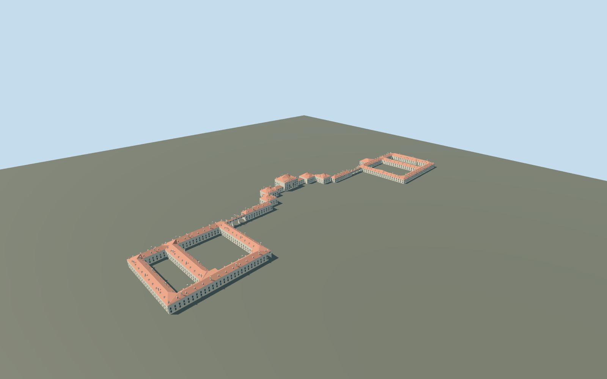

# Nymphenburg Palace, four courts and red roofs

Nymphenburg Palace principal connected exterior: central pale Baroque pavilion, stepped side pavilions, lower galleries and both pairs of outer courtyard ranges. Four mapped courts stay open. Two mapped bridge galleries have a clear lower passage between reconstructed supporting piers. Red ceramic hip roofs, dormers/stacks, crossed windows/tall central arched windows, pale pilasters/cornices, restrained original ochre detail, west terrace/balustrade and a true east entrance recess/soffit/threshold/steps. Detached crescent houses, garden pavilions, canals, fountains and gardens remain map context. No furnished rooms, copied portraits/arms/inscriptions or exact sculptural relief.

## Evidence and reconstruction

Published dimensions and reconstructed details are separated in spec.json. Primary references:

- [Reference](https://commons.wikimedia.org/wiki/File:Aerial_image_of_Schloss_Nymphenburg.jpg)
- [Reference](https://commons.wikimedia.org/wiki/File:Schloss_Nymphenburg_Fassade-Detail.jpg)

Nymphenburg Palace principal connected exterior: central pale Baroque pavilion, stepped side pavilions, lower galleries and both pairs of outer courtyard ranges. Four mapped courts stay open. Two mapped bridge galleries have a clear lower passage between reconstructed supporting piers. Red ceramic hip roofs, dormers/stacks, crossed windows/tall central arched windows, pale pilasters/cornices, restrained original ochre detail, west terrace/balustrade and a true east entrance recess/soffit/threshold/steps. Detached crescent houses, garden pavilions, canals, fountains and gardens remain map context. No furnished rooms, copied portraits/arms/inscriptions or exact sculptural relief.

## Model and axes

29,645 triangles; 67,105 vertices; 5 material groups; 2,774,968 bytes. Native bounds: -18.474, -2.805, -326.644 to 180.277, 26.830, 314.904. Source hash: `sha256:3f4b835b7de8ce59dda0e201bf4232a721b5098bf8631cf8c0521198f0abdec2`.

{"x":"east","y":"up","z":"south"}

The geographic proposal uses exact-QID OpenStreetMap evidence. Map-derived orientation and estimated architectural details require real-site visual review; preview eligibility is distinct from geographic/fidelity approval. Map attribution: © OpenStreetMap contributors, ODbL-1.0.

## Reproduce

Run `node packages/worldgen/scripts/generate-additional-landmarks.mjs --ids=N0761` (or add `--check`). The generator preserves manually edited masters by checking their baseline hashes. Import through the standard authored-model workflow with optimization disabled; then capture all QA cameras, including shared-surface views.

## Pending work

- Nymphenburg Palace principal connected exterior: central pale Baroque pavilion, stepped side pavilions, lower galleries and both pairs of outer courtyard ranges. Four mapped courts stay open. Two mapped bridge galleries have a clear lower passage between reconstructed supporting piers. Red ceramic hip roofs, dormers/stacks, crossed windows/tall central arched windows, pale pilasters/cornices, restrained original ochre detail, west terrace/balustrade and a true east entrance recess/soffit/threshold/steps. Detached crescent houses, garden pavilions, canals, fountains and gardens remain map context. No furnished rooms, copied portraits/arms/inscriptions or exact sculptural relief.
- Q131631 and named parent relation2144986/native52776560278234 identify Nymphenburg Palace. Thirteen integral mapped parts, including northern/southern two-court ranges and two bridge galleries, bring explicit ownership to14 records. The exact83-vertex parent/four holes and actual part polygons supply horizontal geometry. Model origin at native[-73,4] places the main pavilion near internal[0,0]; anchor[11.50330081793603,48.15825002838863]. InternalX south along the ranges, internalZ east toward the front court/canal, native east/up/south geometry baked in and heading0. All unrelated buildings and mapped open courts remain independent.
- Photo-led approximate exterior. Mapped unqualified height tags8/11/17m are working eave controls: central pavilion17m, inner pavilions11m, gallery/outer ranges8m, with distance-to-eave red hip roofs at slope0.65/rise capped10m. Most heights, roof junctions, bay/window/dormer/chimney inventories and unseen elevations are reconstructed, not surveyed. Two bridge tags lack reliable minimum height; a4m northern/8m southern gallery base (the southern8m base retains about2.8m clearance over the highest retained approach grade),11m working southern eave and four supporting pier rows per bridge are explicit schematic reconstruction. Main entrance0.5m above working floor has1.35m recess, arched soffit and five short treads. Western0.5m terrace/blank balustrade and original ochre accents abstract the photographed architecture without copying portrait medallions or arms.
- Qualified approximate native exterior fit on original standard Protomaps20261020/Mapzen201x201/6m terrain. Front court provider datum518.1923222222223m, working floor0.3m and closed foundation-2.805m. Boundary grades-2.655..5.484m leave low-side foundation exposure and uphill base/lower-window burial in the outer ranges. The main front approach/threshold and all four court voids remain visible; exact terrace grades, paving, step levels and accessibility are unverified. Four courts and gallery passages preserve original terrain; original independent buildings, roads, canals/ponds and water inputs remain. Native inspection, ownership, all LODs, failed loading and unload evidence are recorded separately in qa.json. No bespoke terrain or custom flattening.

This bundle follows the medium-fi standard. Medium-fi appearance and geographic fit are reviewed separately. Hash-bound visual acceptance is recorded separately after capture inspection.
