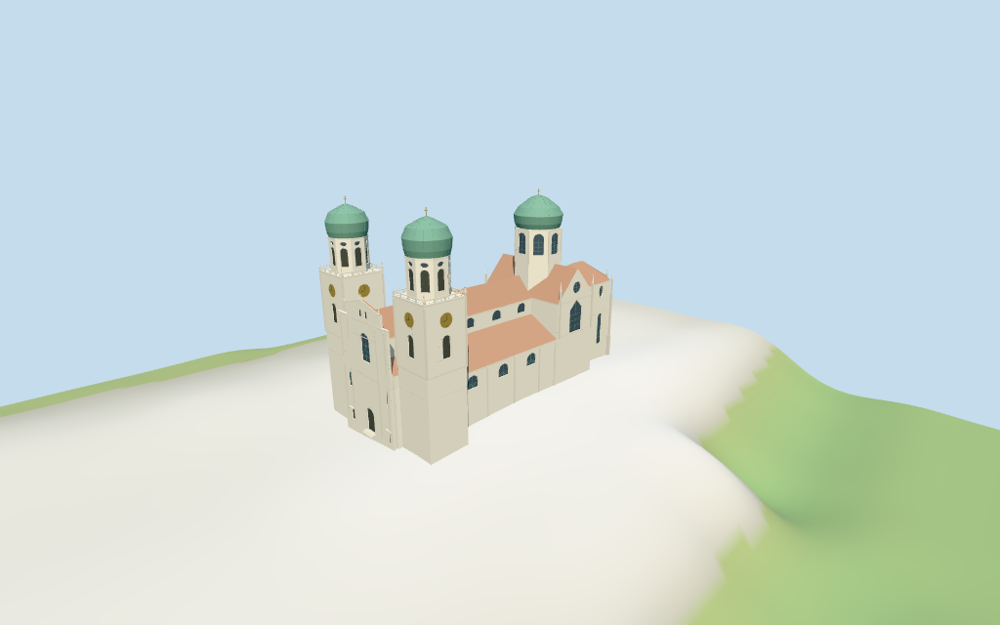

# St. Stephan's Cathedral, Passau

Individual medium-fi Passau Cathedral: white twin west clock towers with balustraded terraces/octagonal belfries/green onion crowns;two-stage west Baroque entrance/pediment/curved shoulders;long red nave and aisle roofs with round clerestory rhythm;Gothic transept and polygonal east choir with stepped buttresses/long lights/upper ovals;large octagonal crossing onion tower. Five existing shared256² graphs,local glazing/gold,seven groups and four browser LODs. Exact current controls retained;nominal map heights,fine architecture and exact ground/site joins estimated or unverified.

## Evidence and reconstruction

Published dimensions and reconstructed details are separated in spec.json. Primary references:

- [Reference](https://commons.wikimedia.org/wiki/File:Dom_St._Stephan_Passau_Westfassade_02.jpg)
- [Reference](https://commons.wikimedia.org/wiki/File:St._Stephans_from_above_-_panoramio.jpg)
- [Reference](https://commons.wikimedia.org/wiki/File:Passau,_Dom,_der_Ostturm.jpg)
- [Reference](https://commons.wikimedia.org/wiki/File:Passau_St._Stephan_vom_Residenzplatz.JPG)

Five existing shared256² lime plaster,raw limestone,flat tile,painted metal and plain wood graphs;local blue-grey glazing/muted gold;seven groups. Green shared metal abstracts patinated copper. Linear tints,metric UVs and flat normals;no embedded images,bespoke textures or baked lighting.

## Model and axes

23,463 triangles; 70,389 vertices; 7 material groups; 2,819,672 bytes. Native bounds: -57.300, -3.882, -27.627 to 56.679, 68.500, 27.571. Source hash: `sha256:7dc4c00457de9ca033ed6709c08f6318b687627d7faec7dbe6555194b3bbbaf7`.

{"x":"east toward polygonal choir/Residenzplatz","y":"up","z":"south"}

Standard viewer DEM datum320.362551m;selected perimeter-3.53 to1.82m relative to it. Floor0.5m;adaptive masonry footings crossY=0 and extend below retained samples. Coarse terrain falls about2m at both west/east ends;precise entry pavement/stair levels are not inferred from those samples. Exact Domplatz/Residenzplatz,threshold/step/base and attached-host joins,altitude and walking remain unverified. No flattening,cutout or road replacement.

## Reproduce

Run `node packages/worldgen/scripts/generate-additional-landmarks.mjs --ids=st_stephans_cathedral_passau` (or add `--check`). The generator preserves manually edited masters by checking their baseline hashes. Import through the standard authored-model workflow with optimization disabled; then capture all QA cameras, including shared-surface views.

## Pending work

- Exact retained way/24771505 and Q267182 identify Dom St. Stephan /Passau Cathedral. Current standard viewer whole35184396860337 and ten selected tower,aisle,nave,transept,choir/crossing parts retain82 raw outline points and all properties,alongside earlier whole/multilingual tags and same-ID named POI. Anchor[13.465532041,48.574226786] and heading−0.069200720611rad unchanged;no horizontal rescale. Native+X east polygonal Gothic choir/Residenzplatz,−X west twin-tower front/Domplatz,+Z south. West-front,elevated north-side and east-end pictures resolve signed facing,approximate3°. Adjoining Domhof/chapel ranges to north,Residenz/hosts to south and surrounding town/plazas remain host content.
- Current map tags:two western tower bases45m;their upper octagonal parts min_height45m/height68m;crossing tower68m;two aisles25m;nave38m;polygonal choir38m;transept42m. These are retained nominal component controls,not surveyed heights or proof of exact roof/floor datum. Estimated partitions above floor0.5m:aisle walls18.5m/red tile crowns25m,nave wall30.8m/ridge38m,choir wall31m/roof38m,transept31m/ridge42m. West square towers reach45m including terrace,cornices and clock stage;upper octagonal belfries56m,green onion bulbs65.6m and gold finials68m. Crossing octagonal support31m beneath the roof/body to54.5m,green onion65.6m and finial68m. Central west facade cornice35.5m/pediment41.5m,small top sculpture43.4m. Window/portal/clock/buttress/roof-rib and ornament profiles are picture estimates;no independent height facts.
- Standard viewer DEM datum320.362551m;selected perimeter-3.53 to1.82m relative to it. Floor0.5m;adaptive masonry footings crossY=0 and extend below retained samples. Coarse terrain falls about2m at both west/east ends;precise entry pavement/stair levels are not inferred from those samples. Exact Domplatz/Residenzplatz,threshold/step/base and attached-host joins,altitude and walking remain unverified. No flattening,cutout or road replacement.
- Individual medium-fi exterior from four inspected matching pictures and standard PMTiles/DEM. Map component height tags are nominal;roof/clock/bay/buttress/portal/step and fine onion/cornice/balustrade/statue profiles are estimated or abstracted. Faithful Gothic/Baroque carving,sculpture/gold relief,inscriptions,clock numerals,window artwork,interiors/bells,engineering,current finish,hidden attached walls and exact Domplatz/Residenzplatz/threshold/step/base contact remain simplified,excluded or unverified. Glazing/doors/belfry fields are recessed panes/timber;no open-interior/belfry claim. Adjoining Domhof/chapel ranges,Residenz/houses,plazas,trees and monuments remain host content. Italian palazzo context is synthetic;physical phone/laptop timing unverified.
- Skyline retains twin west towers/green crowns,central Baroque front,long red nave/aisles,polygonal choir,transept and large crossing onion tower. District adds shared surfaces,portals/upper front window,coarse side-window rhythm,clock discs and belfry/drum/choir openings. Street adds upper/lower choir lights,roses,full window/pilaster rhythm,clock hands/marks,balustrades,stepped buttresses/pinnacles,curved facade shoulders and statue/step abstractions;close-up/master refine circles.

This bundle follows the medium-fi standard. Medium-fi appearance and geographic fit are reviewed separately. Hash-bound visual acceptance is recorded separately after capture inspection.

## Additional geographic data

©OpenStreetMap contributors;Protomaps;Mapzen/USGS terrain tiles.
