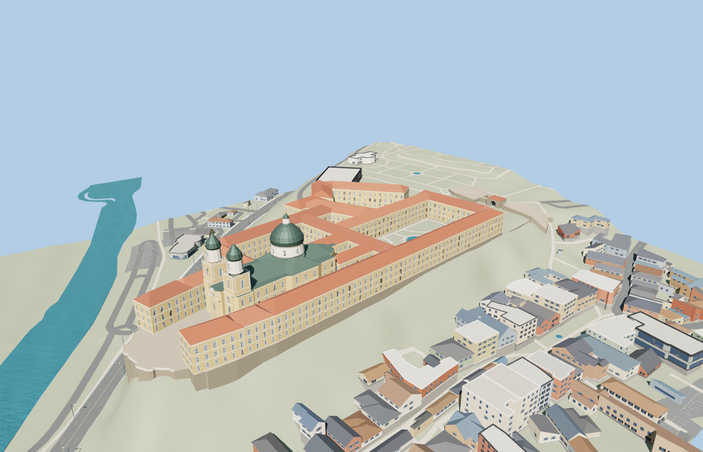

# Melk Abbey

Melk Abbey with the west terrace and paired Baroque towers, the copper church dome, pitched terracotta wings enclosing open courts, the town-facing cliff wall, and the eastern arch and bastions.

The 37,946-triangle source rebuilds byte for byte. Skyline, district, street and close-up use 997, 3,912, 12,276, 35,204 triangles. The first two tiers total 392,716 bytes. Six GLBs validated and 38 current views were inspected.

Each tier passes sixteen foundation contacts, seven open-court probes, three west terrace probes, and six horizontal path probes through the two gates. The smallest measured headroom at the east gate is 4.65 m. The viewer preserves the original terrain and water, 151 independent buildings, and 145 mapped road and path parts. Failed loading retains the mapped abbey shell.

Façade details, roof pitches and exposed foundation heights are visual approximations from ordinary aerial photographs, mapped building parts and standard Terrarium. The model covers the connected exterior and pedestrian entries. The slope at the west terrace is represented with its masonry foundation. Physical-device timings are unmeasured.

Rebuild with `node packages/worldgen/scripts/generate-melk-abbey.mjs`. Append `--check` to compare exact bytes. Use `--ids=melk_abbey` for targeted import, LOD, placement and readiness.
