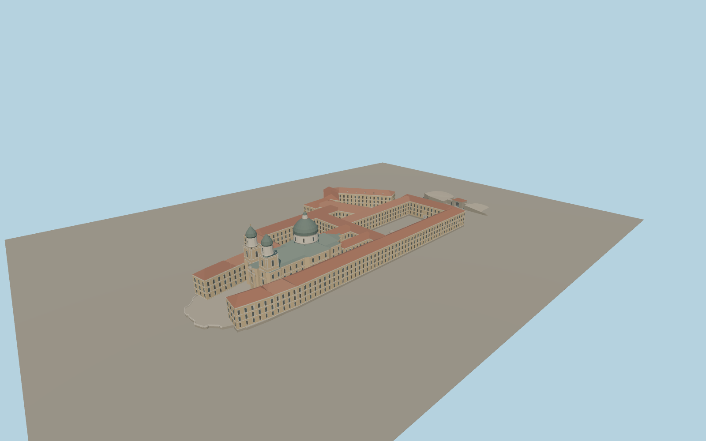

# Melk Abbey

Melk Abbey with the west terrace and paired Baroque towers, the copper church dome, pitched terracotta wings enclosing open courts, the town-facing cliff wall, and the eastern arch and bastions.

Run `node packages/worldgen/scripts/generate-melk-abbey.mjs` to rebuild the source master. Append `--check` to compare the exact bytes. Use `--ids=melk_abbey` for targeted import, LOD generation and placement.

Photo-derived façades, roof pitches, masonry profiles and ornament are visual approximations. Heights use mapped building-part values where available.

The model covers the connected exterior and entrance route. Interiors and detached garden structures are outside this scope.

Original geometry:repository license. Map:© OpenStreetMap contributors,ODbL-1.0;Protomaps. Standard terrain:terrain-grid.json. Ordinary pictures stay local and are not redistributed or used as textures. Current acceptance:qa.json.
