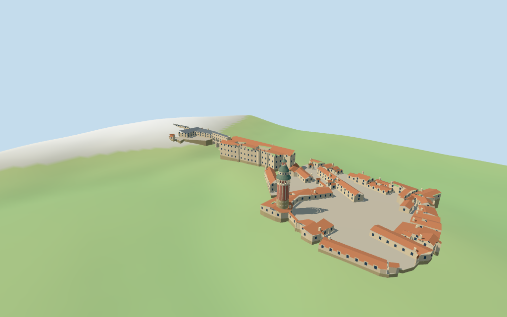

# Český Krumlov Castle

Individual ridge castle: open double-courtyard upper palace, lower Hradek and54.5m decorated round tower with a real open arcade, flared copper roofs/lantern, mapped service ranges, western theater/elevated gallery and stacked arched Cloak Bridge. Shared pale plaster, salmon accents and red ceramic roofs.

## Evidence and reconstruction

Published dimensions and reconstructed details are separated in spec.json. Primary references:

- [Reference](https://www.jiznicechy.cz/turisticke-cile/1723-zamecka-vez-cesky-krumlov)
- [Reference](https://www.explorow.com/places/cesky-krumlov-state-castle/7842)

Five existing256-square shared graphs provide lime plaster, weathered limestone, ceramic tile, slate and painted metal. Linear palette tints and metric UVs; no unique photograph/bitmap. Sparse colored bands approximate the tower decoration.

## Model and axes

13,792 triangles; 41,376 vertices; 6 material groups; 1,658,816 bytes. Native bounds: -247.347, -12.837, -83.952 to 205.913, 54.500, 84.065. Source hash: `sha256:56a682e0532d3609db53b4c88cc63e5444d16d1cffdf094232913c0eb6f90f0e`.

{"x":"east-northeast toward lower castle","y":"up","z":"south-southeast toward river"}

Two inspected exterior photographs and standard viewer PMTiles/DEM guide the individual castle compound and approximate signed fit. Town/gardens are excluded. Untagged profiles and terrace/bridge joins are exterior estimates. © OpenStreetMap contributors, ODbL-1.0.

## Reproduce

Run `node packages/worldgen/scripts/generate-additional-landmarks.mjs --ids=N0321` (or add `--check`). The generator preserves manually edited masters by checking their baseline hashes. Import through the standard authored-model workflow with optimization disabled; then capture all QA cameras, including shared-surface views.

## Pending work

- Selected current PMTiles polygons guide approximate compound fit; overlapping building-part overlays and nearby town polygons are excluded. Heights with tags are retained; untagged ranges and facade/window/roof profiles are exterior estimates.
- Standard viewer DEM supplies a working497.6021m anchor datum. Upper/lower/theater court levels, foundations and bridge story/arch/approach joins are estimates; no bare-earth survey, terrain carving or navigable collision guarantee.
- Tower decoration uses a sparse shared-material/palette rhythm rather than exact painted frescoes. Gallery arches are real openings; detailed stairs, rooms, museum exhibits, gardens, trees and neighboring village are excluded.
- The western elevated gallery is mapped outside the main enclosure; its support and roof profile are approximate. Cloak Bridge path fixes its axis; theater-end continuation and stacked corridors are photo-led.
- Physical laptop and phone frame-rate measurements remain pending.

This bundle follows the medium-fi standard. Medium-fi appearance and geographic fit are reviewed separately. Hash-bound visual acceptance is recorded separately after capture inspection.

## Additional geographic data

© OpenStreetMap contributors; Protomaps; Mapzen/USGS terrain tiles.
