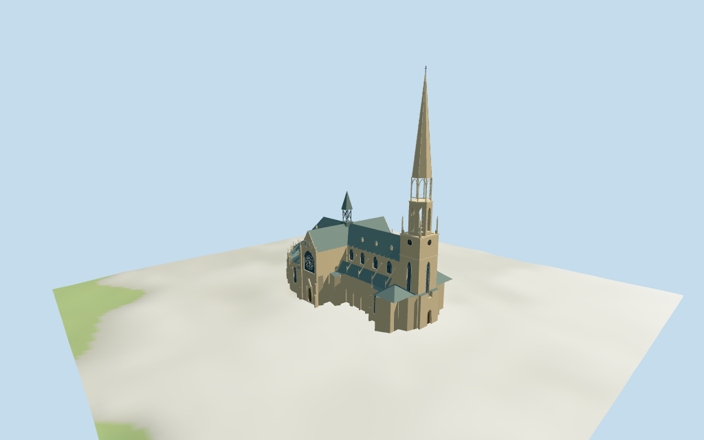

# new_cathedral_linz — New Cathedral, Linz review

Reviewed2026-10-15 against current source/runtime bytes. Accepted for medium-fi exterior and approximate horizontal placement. Exact vertical datum and host-ground contact remain unverified.

## Built result

Inspected11 current portable/source-terrain frames. Linz Mariendom has an individually authored long warm-stone cruciform nave/transept,high polygonal choir and lower chapel envelope,gray-green copper roof hierarchy and small dormers. Double-centered faceted Gothic recesses,pointed rose/tracery windows,deep timber transept portals,blind gable panels,stepped buttresses/flying struts and pinnacles distinguish the facade. The tall northern50m tower has clocks,an open mapped50..68m belfry,pierced68..80m crown,long ribbed stone cone131m and134.7m finial. Smaller dark cross-braced open crossing fleche reaches67m. Separate mapped western canopy remains a low4m glass enclosure. Corrected missing high-choir walls/overlapping roof termination,short chapel facets without windows,a canopy gap below its roof,and overly bare crossing posts. Reduced alternate small chapel bays only in district to keep its budget. Fine sculpture,exact rose lobes/glass art,clock lettering and hidden roof/window rhythm remain simplified.

Medium-fi exterior from actually inspected H.Raab/Vesta2009 whole eastern oblique and Dein Freund der Baum2009 elevated whole photographs,plus standard viewer PMTiles/DEM only. No bespoke plans/surveys or redistributed reference images. Single tall northern staged clock/belfry tower,pierced crown/long stone spire,smaller dark open crossing fleche,gray-green pitched copper roofs,cruciform/choir/chapel envelope and pointed rose/portal facades carry identity. Curved pointed apertures and geometric spokes/foils approximate richer tracery. Fine figures,crockets,exact glass art/clock lettering,hidden bays,full interiors/bells and engineering sections are simplified or excluded. The upper stone cone is solid with ribs/sparse crockets;the lower crown/fleche are open. Current finish and hidden4m western canopy shape are unverified;its glass enclosure is an approximate visualization from the map. Height datum/partitions and precise host-ground joins remain uncertain. Surrounding city blocks,roads,trees,temporary scaffolding and site furniture remain host content.

## Shared surfaces,placement and levels

Inspected11 current shared/geographic frames. Four existing cached256-square ashlar,continuous limestone,standing-seam metal and plain timber graphs serve six merged groups;skyline uses one draw. Warm light stone,cream trim,muted gray-green copper and wood tints are linear,with metric UVs and flat architectural normals. Glass,clock faces/hands and small lattice/finial elements use local geometric PBR colors. No embedded images,unique facade maps,reference-photo textures or baked lighting. Actual texture presence,one read per graph and unload pass with zero live model geometries. Shared details show real stone courses,copper seams,curved Gothic recesses,geometric rose spokes/foils and genuinely open belfry/crown/fleche. Native and signed geographic plan agree with eight controls. Generic roof/detail views deliberately crop the very tall spire;four matched whole LOD views contain the complete envelope.

Retained exact-QID way/13961069,Q257481 and multilingual Mariendom identity match current compound35184386049901. Eight current controls retain637 raw vertices:284 whole,41 high cruciform35184596459319,283 low35184596459340,4 lower tower35184596459346,4 crossing fleche35184596459347,8 belfry35185472769471,8 spire35185472769472 and5 canopy35185472769473. Raw heights19/46/20/50/67/68/131/4m,plus belfry min_height50/spire min_height68,and earlier301 distinct whole vertices/tags remain intact. Component associations are positional/visual,not independent exact-QID claims. Anchor[14.28602778,48.300232254],heading-1.344098221131rad signs+X south-southeast choir,-X north-northwest main tower/portal,+Z west-southwest low canopy. No rescale.134.7m fact lacks a reference URL;it controls the finial above estimated0.65m floor while131m marks the stone spire. Estimated eaves34m/ridges46m,low eaves19m/roofs25..27m,pierced crown68..80m and details remain approximate;19/20m lower-envelope tags differ in scope/rounding. Geometry simplifies small mapped spikes while all raw points remain source controls. Seventy-two actual viewer-footprint checks cover all eight controls and retain two neighboring buildings,north square and east street. Local UV-preserving subdivision keeps conservative stamps out of those neighbors. DEM datum264.464573m,raw perimeter-3.26..0.94m. Footings crossY=0 and extend below samples. No flattening,host terrain change or road replacement. Exact pavement/door joins,base clipping,absolute altitude and walking remain unverified.

Inspected27 current Earth-lighting frames:Economy/High,noon/late,three distances,texture-free silhouette,six details,four matched whole LODs and four transitions. Skyline550 triangles preserves massive cruciform roof hierarchy,lower chapel envelope,tall stone spire/open stages,crossing fleche and separate low canopy. District2739 adds shared surfaces,selected recessed glazing/portals,clock disks,crown arches and main buttress silhouette;alternate small chapel bays are omitted. Street14115 adds fuller choir/clerestory bays,mullions,rose spokes,dormers and flying struts. Closeup35818/master36586 add simple foils/transoms,blind gable panels,parapet rhythms and sparse geometric crockets. Far belfry uses posts;near has true arched walls. The upper stone cone is intentionally solid with ribs;its lower crown and crossing fleche keep air. Near street-context views crop the top/base;four matched whole LODs contain the135.35m local finial. Regional Austrian inn neighbors and coarse standard terrain are fixtures. Physical laptop/phone timing remains pending.

## Browser budgets

| Level | Triangles | Bytes | Draws |
| --- | ---: | ---: | ---: |
| skyline | 550 | 57888 | 1 |
| district | 2739 | 267580 | 6 |
| street | 14115 | 1301832 | 6 |
| closeup | 35818 | 3361360 | 6 |

Initial skyline plus district: **325468 bytes** of geometry. Master: **4393992 bytes / 36586 triangles**. Four shared256-square graphs;zero embedded images. Bytes exclude graph definitions/texture generation. Split POSITION/NORMAL streams,equal CPU/GPU totals. Physical-device timing pending.

## Verification

- Targeted byte reproduction,current source/import/LOD/input/report bindings and source/recipe inventory/schema.
- Six Khronos validations:zero errors/warnings/images;all four LOD budgets pass.
- Exact-QID whole,eight controls/all637 raw points,tags/heights/min_height fields,134.7m fact and standard DEM match.
- **1056 actual geometry probes** and **72 actual viewer-footprint checks** pass.
- Shared texture read-once/unload and hash-bound geographic/medium-fi checks pass.
- Scene validation and30-tick simulation:sha256:2aeccf6299b7badfb0fcf260efe5c743b41c19e39c60d37bdd5440abc612a664.
- Inspected **49 current frames** after corrections:11portable,11shared/geographic,27medium-fi. Bulk captures remain ignored.

Source hash: sha256:47a4d67b48194265514d5184966dcbd20f1240435b68716116012c197df946fd. Runtime hash: sha256:8feb6a72c2fe2d3959b5bd4b9a055ef268ae70b2fe1e7ec88c026a95fc6a2694. Input hash: sha256:b26e8632557bfbe29c0ed6e64903b76a86f14e4e9e0c10e81358abd3fb4cb1bc.

Commands:targeted generate/import/LOD/register-landmark-previews --ids=new_cathedral_linz;generate-additional-landmarks.mjs --ids=new_cathedral_linz --check;capture-structure-models.mjs --ids=new_cathedral_linz --reflections --antialias --fit-shadows;capture-landmark-library.mjs --ids=new_cathedral_linz --reflections --adaptive-clipping --bounded-placement;capture-medium-fi.mjs --ids=new_cathedral_linz --reflections;molen validate;molen sim run --ticks30 --hash. Earlier full branch source audit covered all models throughN0391;next routine checkpoint:new_cathedral_linz–st_stephans_cathedral_passau.

## Limits

- Retained exact-QID way/13961069/Q257481 matches current compound35184386049901. Eight current controls retain284 whole,41 high cruciform,283 low,4 lower tower,4 crossing fleche,8 belfry,8 spire and5 canopy vertices (637 total),all original tags/min_height values,and earlier301 distinct whole vertices. Raw heights19/46/20/50/67/68/131/4m remain unchanged. Belfry min_height50m and spire min_height68m control stages. Retained134.7m Wikidata height has no reference URL;the finial uses134.7m above estimated0.65m floor,while mapped131m controls the stone spire. Native+X south-southeast toward choir,-X north-northwest main tower/portal,+Z west-southwest low canopy. No horizontal rescale. Simplified body ring removes small mapped buttress/stair spikes;all637 raw points remain source controls. Estimated nave/transept eaves34m/ridges46m,low eaves19m/roof25m,belfry50..68m,pierced spire crown68..80m/stone cone131m,finial134.7m and crossing fleche67m. Raw19/20m lower-envelope tags are rounded/differently scoped;they do not prove exact parapet/roof heights. Internal partitions,pinnacle/clock/tracery profiles and height datum are approximate.
- Standard viewer DEM datum264.464573m,estimated floor0.65m,whole perimeter-3.26..0.94m. Footings crossY=0 and extend below samples. No preview flattening,host DEM change or road replacement. Exact pavement/door joins,base clipping,absolute altitude and walking remain unverified. Surrounding city blocks,roads,trees,temporary scaffolding and site furniture remain host content.
- Medium-fi exterior from two actually inspected2009 oblique/elevated pictures and standard viewer PMTiles/DEM.No bespoke plans/surveys.Fine sculpture,crockets,exact rose-window lobes/stained-glass art,lettering,hidden bays,full interiors/bells and engineering sections simplified or excluded.The upper stone cone is solid with ribs/sparse geometric crockets;its lower crown and crossing fleche retain genuine air.Current finish and exact hidden western4m canopy shape unverified.Physical laptop/phone timing pending.
- Skyline preserves cruciform roof hierarchy,lower chapel envelope,tall open-stage tower/stone spire and crossing fleche.District adds shared textures,selected recessed glazing/portals,clock,crown arches and main buttress silhouette.Street adds more choir/clerestory bays,mullions,rose spokes,dormers/flying struts.Closeup/master add simple foils/transoms,blind gable panels,parapet rhythms and sparse crockets.Body ring simplifies mapped micro projections while raw points remain intact.Regional neighbors are fixtures.

Readiness accepts this exterior/approximate horizontal scope. The1,000-candidate goal remains incomplete.
