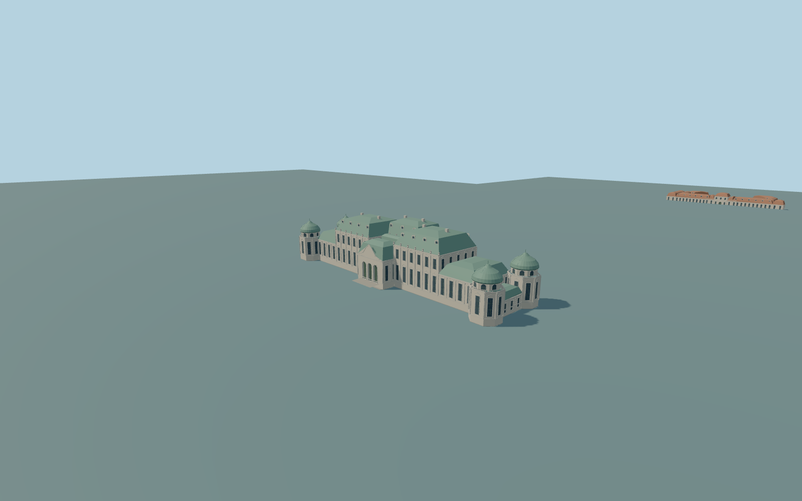

# Belvedere

Both individual principal Belvedere palaces: the complete Upper palace with three raised mansard-roofed central blocks and four domed corner pavilions, and the complete Lower palace with raised central hall, red hipped/mansard roofs and its actual bent rear courtyard ranges. Gardens, ponds, detached annexes and city buildings remain native context. Original exterior geometry; no interiors or copied sculpture.

Rebuild: `node packages/worldgen/scripts/generate-belvedere.mjs`;append `--check` for exact source bytes. Select import/LOD/placement with `--ids=belvedere`. Detailed source and four browser tiers are separate ignored GLB outputs.

Both individual principal Belvedere palaces: the complete Upper palace with three raised mansard-roofed central blocks and four domed corner pavilions, and the complete Lower palace with raised central hall, red hipped/mansard roofs and its actual bent rear courtyard ranges. Gardens, ponds, detached annexes and city buildings remain native context. Original exterior geometry; no interiors or copied sculpture.

Picture-guided relative palace heights on an approximate182m standard Terrarium reference. Upper threshold194m (pool front195.7m), Lower threshold173.3m. Separate occupied foundations and bounded entry transitions meet the unchanged coarse field; no garden flattening. Lower native central height28m is inconsistent with its photographed one-story frontage/raised hall and is not treated as a surveyed dimension. Historic thresholds and roof heights remain approximate.

Fine ornaments, window inventories, concealed roof joins and historic grade are original approximations. No copied statues, heraldry or inscriptions. The coarse global elevation field is not surveyed; bounded thresholds approximate contact, not historic stairs. Physical-device timings and numerical LOD errors remain unmeasured.

Seven existing256px plaster,limestone,granite,painted metal,ceramic tile,window grid andpainted wood graphs. Original metric UVs andlinear colors; no private or embedded images. Skyline retains both principal silhouettes, openLower forecourt, four Upper domes andthree raised crowns; district adds sparse recessed glazing; street adds frames; close-up adds dormers,pilasters,balustrades andoriginal ornaments. Source preserves finer profiles. Numerical LOD errors3/1.5/.7/.25m andphysical timings are unmeasured.

Original geometry:repository license. Map:© OpenStreetMap contributors,ODbL-1.0;Protomaps. Standard terrain:terrain-grid.json. Ordinary pictures stay local and are not redistributed or used as textures. Current acceptance:qa.json.
