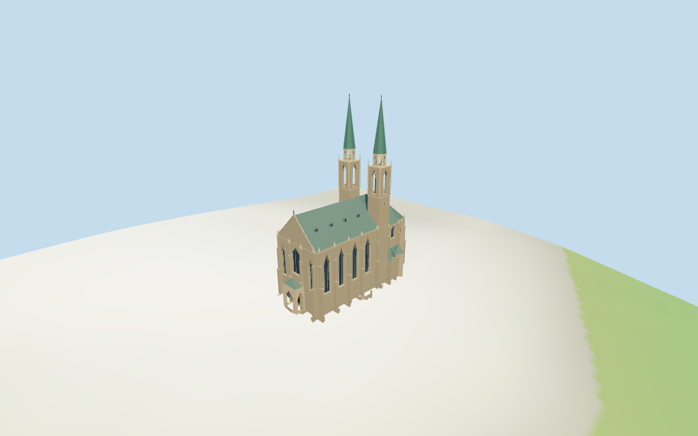

# cathedral_of_st_peter_and_paul — Cathedral of St. Peter and Paul, Brno review

Reviewed 2026-10-15 against current source/runtime bytes. Accepted for the medium-fi exterior and approximate geographic/terrain scope.

## Built result

Inspected all 11 current portable/source-terrain frames. Individual Brno Petrov cathedral has twin square stone towers at the nave/choir junction, tall open pointed belfries, small open crowns and very slender green metal needle spires. The broad higher western nave has a gray-green metal roof and four small dormers per side; the lower polygonal eastern choir has a smaller ridge fleche. Warm rubble masonry, pale stone trim, recessed pointed glazing, stepped buttresses/pinnacles, low northern chapels and southern vestry retain the exterior hierarchy. Western gabled facade has a broad pointed upper window, narrower flanking windows, modeled arch surrounds and an open outer porch with a closed wood entry behind it. Corrected the porch back face that occluded the recessed entry and cut both side arch apertures fully through the inner wall skin; deeper cavity probes pass. Removed the extra horizontal foundation cap from the entry area. Exact carved figures, reliefs/inscriptions, stained-glass art and fine latticework omitted.

Medium-fi exterior from four inspected useful pictures plus standard viewer PMTiles/DEM only. Approximate current 40/30/84/45m height tags and raw plans retained; eaves, spire/crown subdivisions, small chapel/vestry clips, window/dormer rhythm, porch dimensions, buttress widths and thresholds are picture estimates. Shared rubble/limestone approximate mixed historic masonry and the same shared standing-seam graph serves all green-gray roofs/spires. No baked snow despite one winter reference. Exact sculpture/inscriptions, tiny latticework, stained-glass art, bells/full interiors, Petrov retaining terraces, surrounding town/landscaping and certified walking excluded. Physical laptop/phone timing pending.

## Shared materials and placement

Inspected all 11 current shared-material/geographic frames. Four existing shared 256-square rubble stone, limestone, standing-seam metal and plain wood graphs serve six merged groups. Main roof and needle spires reuse the same graph with gray-green/green tints; warm masonry/pale trim use linear colors and metric UVs. Dark glazing, small geometric clocks and accents use flat PBR colors. No embedded images, unique facade textures or baked snow/soot/shadows. Every graph reads once; unload disposes model geometry, leaves zero live model geometries and restores ground. Flat geographic view confirms the signed mapped plan and partly masks below-datum entry geometry; source-terrain views show approximate porch/threshold contact. Ground bands are diagnostic.

Exact-QID way32877797/Q45033 matches current main35184404966629. Seven raw main/nave/crossing/choir/tower/fleche controls preserve tags and missing min_height values without rescale. Anchor [16.607488912,49.191010457], heading-0.07961876147662411rad follows the long nave edge; western gabled portal, lower eastern choir and paired junction towers sign it. The retained-0.083612476803rad axis differs by0.229deg. Current 40m nave/crossing,30m choir,84m tower envelopes and45m fleche tags are full roof/spire controls, not stacked walls. Estimated eaves28/23m, tower subdivisions42/55/60.5m, low annex clipping and minor ornament remain approximate; no independent measured dimensions are present in retained facts. Raw transforms, all joined-height wall unions/annex clips and standard DEM reproduce. All 66 actual viewer footprint checks cover seven controls while preserving three unrelated neighboring buildings and a west-front patch across six outputs. Standard DEM datum239.782823m, display offset0.4m, perimeter-3.04..0.84m; foundations follow terrain and approximate thresholds use local DEM+0.22m. Petrov retaining terraces, absolute altitude, paving/steps, thresholds and certified walking unverified. No road replacement or terrain flattening.

Inspected all 27 current Earth-lighting frames: Economy/High, noon/late, three distances, silhouette, six detail crops, four matched whole-model levels and four transitions. Skyline preserves the paired junction needles, higher broad nave/lower choir, fleche, coarse buttresses and open outer porch. District adds textures, flat glazing/doors, geometric clocks/dormers and open tower belfries/crowns. Street adds facade/entry recesses, stepped supports/pinnacles, arch surrounds and restrained tracery; closeup/master refine facets. All four matched whole-model views show both complete spire tips and the church; detail/default street crops intentionally show portions. Synthetic Swedish-cottage neighbors and terrain bands represent review fixtures rather than mapped Brno town or snow/paving.

## Browser budgets

| Level | Triangles | Bytes | Draws |
| --- | ---: | ---: | ---: |
| skyline | 1000 | 94972 | 1 |
| district | 3913 | 296008 | 6 |
| street | 8182 | 669576 | 6 |
| closeup | 8764 | 727288 | 6 |

Initial skyline plus district: **390980 bytes** of geometry. Master: **1055332 bytes / 8764 triangles**. Four cached shared 256² graphs, zero embedded images. Geometry bytes exclude graph definitions/texture generation. Split POSITION/NORMAL streams with equal CPU/GPU totals. Physical device timing pending.

## Verification

- Targeted byte reproduction, source/import/LOD/input/review hashes, recipe index and source inventory/schema match.
- Six Khronos validations: zero errors/warnings/images; four browser budgets pass.
- Seven raw map controls, height tags/min_height absences, signed frame, joined wall layers/annex clips and standard DEM match.
- **708 geometry probes** and **66 actual viewer footprint checks** pass.
- Shared graph read-once/unload and hash-bound placement/medium-fi reviews pass.
- Scene validation and 30-tick simulation pass: sha256:9a57a5dc096bdc2d124c22f301182f9d662e5e4b44ae956b7c067816d7538df9.
- Inspected **49 current frames**: 11 portable, 11 shared/placement, 27 medium-fi. Cameras/paths/hashes retained; bulk images ignored.

Source hash:sha256:cfedb7f6fbe98f7689bb21b68380521d98915814c32b9f17667afa41ef9cde88. Runtime hash:sha256:f380a479e7d9a1be7e69480a152ed928a8746ac2dffedc8d63af3a2232c99512. Input hash:sha256:389eb63594a55779e26c77a095b7f0dcd6430ca24881a1d7023ea4ba547d7eda.

Commands: targeted generate/import/LOD/register-landmark-previews --ids=cathedral_of_st_peter_and_paul; generate-additional-landmarks.mjs --ids=cathedral_of_st_peter_and_paul --check; capture-structure-models.mjs --ids=cathedral_of_st_peter_and_paul --reflections --antialias --fit-shadows; capture-landmark-library.mjs --ids=cathedral_of_st_peter_and_paul --reflections --adaptive-clipping --bounded-placement; capture-medium-fi.mjs --ids=cathedral_of_st_peter_and_paul --reflections; molen validate; molen sim run --ticks 30 --hash. Routine full source checkpoint covers ljubljana_cathedral–saint_sophia_cathedral_in_polotsk.

## Limits

- Exact-QID OSMway32877797/Q45033 matches current main35184404966629. Seven raw controls/tags are retained without rescale. Nave and short crossing parts are40m, choir30m, two tower envelopes84m and choir fleche45m, with no min_height values. These are approximate complete roof/spire envelopes, not stacked wall solids. Estimated nave eave28m/ridge40m, choir eave23m/ridge30m, tower square wall42m/open belfry55m/crown60.5m/needle and finial84m, and fleche above the30m roof to45m are picture-led subdivisions. Low chapel/annex plans clip the raw main envelope and have estimated7.5/10m eaves. Retained facts contain no independent measured dimensions. Raw tiny buttress notches remain in the detailed foundation; above that, the joined main/part volumes provide the architectural wall envelope.
- Standard DEM datum 239.782823m; display datum offset 0.4m, mapped perimeter terrain -3.04..0.84m. Foundations follow terrain; approximate west/south exterior thresholds use local DEM +0.22m. Coarse standard DEM does not certify absolute altitude, Petrov terrace retaining walls, paving/step joins, thresholds, cut/fill, interiors or walking. No global flattening.
- Medium-fi exterior based on four useful pictures and standard viewer PMTiles/DEM only. Eaves/roof slopes, tower subdivisions/crowns, small annex clipping, porch dimensions, dormers, facade rhythm, buttress widths and thresholds are estimates. Exact sculpture/inscriptions, stained-glass art, bells/interiors, Petrov terrace retaining walls, surrounding town/landscaping and certified walking excluded. Physical device timing pending.
- Skyline keeps twin needle spires at the junction, broad high nave, lower choir, fleche, open porch and coarse buttresses. District adds textures, flat glazing/doors, clocks/dormers and open belfries/crowns. Street adds recesses, stepped buttresses/pinnacles, portal bands and sparse tracery. Closeup/master refine facets. Synthetic context neighbors are not mapped Brno buildings.

Readiness accepts this exterior scope. The 1,000-candidate goal remains incomplete.
