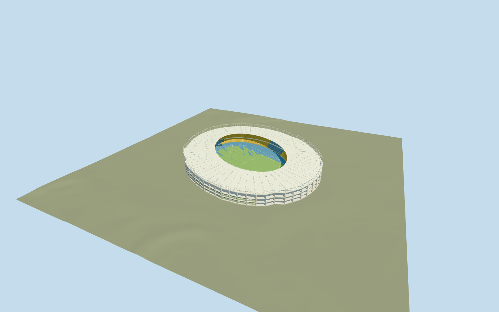

# Ernst-Happel-Stadion

Specific Ernst-Happel-Stadion: exact mapped oval roof envelope/opening, closed shallow white annular roof/radial underside beams, white outer collar truss/open inner catwalk, exposed concrete perimeter columns/floor belts, pale green windowed frontage, three covered blue/yellow seating tiers/concourse aisles, blue representative athletics track and football pitch/goals, two supported neutral end boards. Four existing shared concrete/paint/window-grid/canvas graphs. No roof over pitch, unique atlas/copied text/live screens, crowd/event fixtures, furnished offices, neighboring practice ground/railway or whole-site slab.

## Evidence and reconstruction

Published dimensions and reconstructed details are separated in spec.json. Primary references:

- [Reference](https://commons.wikimedia.org/wiki/File:Ernst-happel-stadion_vienna.jpg)
- [Reference](https://commons.wikimedia.org/wiki/File:Ernst-Happel-Stadion_Dach_01.jpg)
- [Reference](https://commons.wikimedia.org/wiki/File:Ernst-Happel-Stadion_(4511)_stitch_IMG_0738_-_IMG_0740.jpg)
- [Reference](https://commons.wikimedia.org/wiki/File:Ernst-Happel-Stadion_-_panoramio.jpg)

Specific Ernst-Happel-Stadion: exact mapped oval roof envelope/opening, closed shallow white annular roof/radial underside beams, white outer collar truss/open inner catwalk, exposed concrete perimeter columns/floor belts, pale green windowed frontage, three covered blue/yellow seating tiers/concourse aisles, blue representative athletics track and football pitch/goals, two supported neutral end boards. Four existing shared concrete/paint/window-grid/canvas graphs. No roof over pitch, unique atlas/copied text/live screens, crowd/event fixtures, furnished offices, neighboring practice ground/railway or whole-site slab.

## Model and axes

29,762 triangles; 89,286 vertices; 5 material groups; 3,574,864 bytes. Native bounds: -126.045, -0.928, -131.670 to 126.414, 26.628, 134.393. Source hash: `sha256:345ed06562de395d7f515d835fe45ead5f8f7609fc4cccdb755380d362064d54`.

{"x":"east","y":"up","z":"south"}

The geographic proposal uses exact-QID OpenStreetMap evidence. Map-derived orientation and estimated architectural details require real-site visual review; preview eligibility is distinct from geographic/fidelity approval. Map attribution: © OpenStreetMap contributors, ODbL-1.0.

## Reproduce

Run `node packages/worldgen/scripts/generate-additional-landmarks.mjs --ids=ernst_happel_stadion` (or add `--check`). The generator preserves manually edited masters by checking their baseline hashes. Import through the standard authored-model workflow with optimization disabled; then capture all QA cameras, including shared-surface views.

## Pending work

- Specific Ernst-Happel-Stadion: exact mapped oval roof envelope/opening, closed shallow white annular roof/radial underside beams, white outer collar truss/open inner catwalk, exposed concrete perimeter columns/floor belts, pale green windowed frontage, three covered blue/yellow seating tiers/concourse aisles, blue representative athletics track and football pitch/goals, two supported neutral end boards. Four existing shared concrete/paint/window-grid/canvas graphs. No roof over pitch, unique atlas/copied text/live screens, crowd/event fixtures, furnished offices, neighboring practice ground/railway or whole-site slab.
- Retained exact-QID OSMrelation37185/native52776558170433 controls the280.067x235.268m oval and its mapped central roof opening. Own anchor16.420911482,48.207193552/global heading0/native east-south, internal X[0.35312278685873716,-0.9355769863571457]/Z[0.9355769863571457,0.35312278685873716] preserves the stadium long axis. Bowl front/field centre are a bounded picture/map allocation inside that opening; frontage placement and fine roof/portal/section inventory retain20degree/2m approximation, not a facade survey.
- OSM/native PMTiles carries26.7m without a qualifying dimension or source. Visualization uses an overall26.7m collar, perimeter floor belts.3/5.8/11.6/18.8m, outer roof20m/inner roof23m, seating1.2..5.7/6.8..11.4/12.5..17.7m. Detailed height allocation, column/row/diagonal counts, catwalk/screens/frontage extent and hidden condition are picture-led estimates. Field105x68m and blue track based on36.5m bends/84.39m straights with representative lane spacing are a neutral sports configuration, not an athletics certification or as-built survey. Later roof finishes/equipment changes beyond the viewed photos are not verified.
- Retain original6m standard Mapzen ground, native roads/water and every independent Prater building/practice ground. Replace only the stadium parent shell. Bounded occupied perimeter feet/internal sports floor meet coarse DEM; no outside whole-site slab, parking/railway mesh, terrain flattening or ground/water cutout. Coarse field/foundation/nearby bank heights are not surveyed drainage/flood measurements.
- Ordinary2010/2014/2016/2017 bowl/exterior/aerial/roof-detail views inspected. Exact stadium relation/outer roof and central opening control the complete covered bowl;26.7m tag is unqualified. Fine heights/column/row/truss/screen/frontage inventory are estimates. Shared canvas grain approximates grass, blue track is a representative configuration. No roof over pitch, copied sign/live screen atlas, crowd, furnished offices, adjacent railway/grounds or outside-site platform; later roof finish/equipment changes are unverified.

This bundle follows the medium-fi standard. Medium-fi appearance and geographic fit are reviewed separately. Hash-bound visual acceptance is recorded separately after capture inspection.
