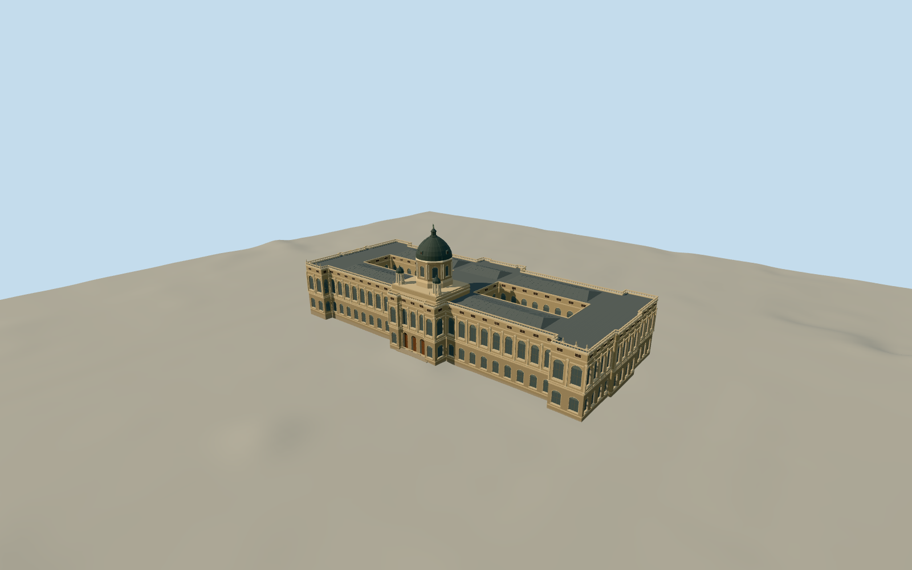

# Kunsthistorisches Museum

Vienna’s Renaissance Revival Kunsthistorisches Museum, with open courts, long wings of round-arched windows, a square-facing portal, copper dome and Pallas Athena.

Authoring state: **review-in-qa.json**. Current completion evidence is in [qa.json](qa.json) and the [completion ledger](../../../../qualla-structures/batches/qualla-003.PROGRESS.md).

- [Kunsthistorisches Museum](https://qualla.com/kunsthistorisches-museum/)

The 60 m dome height follows the approximately matching tower and dome of the Natural History Museum. Architectural offsets are measured from the surviving footprint and exterior photos. Unphotographed rear courtyards, minor embellishments and small sculpture are estimates.

The museum facade is the standing configuration. Temporary coverings, banners and construction scaffolds visible in one photograph were disregarded. Some entry grades and stair geometry are approximate.

Build: `node content/worldgen/source/places/u2/u2e/kunsthistorisches_museum/models/generate-kunsthistorisches-museum.mjs`. Add `--check` to verify exact regeneration. 61802 triangles; 6 materials; no embedded photographs.
