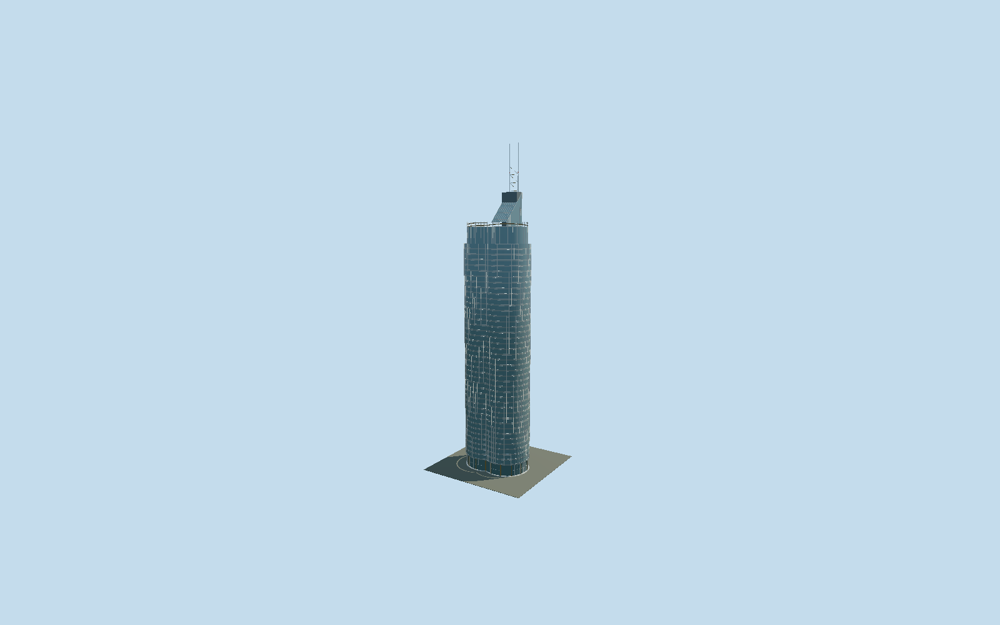

# Millennium Tower, Vienna

Two interlocking cylindrical glazed office volumes, projecting service spine, narrow silver mullions and glass spandrels, recessed entry columns, stepped lamella-screened hood, sloping glass crown and paired braced antenna masts.

## Evidence and reconstruction

Published dimensions and reconstructed details are separated in spec.json. Primary references:

- [Reference](https://www.millenniumtower.at/en/architecture/)
- [Reference](https://www.millenniumtower.at/en/office/)
- [Reference](https://www.podrecca.com/projects/millenium-tower)
- [Reference](https://www.atp.ag/en/projects/millennium-tower-vienna/)
- [Reference](https://ifgroup.org/en/project/millennium-tower-vienna)
- [Reference](https://www.tandfonline.com/doi/abs/10.2749/101686699780481961)
- [Reference](https://www.openstreetmap.org/way/105310525)

No third-party geometry, photograph or bitmap texture is embedded. Shared surface graphs come from the central library; vertex tints carry model colors. Glazing uses PBR materials; transparent surfaces are declared per model.

## Model and axes

268,856 triangles; 536,724 vertices; 4 material groups; 2,518,992 bytes. Native bounds: -21.515, 0.000, -17.748 to 21.598, 202.000, 17.580. Source hash: `sha256:9b5fe07fede15c7a47aee383c0e988589cfb4da45ba0a2d2cef9076b7ea63307`.

{"up":"+Y","longitudinal":"+X between cylindrical lobes in cached map frame","front":"-Z at the concave facade seam; +Z toward projecting rear service spine","origin":"Cached mapped envelope center at ground datum"}

The geographic proposal uses exact-QID OpenStreetMap evidence. Map-derived orientation and estimated architectural details require real-site visual review; preview eligibility is distinct from geographic/fidelity approval. Map attribution: © OpenStreetMap contributors, ODbL-1.0.

## Reproduce

Run `node packages/worldgen/scripts/generate-signature-towers.mjs --ids=N0235` (or add `--check`). The generator preserves manually edited masters by checking their baseline hashes. Import through the standard authored-model workflow with optimization disabled; then capture all QA cameras, including shared-surface views.

## Pending work

- Original detailed instanced master remains exactly reproducible at 2518992 bytes, sha256:9b5fe07fede15c7a47aee383c0e988589cfb4da45ba0a2d2cef9076b7ea63307, 268856 expanded /30296 stored triangles in four parts and 84 placements. It is retained as the detailed source; separate browser variants use authored geometry instead of loading it as the default model. Four levels preserve twin fitted cylinders and concave front seam, projecting service spine, setback glass hood/lamella screen, sloped crown and paired braced 202 m masts. Skyline combines measured canonical graph means and an area-weighted glazing/spandrel colour into one opaque draw, with tower-only pavement and coarse mast bracing. District corrects the older 153.4 m solid hood cap to the 150.4 m roof below separate coarse 150.6/151.4/152.2 m lamella bands, with grouped floor rhythm and coarse mast bracing; street coarsens curved-panel pitch; close keeps the 1.4 m working grid, fine metal mullions/transoms, reconstructed glazed ground floor and support columns, hood fins and mast sections. Two canonical shared metal_painted and metal_stainless graphs plus opaque glazing/recess palette provide four near groups and zero embedded images. The 50-floor owner program, 140.5 m OSM tag, working 41 cylinder rows at 3.25 m spacing, 153.4 m hood and 172 m spine are deliberately distinguished: intermediate tiers and floor subdivisions are photographic reconstructions, not surveyed elevations. Hood radius/setbacks, sloping roof, lamella brackets, column/door positions, mast dimensions and exact renovated lobby are unmeasured. Ground-floor doors remain schematic closed glazing; passage through the adjoining mall is outside this exterior asset. Separate Millennium City mall/housing/river footbridge, office interiors, actual terrain grade and roof plant are not modeled. No third-party photograph or plan is embedded or redistributed. Physical phone/laptop dense-city measurements remain pending.

This bundle follows the medium-fi standard. Medium-fi appearance and geographic fit are reviewed separately. Hash-bound visual acceptance is recorded separately after capture inspection.
