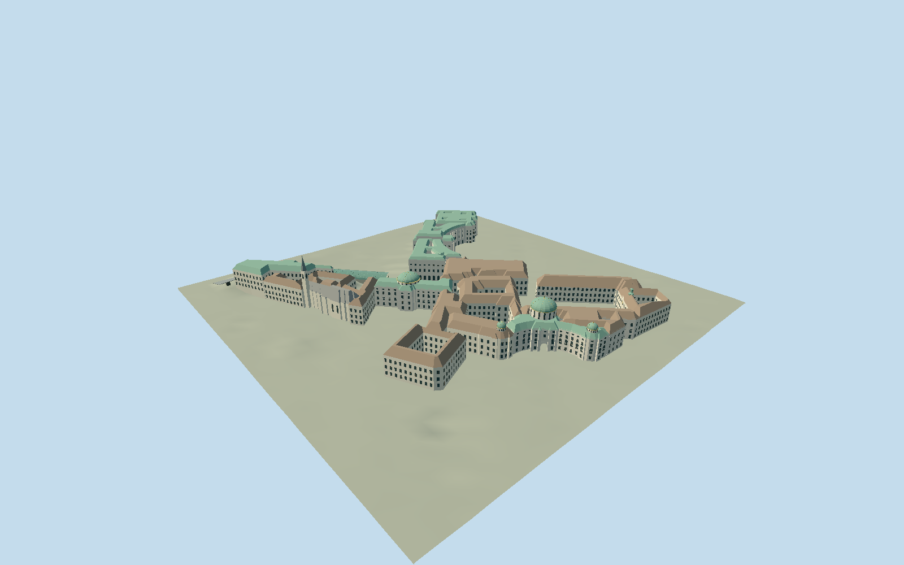

# Hofburg Palace

Individually mapped Hofburg wings around open courts, curved Neue Burg, Michaeler copper domes, Amalien clock turret, library dome, riding school and Stallburg courtyard, Augustinian spire, Albertina terrace and Palmenhaus.

## Evidence and reconstruction

Published dimensions and reconstructed details are separated in spec.json. Primary references:

- [Reference](https://www.openstreetmap.org/relation/3898175)
- [Reference](https://www.burghauptmannschaft.at/Themen/Hofburg-Wien/)
- [Reference](https://www.burghauptmannschaft.at/Liegenschaften/Liegenschaften/Wien/Hofburg-Wien-/Michaelertrakt.html)
- [Reference](https://www.burghauptmannschaft.at/Liegenschaften/Liegenschaften/Wien/Hofburg-Wien-/Neue-Burg.html)
- [Reference](https://www.burghauptmannschaft.at/Liegenschaften/Liegenschaften/Wien/Hofburg-Wien-/Amalientrakt.html)
- [Reference](https://commons.wikimedia.org/wiki/File:Hofburg_Vienna_plan.svg)
- [Reference](https://commons.wikimedia.org/wiki/File:Wien_Hofburg_Michaelertrakt.jpg)
- [Reference](https://commons.wikimedia.org/wiki/File:Wien_Hofburg_Neue_Burg_Heldenplatz.jpg)
- [Reference](https://commons.wikimedia.org/wiki/File:Leopoldinischer_Trakt_Vienna_August_2006_002.jpg)
- [Reference](https://commons.wikimedia.org/wiki/File:Amalienburg_Vienna_Oct._2006_004.jpg)
- [Reference](https://commons.wikimedia.org/wiki/File:Reichskanzleitrakt_Vienna_June_2006_336.jpg)

No third-party geometry, photograph or bitmap texture is embedded. Shared surface graphs come from the central library; vertex tints carry model colors. Glazing uses PBR materials; transparent surfaces are declared per model.

## Model and axes

59,792 triangles; 124,344 vertices; 8 material groups; 5,198,592 bytes. Native bounds: -215.729, -10.000, -202.367 to 215.156, 66.700, 224.863. Source hash: `sha256:c42e9629f63ef486480159eb3d707a8fc2dd3abd53969939766c23503075a975`.

{"up":"+Y","longitudinal":"+X approximately north","front":"+Z approximately east","origin":"Exact-Q46242 frame;Y0 reconstructed18.85m Wiener Null Michaeler working datum."}

Fresh exact-Q46242 relation3898175 and123 component ways agree within0.694mm. Native+X2.678deg points north,+Z92.678deg east; Michaeler dome fixes north-east entry,Amalien clock north-west,Neue Burg curved garden/front wings south-west and Albertina/Soravia terrace south-east. Main envelope includes open courts and is not an occupied replacement mask. Retained public Wien1m DGM Float32 crop in EPSG31256 and10197-value5m native grid establishes relative grade. Heights use published Wiener Null EPSG8881 (156.68m above Adria); modelY0 is reconstructed18.85mWienerNull gate datum. Placement subtracts actual grid height at source anchor,not a nominal0floor. Albertina floor is evidence-guided+9.56m above datum,canopy15m with solid cantilever pylon. Terrain supplies Bastei earth; no duplicate land plinth or whole-precinct excavation. Other wings have modest approximate floor offsets and occupied feet extend10m below their floors. Exact architectural levels and host terrain vintage/precision remain unverified.

## Reproduce

Run `node packages/worldgen/scripts/generate-signature-towers.mjs --ids=N0245` (or add `--check`). The generator preserves manually edited masters by checking their baseline hashes. Import through the standard authored-model workflow with optimization disabled; then capture all QA cameras, including shared-surface views.

## Pending work

- Original detailed606293-triangle/52576076-byte master remains exactly reproducible atsha256:79084a947c6c83616f25e862fab35a882027b1012e91d045614889f344256de9 from hofburg-palace-model.mjs#hofburgStudy.build. Reviewed independent model repairs sampled jagged roofs,clipped partial court masks,Albertina floor/filled bastion,canopy pylon,conservatory ends and garden terrace.
- Fresh exact-Q46242 relation3898175 and123 component ways agree within0.694mm. Native+X2.678deg points north,+Z92.678deg east; Michaeler dome fixes north-east entry,Amalien clock north-west,Neue Burg curved garden/front wings south-west and Albertina/Soravia terrace south-east. Main envelope includes open courts and is not an occupied replacement mask. Retained public Wien1m DGM Float32 crop in EPSG31256 and10197-value5m native grid establishes relative grade. Heights use published Wiener Null EPSG8881 (156.68m above Adria); modelY0 is reconstructed18.85mWienerNull gate datum. Placement subtracts actual grid height at source anchor,not a nominal0floor. Albertina floor is evidence-guided+9.56m above datum,canopy15m with solid cantilever pylon. Terrain supplies Bastei earth; no duplicate land plinth or whole-precinct excavation. Other wings have modest approximate floor offsets and occupied feet extend10m below their floors. Exact architectural levels and host terrain vintage/precision remain unverified.
- Reconstructed hip slopes/ridges derive from straight skeletons of mapped simplified wing plans; checked numerical roof-plans.json is source input,not surveyed roof planes. Court holes crossing wing boundaries are clipped by polygon difference. Measured acquisition vintage,window counts and architectural floor levels are not asserted.
- Seven common plaster,limestone,ceramic tile,copper,timber,granite and painted-metal graphs plus opaque PBR glazing. Carved limestone shares wall graph;small gold pieces share tinted painted metal,slate spire shares tinted ceramic pattern. Those are explicit medium-fi approximations,no embedded/copy textures.
- Imperial figurative statues,fountains,heraldic reliefs,equestrian monuments,Palmenhaus centralcrosspavilion,balustrade balusters and fine capitals are simplified/omitted. No fully navigable interiors,underground rooms or neighbouring Michaelerkirche.
- Public1mDGM under occupied roofs interpolates and does not survey floor levels. Native5m fixture smooths stairs; source/medium display resamples to4m and clamps only beyond bounded evidence. Physical laptop/phone measurements remain pending.

This bundle follows the medium-fi standard. Medium-fi appearance and geographic fit are reviewed separately. Hash-bound visual acceptance is recorded separately after capture inspection.

## Additional geographic data

Map geometry © OpenStreetMap contributors, ODbL-1.0. Photographs are linked reference only; no third-party pixels or meshes distributed.
