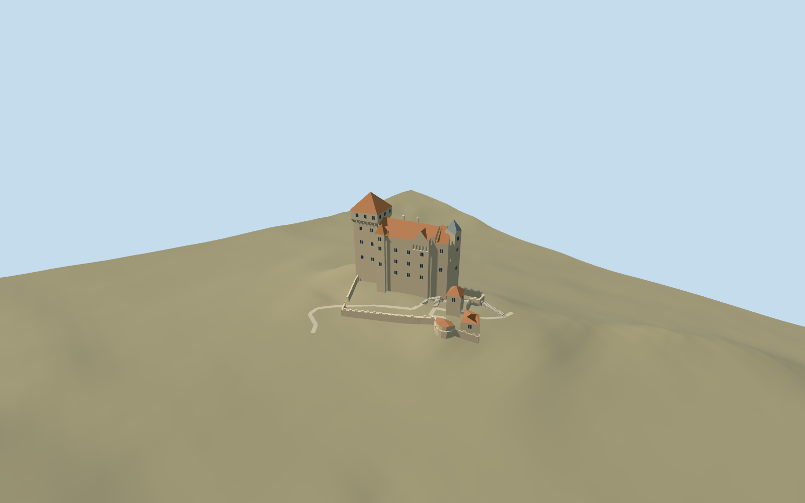

# Liechtenstein Castle

Current Austrian Burg Liechtenstein exterior draft: tall west keep with corbel gallery,round corner oriel and red pyramidal roof;long palas,five open upper arches,grey-roofed east tower,south turret,lower arched gatehouse and mapped curtain wall/current service buildings.

## Evidence and reconstruction

Published dimensions and reconstructed details are separated in spec.json. Primary references:

- [Reference](https://api.openstreetmap.org/api/0.6/map?bbox=16.2685,48.0915,16.272,48.0937)
- [Reference](https://www.burgliechtenstein.eu/de/die-burg.html)
- [Reference](https://www.burgliechtenstein.eu/de/die-burg/zeittafel.html)
- [Reference](https://www.burgliechtenstein.eu/images/site/slider.jpg)
- [Reference](https://www.burgliechtenstein.eu/images/uploads/images/headerbilder_klein/burg03.jpg)
- [Reference](https://www.burgliechtenstein.eu/images/uploads/images/Oliver-Bolch_Burg-Liechtenstein-010.jpg)
- [Reference](https://www.burgliechtenstein.eu/images/uploads/images/Burg/Aborttrum.1jpg.jpg)

Five existing shared256-square material graphs,flat glass,linear tints and metric repeats. No embedded/new image,downloaded mesh or photo texture. Natural rocky ridge is separate terrain.

## Model and axes

5,225 triangles; 15,675 vertices; 5 material groups; 630,252 bytes. Native bounds: -25.041, -10.006, -19.945 to 49.943, 42.000, 47.877. Source hash: `sha256:40373d3cba18b61a02241020786c81a9a125bfa97051c2aa9193b1fdf9143a20`.

{"up":"+Y","longitudinal":"West keep is at negative plan X; palas/east tower and upper forecourt extend east. Native +X east,+Z south;heading0.","origin":"Site anchor; Y0 standard PMTiles working datum."}

The inspected exterior picture supports the tall west keep, pale masonry, tiled palace wings, south arcade and slimmer east tower. Retained east/south map geometry sets approximate footprint, scale and orientation. Standard viewer PMTiles supply the ridge; main architecture is raised3m above its coarse crest, bounded toes reach sampled ground, lower gate/auxiliary floors clear it and court routes/walls share the sampler across levels. The natural ridge is supplied by host terrain. Anchor 16.270299868,48.092690906; heading 0; standard PMTiles datum 302.080059918783m. Floors are reconstructed and foundations extend below the coarse sampled ground.

## Reproduce

Run `node packages/worldgen/scripts/generate-signature-towers.mjs --ids=N0302` (or add `--check`). The generator preserves manually edited masters by checking their baseline hashes. Import through the standard authored-model workflow with optimization disabled; then capture all QA cameras, including shared-surface views.

## Pending work

- Approximate current exterior and fit from inspected picture and standard viewer PMTiles; no bespoke survey or exact thresholds.
- Detailed original master/hash/recipe preserved. Tower profiles, facade/arcade ornaments, restoration fixtures and reconstructed floor levels are interpreted; interiors and collision excluded.
- Four common limestone/tile/slate/aggregate graphs plus explicit glass color slot, zero embedded images. No broad duplicated terrain, forest geometry or ground cutout.
- Footprint replacement remains off; physical-device timing unmeasured.

This bundle follows the medium-fi standard. Medium-fi appearance and geographic fit are reviewed separately. Hash-bound visual acceptance is recorded separately after capture inspection.

## Additional geographic data

©OpenStreetMap contributors;Burgverwaltung L.Fasching/Oliver Bolch.
