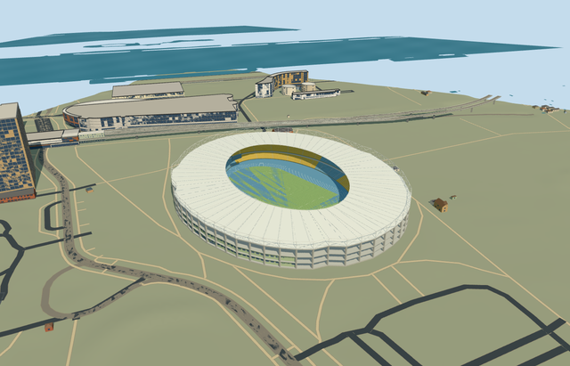

# N0709 — Ernst-Happel-Stadion

Reviewed 2026-10-20 in one continuous author/build/inspect/fix round.

## Appearance

Inspected47 current portable/shared/medium-fi/native-site frames in one ordinary-picture/map/build/inspect/fix round. Specific mapped oval with closed shallow white annular roof and true open pitch, renderable underside/radial beams, outer white collar truss/posts/diagonals, open inner catwalk/guardrail, exposed concrete columns/floor belts/open bays, pale green two-storey curved frontage with windows and main entrance glazing, three covered blue/yellow stepped seating tiers/concourses/radial aisles, blue athletics surface, neutral football field/linework/goals and two supported end boards. Refined entrance glazing and attached board brackets during construction. Accepted views show no unintended missing roof faces, floating screens or closed-over pitch. Flat-facet lighting remains intentionally simplified.

## Shared materials and browser levels

Four existing shared256-square graphs: concrete_plain, metal_painted, window_grid and fabric_canvas. Concrete supplies the exposed frame; tinted paint supplies roof, steel, seats, green frontage, track, markings and neutral boards; window-grid supplies closed glazing; canvas grain is an explicit approximation for the green playing surface. Semantic palette roles merge into five near-level draws. Each shared graph is read once and eviction releases model geometry. All six current GLBs contain zero embedded images/copied pixels, canonical shared references, separate runtime POSITION/NORMAL streams and equal counted CPU/GPU geometry bytes. No bespoke bitmap or building photo atlas was created.

| Level | Triangles | Bytes | Draws |
| --- | ---: | ---: | ---: |
| skyline | 752 | 75572 | 1 |
| district | 3790 | 329068 | 5 |
| street | 15958 | 1299872 | 5 |
| closeup | 29762 | 2466096 | 5 |

Inspected24 current medium-fi frames at street/block/skyline distances, noon/late afternoon, Economy/High, neutral silhouette, matched levels and transitions. Skyline retains the annular roof/opening, lower shell, three colored tiers and field; district adds frame/frontage windows and roof collar; street and closeup add radial roof structure, seating rows/aisles, railings, track/field lines and entrance/board/goal details. Initial skyline plus district404640bytes. Synthetic context tests appearance; separate native fixture tests approximate geographic fit. Physical ordinary-laptop/phone and dense-city timing measurements remain pending. Levels752/3790/15958/29762 triangles; at most five draws.

## Approximate map fit

Retained exact-QID OSMrelation37185/native parent52776558170433 identifies Q185741 and controls the280.067x235.268m outer oval and mapped central roof opening. Own anchor16.420911482,48.207193552/global heading0/native east-south; internal X[.35312278685873716,-.9355769863571457]/Z[.9355769863571457,.35312278685873716] retains its long-axis orientation. Field centre/bowl front use bounded allocations inside that opening; fine frontage/section/entry/screen orientation retains20degree/2m approximation. Only the stadium parent shell is replaced. All113 independent resident inputs among114 originals (376 wider records), original6m terrain/native roads and797098.459312224m2 water remain unchanged. A numerical parent remainder of1.2789769243681803e-11m2 is below the1e-7m2 threshold and has no visible old shell; loaded record count is114, not113. Failure restores114 originals and all four levels unload with zero live model geometry. Bounded occupied perimeter feet/internal sports floor meet coarse native grade; floor-.192003m relative to159.075297m datum. No whole-site slab, practice grounds/railway/parking mesh, flattening or ground/water cutout.

## Limits

Original medium-fi exterior follows four actually viewed ordinary2010/2014/2016/2017 bowl/exterior/aerial/roof pictures. This is a reference-era appearance; later roof finishes and equipment changes are unverified. Native26.7m height has no qualifying dimension or source. Overall collar26.7m, perimeter floor belts.3/5.8/11.6/18.8m, outer/inner roof20/23m, seating1.2..5.7/6.8..11.4/12.5..17.7m and fine row/column/brace/catwalk/frontage/screen inventory are picture-led estimates. The105x68m football pitch and blue athletics surface use representative permanent-sport dimensions, not an athletics certification or as-built survey. Canvas grain approximates grass. No roof over the field, furnished service/office interior, spectators/event fixtures, copied text/live graphics/photo atlas, adjacent practice grounds or whole-site reconstruction is authored. Coarse DEM contacts are not surveyed foundations, drainage or flood levels.

## Selected checks

Six Khronos files: zero errors/warnings.411 actual mesh/material/contact checks; 47 current inspected views. Scene validation/sim30 and strict selected medium-fi audit pass. Source/runtime/LOD hashes and material bindings verified.

Rebuild: node packages/worldgen/scripts/generate-additional-landmarks.mjs --ids=N0709; node packages/worldgen/scripts/import-next-1000-models.mjs --ids=N0709; node packages/tooling/scripts/generate-landmark-lods.mjs --ids=N0709 --force.

Source: sha256:345ed06562de395d7f515d835fe45ead5f8f7609fc4cccdb755380d362064d54

Runtime: sha256:f683f48745730c813118c068245ded24f59c5f6246335ec5ee8a31a5c12ad4fe

Input: sha256:9c814ca626baa1e6a6edeb4c7471b9a2d6c5461758de99c6d7258c0cb4fad79c

## Viewed ordinary pictures

https://commons.wikimedia.org/wiki/File:Ernst-happel-stadion_vienna.jpg — Arne Müseler / arne-mueseler.com; CC-BY-SA-3.0-DE. Viewed only; no pixels copied.

https://commons.wikimedia.org/wiki/File:Ernst-Happel-Stadion_Dach_01.jpg — Niki.L; CC-BY-SA-4.0. Viewed only; no pixels copied.

https://commons.wikimedia.org/wiki/File:Ernst-Happel-Stadion_(4511)_stitch_IMG_0738_-_IMG_0740.jpg — Tokfo; CC0-1.0. Viewed only; no pixels copied.

https://commons.wikimedia.org/wiki/File:Ernst-Happel-Stadion_-_panoramio.jpg — Mister No; CC-BY-3.0. Viewed only; no pixels copied.
