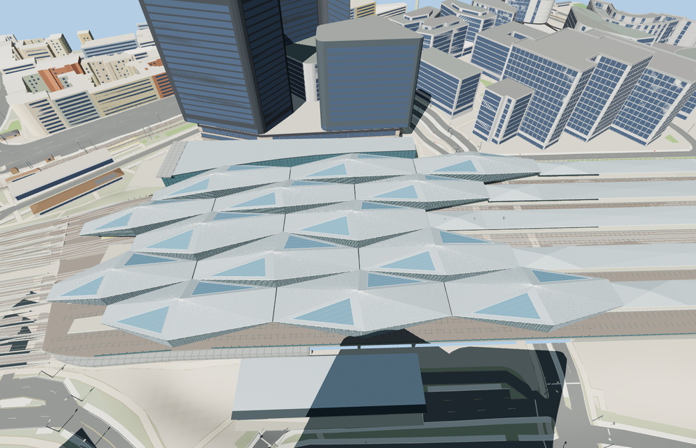

# Wien Hauptbahnhof

Fourteen folded silver roofs and triangular clerestories cover the rail deck. Five island platforms connect to stepped eastern shelters. The clock and lettered glass entrance face Südtiroler Platz, with a lower south concourse at the opposite side.

The 34,104-triangle source rebuilds byte for byte. Skyline, district, street and close-up use 970, 3,086, 13,550, 33,144 triangles. Skyline and district total 393,872 bytes. Six GLBs validated and 38 current views were inspected.

The model replaces 38 mapped station parts and preserves 221 surrounding buildings and 850 transportation records. All four tiers pass checks for six open doorway samples, fourteen roof crests, twelve rail passages, five island-platform floors and four surrounding terrain samples. Ground, water and landcover restore on unload.

PMTiles controls the station footprint, the fourteen folded canopy footprints, eastern shelters and twelve sampled through-track lanes. Roof folds, concourse levels and interior circulation are reconstructed from photographs and standard viewer terrain. The authored geometry covers the public entrances, station deck and above-ground platforms. Trackside equipment and public concourses are static representations.

Rebuild with `node packages/worldgen/scripts/generate-wien-hauptbahnhof.mjs`. Append `--check` to compare exact bytes. Use `--ids=wien_hauptbahnhof` for targeted import, LOD, placement and readiness.
