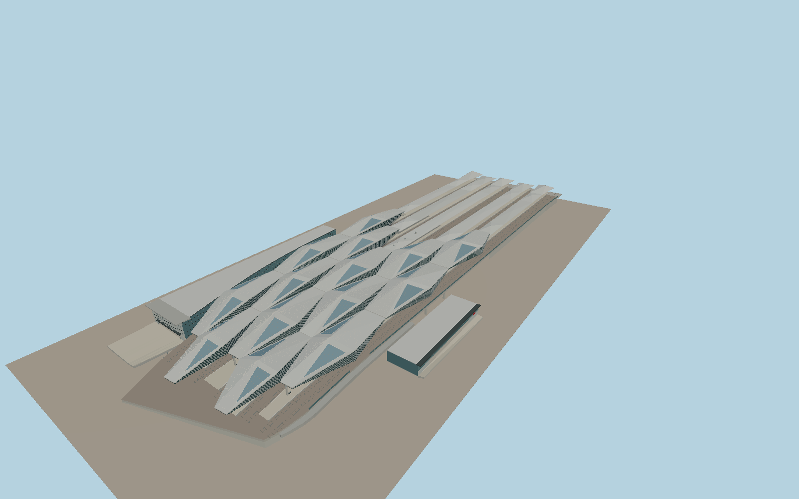

# Wien Hauptbahnhof

Fourteen folded silver roofs and triangular clerestories cover the rail deck. Five island platforms connect to stepped eastern shelters. The clock and lettered glass entrance face Südtiroler Platz, with a lower south concourse at the opposite side.

Run `node packages/worldgen/scripts/generate-wien-hauptbahnhof.mjs` to rebuild the source master. Append `--check` to compare the exact bytes. Use `--ids=wien_hauptbahnhof` for targeted import, LOD generation and placement.

PMTiles controls the station footprint, the fourteen folded canopy footprints, eastern shelters and twelve sampled through-track lanes. Roof folds, concourse levels and interior circulation are reconstructed from photographs and standard viewer terrain.

The authored geometry covers the public entrances, station deck and above-ground platforms. Trackside equipment and public concourses are static representations.

Original geometry follows the repository license. Map data is © OpenStreetMap contributors under ODbL-1.0 via Protomaps. Terrain samples are described in terrain-grid.json. Local photographs serve as visual references for the authored geometry. Current acceptance is recorded in qa.json.
