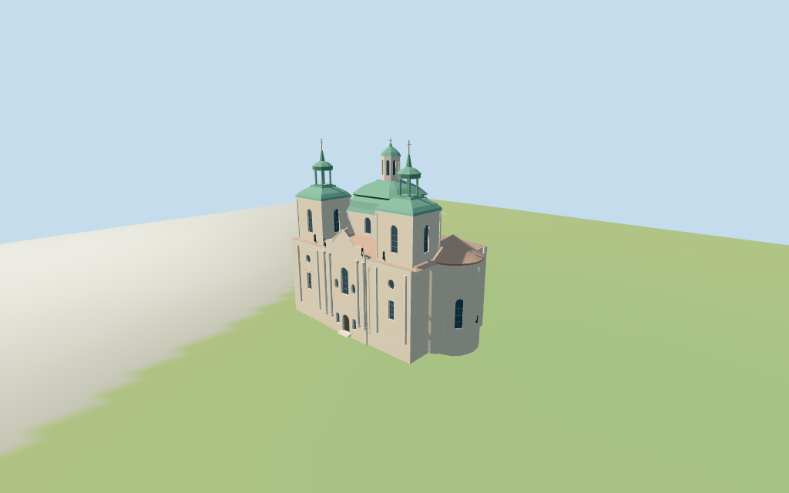

# Church of Saint Nicholas

Individual medium-fi Old Town Saint Nicholas: pale south Baroque front with paired columns,arched/oval fields,curved crown and abstract sculpture;two mapped square towers with green bell/onion crowns and genuinely open upper lanterns;central octagonal pale drum,two-tier green bell roof and smaller white lantern;red tile side roofs,east rounded apse and west secondary portal/curved steps. Five existing shared256² graphs plus local glazing/gold accents,seven groups and four browser LODs. Exact map controls retained;fine architecture and ground joins approximate.

## Evidence and reconstruction

Published dimensions and reconstructed details are separated in spec.json. Primary references:

- [Reference](https://commons.wikimedia.org/wiki/File:Kostel_sv._Mikuláše_-_Praha,_Staré_město_-_Staroměstské_náměstí.jpg)
- [Reference](https://commons.wikimedia.org/wiki/File:West_facade_of_the_Church_of_Saint_Nicholas_in_Old_Town,_Prague_(4265).jpg)
- [Reference](https://commons.wikimedia.org/wiki/File:Praha,_Staré_Město,_kostel_sv._Mikuláše,_apsida_01.jpg)

Five existing shared256² lime plaster,raw limestone,flat tile,painted metal and plain wood graphs,with local blue-grey glazing and muted gold accents;seven groups. Green metal tints abstract patinated copper. Linear tints,metric UVs,flat normals,no embedded images,bespoke textures or baked lighting.

## Model and axes

12,180 triangles; 36,540 vertices; 7 material groups; 1,465,700 bytes. Native bounds: -23.950, -0.706, -12.969 to 21.700, 41.500, 13.940. Source hash: `sha256:2b59c922e2ea92155cd0015c94f128d41d47525765dc42eaec78595282901297`.

{"x":"east toward rounded apse","y":"up","z":"south toward ornate twin-tower frontage/Old Town Square"}

Standard viewer DEM datum203.248140m;selected perimeter-0.35 to0.72m relative to it. Floor0.5m;adaptive footings crossY=0 and extend below retained samples. No flattening,cutout or road replacement. Exact square/pavement,threshold/curved-stair/base and adjoining-house joins,altitude and walking remain unverified.

## Reproduce

Run `node packages/worldgen/scripts/generate-additional-landmarks.mjs --ids=church_of_saint_nicholas` (or add `--check`). The generator preserves manually edited masters by checking their baseline hashes. Import through the standard authored-model workflow with optimization disabled; then capture all QA cameras, including shared-surface views.

## Pending work

- Exact retained way/27859115 and Q2595999 identify Saint Nicholas in Prague Old Town,not the other Prague Saint Nicholas church. Current standard viewer whole35184399947947 and six tower/dome/lantern parts35184834500034–39 retain83 raw outline points and all properties,with the earlier whole/multilingual tags and same-ID Saint Nicholas POI. Anchor[14.419905274,50.08790284] and heading0.190715332884rad unchanged;no horizontal rescale. Native+X east rounded apse,−X west secondary portal,+Z south ornate twin-tower frontage/Old Town Square. Named square and south-front/east-apse pictures resolve the undirected axis;facing approximate3°. Neighboring houses to north/west and the southwest square-edge buildings remain host content.
- Current map whole height18m;two lower tower parts28m,two upper crown/lantern parts36m,central octagonal drum/dome part32m,and central lantern part41m. These tags are retained as nominal whole/component controls,not surveyed dimensions or proof of exact roof datum. Above floor0.5m:body cornice18m,tile roof22.6m;lower tower wall28m,green lower helmet30.7m,open upper lantern30.7–34.1m and upper bulb36m;thin spire/finial tips40.8m are picture estimates beyond the upper-part tag. Central drum25.5m/copper bell roof32m,white lantern37.2m and copper cap/finial41m. Facade crown23.2m,portals/steps,window/bay partitions,apse roof22.5m,decorative figures/crest/capital/scroll profiles are estimates. No independent height facts.
- Standard viewer DEM datum203.248140m;selected perimeter-0.35 to0.72m relative to it. Floor0.5m;adaptive footings crossY=0 and extend below retained samples. No flattening,cutout or road replacement. Exact square/pavement,threshold/curved-stair/base and adjoining-house joins,altitude and walking remain unverified.
- Individual medium-fi exterior from three matching pictures and standard PMTiles/DEM. A mislabeled reference was excluded after actual inspection. Whole/part height tags are nominal controls;finials,roof/bay profiles,columns,curved pediments,statues and west semicircular stairs are estimated or abstracted. No faithful sculpture/inscriptions,door studs,window artwork,interior/bells,engineering,current finish,concealed northern joins or exact street/square/threshold/step/base contact. Glazing/doors are recessed panes/timber;the two upper tower lantern cores are open geometry. Italian palazzo neighbors are synthetic fixtures;physical phone/laptop timing unverified.
- Skyline retains south twin-tower front,green bell/onion crowns and open tower lanterns,central octagonal bell dome/white lantern,east apse and red tile roof. District adds shared surfaces,main portal/arched/oval lights,columns and tower/drum openings. Street adds full bay rhythm,mullions,pilasters,curved step fan,pediment/statue abstractions and roof ribs. Close-up/master refine circles.

This bundle follows the medium-fi standard. Medium-fi appearance and geographic fit are reviewed separately. Hash-bound visual acceptance is recorded separately after capture inspection.

## Additional geographic data

©OpenStreetMap contributors;Protomaps;Mapzen/USGS terrain tiles.
