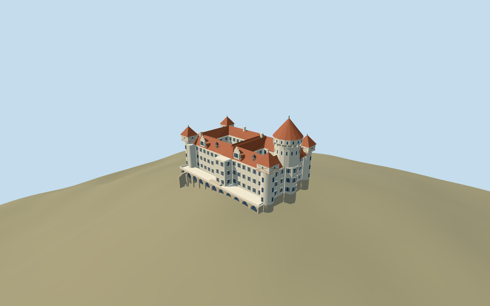

# Konopiště Castle

Cream quadrangular castle with two mapped open courts,terracotta pitched roofs,dominant round keep with corbelled upper gallery/red cone,square-topped corner rooms with broad timber crosses,stepped gabled dormers,stone terrace and open pointed courtyard loggia.

## Evidence and reconstruction

Published dimensions and reconstructed details are separated in spec.json. Primary references:

- [Reference](https://www.zamek-konopiste.cz/en/about/history)
- [Reference](https://www.zamek-konopiste.cz/en/photogalleries/10225-exteriors)
- [Reference](https://www.zamek-konopiste.cz/pamatky/konopiste/fotogalerie/exteriery/imu00001-2-.jpg)
- [Reference](https://www.zamek-konopiste.cz/pamatky/konopiste/fotogalerie/exteriery/IMG_9003.JPG)
- [Reference](https://www.zamek-konopiste.cz/pamatky/konopiste/fotogalerie/exteriery/IMG_8995.JPG)
- [Reference](https://www.zamek-konopiste.cz/pamatky/konopiste/fotogalerie/exteriery/img00l51.jpg)
- [Reference](https://commons.wikimedia.org/wiki/File:Konopiste_hlavni_vez.JPG)
- [Reference](https://commons.wikimedia.org/wiki/File:Konopiste_panorama_z_jizni_terasy.JPG)
- [Reference](https://commons.wikimedia.org/wiki/File:Konopiste_vych_cast_jizniho_pruceli_a_jv_narozni_vez.JPG)
- [Reference](https://commons.wikimedia.org/wiki/File:Konopiste_Castle_courtyard_-_Czech_Republic_-_panoramio.jpg)
- [Reference](https://www.openstreetmap.org/relation/282741)

No third-party geometry, photograph or bitmap texture is embedded. Shared surface graphs come from the central library; vertex tints carry model colors. Glazing uses PBR materials; transparent surfaces are declared per model.

## Model and axes

17,454 triangles; 52,362 vertices; 6 material groups; 2,098,280 bytes. Native bounds: -42.650, -14.398, -25.396 to 42.900, 50.100, 31.800. Source hash: `sha256:66f4ddc7692e3d7fc79cb7b76d70fec6074d000ff37be372bd88dad840f19471`.

{"up":"+Y","lateral":"+X approximately east along cached mapped axis; axis is undirected","longitudinal":"+Z interpreted as the photographed southern terrace side; signed registration pending","origin":"Site anchor; Y0 standard PMTiles working datum."}

Inspected picture confirms the cream quadrangular castle, dominant round keep with corbelled upper gallery/red cone, red roofline and timber-cross corner rooms. Retained mapped outer/two-court rings and standard viewer PMTiles set approximate location, scale and south-terrace orientation. The original4.8m reconstructed court/terrace floor receives a0.6m working rise; bounded wall bottoms extend beneath the coarse sampled hill. Anchor 14.656541475,49.779576024; heading -0.117875714253; standard PMTiles datum 384.34631015663166m. Floors are reconstructed and foundations extend below the coarse sampled ground.

## Reproduce

Run `node packages/worldgen/scripts/generate-signature-towers.mjs --ids=konopiste_castle` (or add `--check`). The generator preserves manually edited masters by checking their baseline hashes. Import through the standard authored-model workflow with optimization disabled; then capture all QA cameras, including shared-surface views.

## Pending work

- Approximate current exterior from one inspected picture and standard viewer PMTiles, without survey accuracy or exact thresholds.
- Original detailed architectural master/hash/recipe preserved. Court, terrace, roof and tower dimensions remain reconstructed.
- Five common graphs plus explicit dark recess slot, zero embedded images. Hill/forest supplied by host; no embedded hill, terrain cutouts or interiors.
- Footprint replacement remains off; physical-device timing unmeasured.

This bundle follows the medium-fi standard. Medium-fi appearance and geographic fit are reviewed separately. Hash-bound visual acceptance is recorded separately after capture inspection.

## Additional geographic data

© OpenStreetMap contributors;National Heritage Institute/official Konopiště operator;primary photographers Lukáš Kalista and Sergey Ashmarin (external references).
