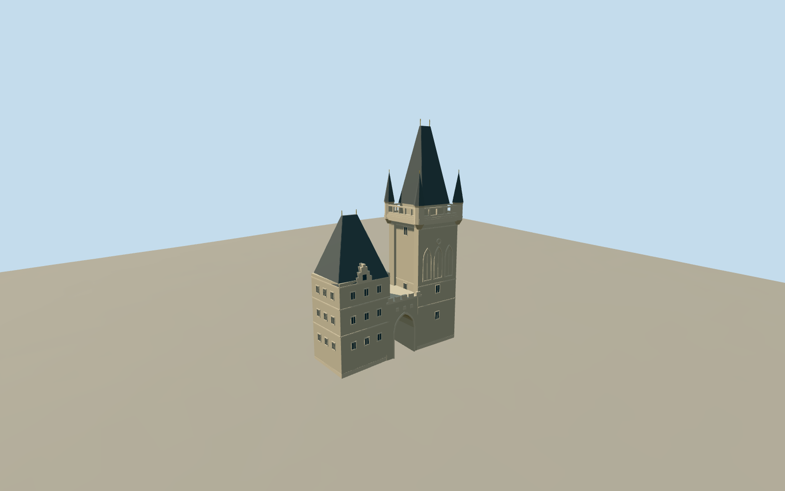

# Malá Strana Bridge Tower

Specific connected Mala Strana bridge-side compound: tall stone Gothic tower with blind tracery, open upper gallery/four corner turrets, steep closed slate hip roof/two finials; lower southern tower with its distinct steep slate roof/stepped dormer; genuine open pointed connecting gate and selected crenellations/blank geometric plaques. Four existing shared sandstone/raw-stone/slate/paint graphs, original simplified relief and closed window/door insets. No complete Charles Bridge, copied heraldry/text/photos, neighboring houses, bridge statues or furnished interior.

## Evidence and reconstruction

Published dimensions and reconstructed details are separated in spec.json. Primary references:

- [Reference](https://commons.wikimedia.org/wiki/File:Prague_Charles_Bridge_Mala_Strana_Tower-01.jpg)
- [Reference](https://commons.wikimedia.org/wiki/File:20190204_LittleTown_4052_(47416471532).jpg)

Specific connected Mala Strana bridge-side compound: tall stone Gothic tower with blind tracery, open upper gallery/four corner turrets, steep closed slate hip roof/two finials; lower southern tower with its distinct steep slate roof/stepped dormer; genuine open pointed connecting gate and selected crenellations/blank geometric plaques. Four existing shared sandstone/raw-stone/slate/paint graphs, original simplified relief and closed window/door insets. No complete Charles Bridge, copied heraldry/text/photos, neighboring houses, bridge statues or furnished interior.

## Model and axes

4,584 triangles; 13,752 vertices; 4 material groups; 553,024 bytes. Native bounds: -6.295, -1.116, -6.594 to 6.331, 46.371, 24.175. Source hash: `sha256:1e14e8f4b74e7cfbbd08ea8302fed0d75ddca57f92f77a1940e9c0fada69df6d`.

{"x":"east","y":"up","z":"south"}

The geographic proposal uses exact-QID OpenStreetMap evidence. Map-derived orientation and estimated architectural details require real-site visual review; preview eligibility is distinct from geographic/fidelity approval. Map attribution: © OpenStreetMap contributors, ODbL-1.0.

## Reproduce

Run `node packages/worldgen/scripts/generate-additional-landmarks.mjs --ids=mala_strana_bridge_tower` (or add `--check`). The generator preserves manually edited masters by checking their baseline hashes. Import through the standard authored-model workflow with optimization disabled; then capture all QA cameras, including shared-surface views.

## Pending work

- Specific connected Mala Strana bridge-side compound: tall stone Gothic tower with blind tracery, open upper gallery/four corner turrets, steep closed slate hip roof/two finials; lower southern tower with its distinct steep slate roof/stepped dormer; genuine open pointed connecting gate and selected crenellations/blank geometric plaques. Four existing shared sandstone/raw-stone/slate/paint graphs, original simplified relief and closed window/door insets. No complete Charles Bridge, copied heraldry/text/photos, neighboring houses, bridge statues or furnished interior.
- Retained exact-QID OSMway839278891 fixes the tall tower. Native parent35185211367723 and its body/gallery/four turrets/roof plus the directly connected lower tower/gateway supply13 component controls. Ordinary bridge-side pictures identify the joined unequal towers and gate. Anchor14.40685391,50.087307246, global heading0/native east-south; internal axes follow the retained near-cardinal footprint. Facade from bridge faces approximately east; fine ornament/reverse facade retains20degree/2m uncertainty. The lower tower/gate are visually connected native compound controls, not a fabricated extension of the exact-QID tall footprint.
- Native PMTiles attributes retain tall body26m, gallery29m, turrets36m, roof/finial46m; lower body17m/roof29m, gateway12m and two edge parts9m. These are ordinary mapped attributes, not surveyed masonry heights. Roof rise/ridge length, open gallery rail/pier inventory, blind tracery/dormer/windows, pole tips and hidden reverse details are picture-led medium-fi estimates within those component height envelopes.
- Retain original6m standard Mapzen grid, native roads/paths/water and all independent surrounding houses. Replace only the13 corresponding tower/roof/gateway shells. Each occupied tower has a bounded buried foot; gate piers reach native ground and the actual opening extends below original grade so the native passage stays open. No broad city platform, terrain flattening, ground or water cutout. Common attachment height is the highest sampled compound rim plus0.08m; foundation depth and street contact remain coarse-DEM estimates. The mapped neighboring annex part35184890435416 overlaps the lower tower: subtract only its overlap with the13 owned component footprints and prove its remaining outside shape unchanged. Other independent buildings remain exact. Exact clipping can leave sub-square-micrometer numerical fragments in owned records; these are measured separately from visible shells.
- Two ordinary2017/2019 bridge-side pictures carried through construction. Reverse facade, fine ornament and coarse-terrain foundation engineering remain approximate. No copied heraldry, text/photo atlas, whole Charles Bridge, neighboring house or furnished interior.

This bundle follows the medium-fi standard. Medium-fi appearance and geographic fit are reviewed separately. Hash-bound visual acceptance is recorded separately after capture inspection.
