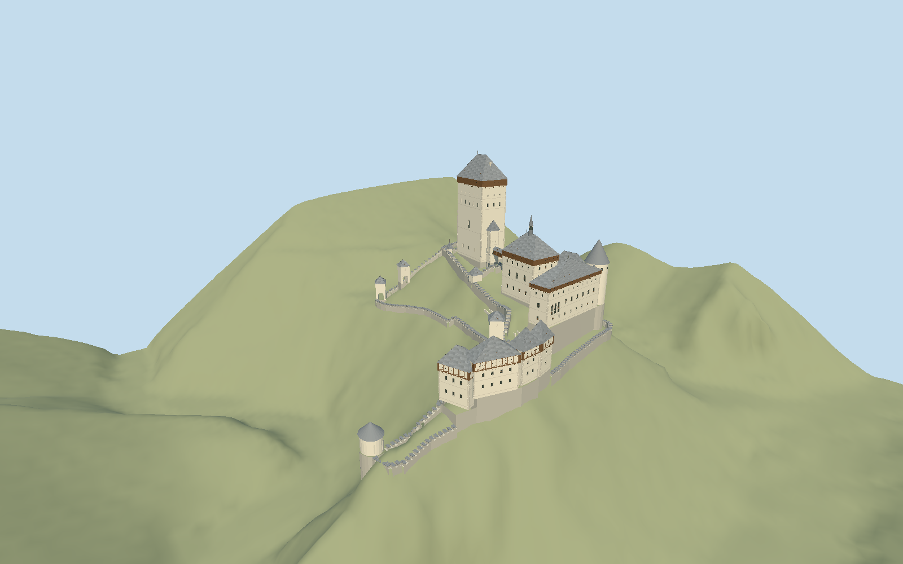

# Karlštejn Castle

Stepped Gothic castle with separately mapped Great and Marian towers, slate roofs, timber galleries, Imperial Palace and round eastern tower, Burgrave House, well tower, gatehouses, crenellated curtains and two elevated covered passages.

## Evidence and reconstruction

Published dimensions and reconstructed details are separated in spec.json. Primary references:

- [Reference](https://www.hrad-karlstejn.cz/en/about-the-castle)
- [Reference](https://www.hrad-karlstejn.cz/en/plan-your-visit/tours)
- [Reference](https://www.openstreetmap.org/relation/6706848)
- [Reference](https://www.openstreetmap.org/way/443238530)
- [Reference](https://commons.wikimedia.org/wiki/File:Karlštejn_(Sedláček,_1889).png)
- [Reference](https://commons.wikimedia.org/wiki/File:View_of_the_castle_Karlstejn_from_the_southeast._Czech_Republic.jpg)
- [Reference](https://commons.wikimedia.org/wiki/File:Burgkarlstein01.jpg)

No third-party geometry, photograph or bitmap texture is embedded. Shared surface graphs come from the central library; vertex tints carry model colors. Glazing uses PBR materials; transparent surfaces are declared per model.

## Model and axes

57,524 triangles; 117,124 vertices; 7 material groups; 4,910,988 bytes. Native bounds: -75.400, -38.299, -72.425 to 76.233, 87.891, 71.902. Source hash: `sha256:d499036d2457d914fb3877bffc6d39b5e8552241c2bb8fbe8dfc5ea3d46bfff5`.

{"up":"+Y","longitudinal":"+X 19.49 degrees north of east","front":"+Z south-southeast","origin":"Retained exact-Q266698 frame;Y0 reconstructed300mBpv working datum."}

Fresh exact-Q266698 OSM relation6706848 v27 and35 retained component ways confirm the signed frame. Native+X points70.510 degrees clockwise from north,+Z160.510 degrees. Great Tower northeast,Marian Tower below it,Imperial Palace south and Burgrave/Well southwest resolve the direction. Retained ČÚZK DMR5G2m Float32 raster in EPSG5514/Bpv and10201-value4m native grid provides relative grade. ModelY0 is the reconstructed300mBpv working datum; placement subtracts actual sampled anchor height,not a nominal floor. Component working floors use highest mapped perimeter sample plus0.25m and remain architectural estimates. Great Tower retains a60m base-to-main-roof span plus small finials,with no seven-meter court-datum explanation. Occupied foundations extend4m under grade; open courts and geological hillside remain host terrain,with no whole-enclosure replacement or cutout. Covered passages are independently elevated. Real host terrain vintage and architectural survey precision remain unverified.

## Reproduce

Run `node packages/worldgen/scripts/generate-signature-towers.mjs --ids=N0247` (or add `--check`). The generator preserves manually edited masters by checking their baseline hashes. Import through the standard authored-model workflow with optimization disabled; then capture all QA cameras, including shared-surface views.

## Pending work

- Original detailed556934-triangle/46864188-byte master remains exactly reproducible atsha256:2094e82b6eb86b1ab78993df6cc09a84d5a65e8fd2f108cb34bf698c82150b85 from karlstejn-castle-model.mjs#karlstejnStudy.build. Independent medium-fi model removes the provisional filled terraces and adapts components to retained numeric grade.
- Fresh exact-Q266698 OSM relation6706848 v27 and35 retained component ways confirm the signed frame. Native+X points70.510 degrees clockwise from north,+Z160.510 degrees. Great Tower northeast,Marian Tower below it,Imperial Palace south and Burgrave/Well southwest resolve the direction. Retained ČÚZK DMR5G2m Float32 raster in EPSG5514/Bpv and10201-value4m native grid provides relative grade. ModelY0 is the reconstructed300mBpv working datum; placement subtracts actual sampled anchor height,not a nominal floor. Component working floors use highest mapped perimeter sample plus0.25m and remain architectural estimates. Great Tower retains a60m base-to-main-roof span plus small finials,with no seven-meter court-datum explanation. Occupied foundations extend4m under grade; open courts and geological hillside remain host terrain,with no whole-enclosure replacement or cutout. Covered passages are independently elevated. Real host terrain vintage and architectural survey precision remain unverified.
- The DMR5G bare-earth service describes2009–2013 acquisition. Under buildings it interpolates; working floor estimates and steep perimeter foundation exposure require surveyed architectural elevations. The raster retains Bpv heights; no conversion to ellipsoidal heights is asserted.
- Published1889 plan guides component topology,not the restored current facade. Original window rhythms,roof silhouettes,hoarding and restored detailing remain photograph-guided approximations. Interior chapels,artworks,visitor fixtures and surrounding village/forest are excluded.
- Six shared granite,limestone,lime plaster,timber,painted metal and slate graphs; carved stone shares tinted limestone and recesses share tinted plaster. Glass uses local opaque PBR. No photographic or per-model embedded image textures.
- Covered passage deck heights,sloping stairs,well court and wall profiles remain reconstructions. Terrain owns the open courts. Fine railings/scaffolding and exact historic crenellations are simplified. Physical laptop/phone timings remain unmeasured.

This bundle follows the medium-fi standard. Medium-fi appearance and geographic fit are reviewed separately. Hash-bound visual acceptance is recorded separately after capture inspection.

## Additional geographic data

Map geometry © OpenStreetMap contributors, ODbL-1.0. Plan and photographs used as references only; no image pixels or third-party mesh included.
