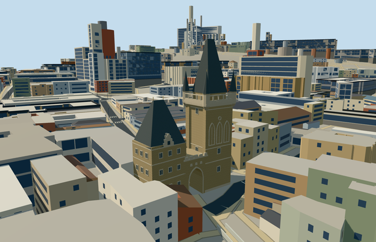

# N0631 — Malá Strana Bridge Tower

Reviewed 2026-10-20 in one continuous author/build/inspect/fix round.

## Appearance

Inspected47 current portable/shared/medium-fi/native-site views in the same construction/correction pass. The unequal connected towers, steep closed slate roofs/two ridge finials, four corner turrets and genuinely open pointed gate remain recognizable. Nearer levels add the pierced gallery, shallow blind Gothic relief, closed window insets and stepped lower dormer. Fixed the lower dormer back attachment before captures and a0.15m skyline gallery-floor gap during construction. No missing roof faces, sealed gate, unsupported visible gallery or disconnected dormer was observed in the accepted views.

## Shared materials and browser levels

Four existing shared256-square graphs: stone_sandstone, stone_sandstone_raw, slate and metal_painted. Coursed sandstone supplies the main walls; raw stone covers modeled relief/frames/gallery/footings; slate covers roof faces; painted metal supplies small dark closed panels and warm finials. Five roles merge into four near-level draws. Shared coursing is cleaner/more regular than real masonry and repairs. Each graph is read once; eviction disposes all model geometry. Zero embedded images/copied picture pixels, canonical refs, six verified GLB hashes, separate LOD position/normal streams and equal counted CPU/GPU bytes.

| Level | Triangles | Bytes | Draws |
| --- | ---: | ---: | ---: |
| skyline | 756 | 80240 | 1 |
| district | 2860 | 277752 | 4 |
| street | 4584 | 443260 | 4 |
| closeup | 4584 | 443260 | 4 |

Inspected24 medium-fi views: three distances, noon/late afternoon, Economy/High, neutral silhouette, four matched levels and transitions. Skyline keeps both unequal roofed towers, four turret spires and open gate; district adds the gallery/major blind relief/window rhythm, nearer levels add frames/bands/dormer. Levels756/2860/4584/4584 triangles; skyline plus district357992bytes, below phone3MB/laptop6MB initial targets. Shared surfaces sit coherently beside the current procedural context; that context is generalized and does not reproduce historic Prague facades. Physical laptop/phone and dense-city timings remain pending.

## Approximate map fit

Retained exact-QID OSMway839278891 identifies the tall tower. Thirteen connected native controls supply its parent/body/gallery/four turrets/roof and the lower tower/roof/gateway/edge parts. Anchor14.40685391,50.087307246, heading0/native east-south with an internal near-cardinal mapped axis; ordinary bridge-side pictures establish tall tower north, lower tower south and approximate eastern main face. Fine facade/reverse details retain20degree/2m uncertainty. All1030 independent resident inputs among1044 originals (1862 wider native building records) remain unchanged. Adjoining annex part35184890435416 retains828.788900186349m2, matching its original-minus-owned-tower shape within2.92e-10m2; failure restores its original829.234911940098m2. Owned numerical remnants stay below4.35e-10m2, with no visible old shell. Original6m ground, native road inputs and528415.9640884496m2 water remain unchanged. Failure restores1044 originals; all four levels unload with zero live model geometry.

## Limits

Original medium-fi geometry represents the connected standing compound from two ordinary2017/2019 bridge-side pictures and standard PMTiles. The tall component heights26/29/36/46m, lower17/29m and gate12m/edge9m are native map attributes, not a surveyed conservation model. Roof rise/ridge lengths, gallery/rail inventory, blind tracery, stepped dormer, closed windows, fine reverse facade and repair condition remain approximate. Blank geometric plaques replace copied heraldry; no inscription/text/photo atlas, full Charles Bridge, statues, neighboring houses or furnished interior is authored. Separate bounded buried tower feet and gate piers use a common attachment plane0.370908m above the coarse anchor datum; no spanning passage slab, flattened city platform or ground/water cutout. The partially overlapping annex remains native outside the owned tower footprint.

## Selected checks

Six Khronos files: zero errors/warnings.372 actual mesh/material/contact checks; 47 current inspected views. Scene validation/sim30 and strict selected medium-fi audit pass. Source/runtime/LOD hashes and material bindings verified.

Rebuild: node packages/worldgen/scripts/generate-additional-landmarks.mjs --ids=N0631; node packages/worldgen/scripts/import-next-1000-models.mjs --ids=N0631; node packages/tooling/scripts/generate-landmark-lods.mjs --ids=N0631 --force.

Source: sha256:1e14e8f4b74e7cfbbd08ea8302fed0d75ddca57f92f77a1940e9c0fada69df6d

Runtime: sha256:858dd3ce86049fe6171cf9008db320d1317e80df33a81e93b53ac504eff04c4e

Input: sha256:517fc81fb21baa046cfa335c78e95531c0f5c151ed56c451a822814e18ac9399

## Viewed ordinary pictures

https://commons.wikimedia.org/wiki/File:Prague_Charles_Bridge_Mala_Strana_Tower-01.jpg — Radler59; CC-BY-SA-4.0. Viewed only; no pixels copied.

https://commons.wikimedia.org/wiki/File:20190204_LittleTown_4052_(47416471532).jpg — Ray Swi-hymn; CC-BY-SA-2.0. Viewed only; no pixels copied.
