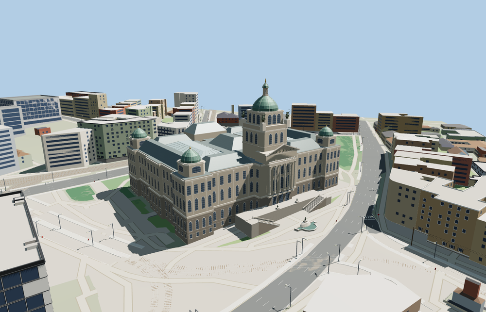

# National Museum in Prague

The historic Neo-Renaissance museum faces Wenceslas Square. Its modeled exterior includes the copper Pantheon dome and lantern, four corner cupolas, two glazed court roofs, paired forecourt stairs, and the mapped fountain.

The 21,397-triangle source rebuilds byte for byte. Skyline, district, street and close-up use 998, 2,919, 7,231, 19,893 triangles. Skyline and district total 316,920 bytes. Six GLBs validated and 36 current views were inspected.

All four tiers pass roof crest, light well, stair, foundation and fountain probes. The viewer retains the separate New Building, 175 independent building records in total, and 366 transportation records. The original fountain water is restored when the model unloads or fails to load.

The main footprint, two rear light wells and the mapped dome and roof positions use standard PMTiles. The historic building represents the museum candidate. The modern New Building retains its separate map geometry. The exterior roof profiles, sculptural groups, fountain basins, stair dimensions and trim are photo-based reconstructions. The roofed court halls are represented from the exterior, with simplified glazing and roof framing. The stone foundation and stair toes are fitted to sampled viewer terrain. Exhibition interiors, the underground link, fountain animation and surveyed construction dimensions are outside this model.

Rebuild with `node packages/worldgen/scripts/generate-national-museum-in-prague.mjs`. Append `--check` to compare exact bytes. Use `--ids=national_museum_in_prague` for targeted import, LOD, placement and readiness.
