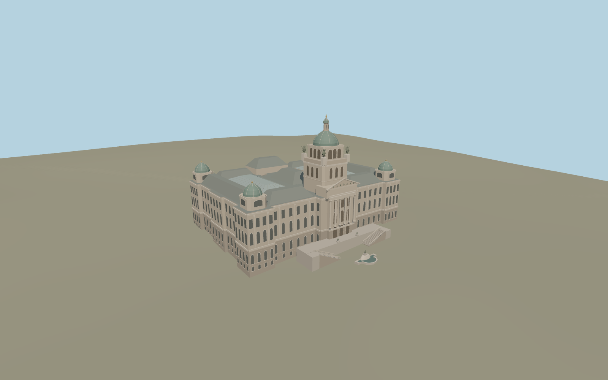

# National Museum in Prague

The historic Neo-Renaissance museum faces Wenceslas Square. Its modeled exterior includes the copper Pantheon dome and lantern, four corner cupolas, two glazed court roofs, paired forecourt stairs, and the mapped fountain.

Run `node packages/worldgen/scripts/generate-national-museum-in-prague.mjs` to rebuild the source master. Append `--check` to compare the exact bytes. Use `--ids=national_museum_in_prague` for targeted import, LOD generation and placement.

The main footprint, two rear light wells and the mapped dome and roof positions use standard PMTiles. The historic building represents the museum candidate. The modern New Building retains its separate map geometry.

The exterior roof profiles, sculptural groups, fountain basins, stair dimensions and trim are photo-based reconstructions. The roofed court halls are represented from the exterior, with simplified glazing and roof framing.

The stone foundation and stair toes are fitted to sampled viewer terrain. Exhibition interiors, the underground link, fountain animation and surveyed construction dimensions are outside this model.

Original geometry follows the repository license. Map data is © OpenStreetMap contributors under ODbL-1.0 via Protomaps. Terrain samples are described in terrain-grid.json. Ordinary pictures stay local and are not redistributed or used as textures. Current acceptance is recorded in qa.json.
