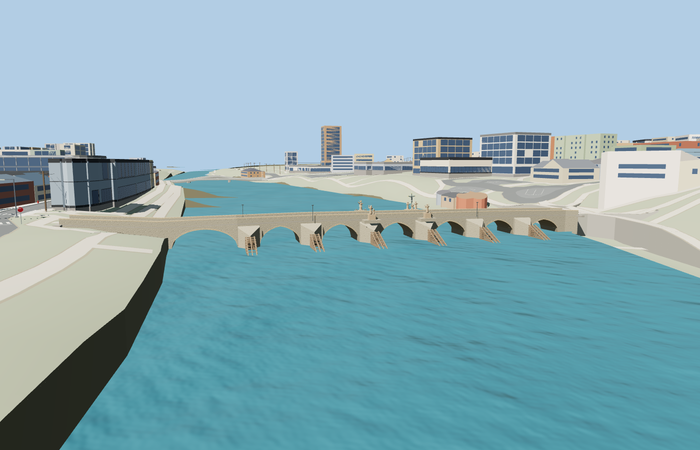

# Písek Stone Bridge

Reviewed 2026-10-27. **Scoped medium-fi exterior and approximate native placement complete.**

Inspected 70 current frames: 13 portable, 13 shared-material/geographic, 25 medium-fi and 19 native. The bent narrow deck, seven true arch openings (including the larger western span), solid parapets/coping, six individually mapped pointed cutwaters, six slatted wooden ice guards and four independent sculpture ensembles are present. Calvary has a metal crucifix and three stone companions; Nepomuk has a biretta, five-star halo and two full angels; Anne has young Mary and infant Jesus; Anthony carries a child. Corrected textured masonry joints on carved figures, missing Anne infant and buried angel bodies during the same build pass. Far levels intentionally simplify small sculpture and fittings.

Six existing shared 256px material graphs: stone_drywall, stone_sandstone, stone_sandstone_raw, stone_granite, wood_plain and metal_painted, with metric UVs and linear vertex tints. Raw sandstone keeps masonry joints off carved figures. No embedded/private images, copied photo pixels or downloaded meshes. Each graph is read once per native view; the four runtime GLBs use separate GPU attribute streams.

| Level | Triangles | Bytes | Draws |
| --- | ---: | ---: | ---: |
| skyline | 956 | 80508 | 1 |
| district | 2168 | 183632 | 6 |
| street | 11280 | 955616 | 6 |
| closeup | 24580 | 2089240 | 6 |

Detailed source master: 54948 triangles / 6597612 bytes. Runtime levels: 956 / 2168 / 11280 / 24580 triangles, 80508 / 183632 / 955616 / 2089240 bytes and 1 / 6 / 6 / 6 draws. Initial skyline plus district is 264140 bytes. Strict medium-fi budgets pass; physical laptop/phone timing remains unmeasured.

Exact-QID OSM way 557027632 / Q3133093 supplies the 110.801 m longitudinal plan and individual cutwater tips; the 14.569 m mapped width includes projecting piers, while the main deck is nominally 6.25 m. Standard PMTiles retains the bent pedestrian route and four artwork/cross points. Anchor [14.145583637,49.309829038], heading 0.095336761605: +X east/northeast toward the old town, -X west/southwest, +Z south/southeast along the Otava. Source datum 356.92734375 m follows native water 357.5273 m. Six width samples at the two actual mapped approach joins retain road and model support within 0.014064 m at every LOD. The western profile is raised for the coarse bank; these are visualization joins, not surveyed geographic accuracy.

All 914 resident buildings and 562 independent road records remain. Raw road inputs, DEM samples, displayed ground and water geometry stay unchanged. Connected approach paving is deliberately graded. Failed loading retains the original map crossing; unloading preserves native ground/water and releases all model/support geometry. The resampled review route uses all four map control points; exact join claims use the actual map approach samples.

## Reconstruction limits

- Ordinary photographs and the mapped plan guide the exterior. Arch heights, wall courses, height datum and foundations remain approximate; no as-built survey is claimed.
- The 14.569m mapped width includes projecting piers. The main walking deck is nominally6.25m with a wider western approach; the mapped overall length is110.801m versus the nominal109.75m reference.
- Statue ensembles preserve their main poses and attributes with faceted three-dimensional robes, heads, hands and children/angels. Faces, drapery, inscriptions, small attributes and exact carved surfaces are interpretive rather than replicas.
- The Calvary crucifix and crucified figure are dark/patinated metal with restrained gold fittings; its lower companion figures and other ensembles are stone. Fine lettering is omitted.
- The six wooden ice guards and simple lamp fittings are photo-led regularized approximations. They are not separate catalog landmarks.
- Source datum356.92734375m follows the357.52734375m water surface in the retained raw-polygon standard fixture. Semantic water heights and bank terrain vary with tile context; this is not a surveyed river stage.
- Skyline uses bounded faceted openings and statue markers; closer levels restore arch bands, ice guards, full poses, drapery and facial forms.
- The surrounding procedural buildings, coarse quays, automatic retaining faces, power lines and approach terrain are context, not a historic reconstruction of Písek.
- Statues are faceted exterior interpretations. Individual facial likenesses, exact drapery, carved base profiles and inscriptions are outside the reconstruction scope. The ice-guard slats are regularized; no structural engineering model is claimed.
- The western endpoint visualization grade and small bank overlaps fit generalized standard map terrain. No surveyed curb, foundation, vault profile or river-stage accuracy is claimed.
