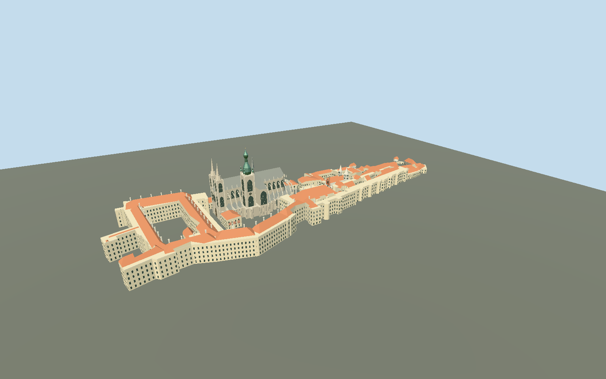

# Prague Castle

Mapped castle complex with open second and third courtyards, St Vitus Cathedral and its unequal Gothic and Baroque towers, St George Basilica, royal palace ranges, Rosenberg and Lobkowicz palaces, Powder and Black towers and the small Golden Lane houses. Individually mapped Daliborka is restored.

## Evidence and reconstruction

Published dimensions and reconstructed details are separated in spec.json. Primary references:

- [Reference](https://www.openstreetmap.org/relation/3312247)
- [Reference](https://www.hrad.cz/en/prague-castle-for-visitors/castle-map)
- [Reference](https://www.hrad.cz/en/prague-castle-for-visitors/objects-for-visitors/st.-vitus-cathedral-10330)
- [Reference](https://www.hrad.cz/en/prague-castle-for-visitors/objects-for-visitors/old-royal-palace-10332)
- [Reference](https://virtualni.praha.eu/towers/cathedral-of-st-vitus-at-prague-castle)
- [Reference](https://virtualni.praha.eu/towers/basilica-of-st-george-at-the-prague-castle)
- [Reference](https://commons.wikimedia.org/wiki/File:Panoramic_view_of_St._Vitus_Cathedral_and_Prague_Castle_grounds.jpg)
- [Reference](https://commons.wikimedia.org/wiki/File:West_facade_of_St._Vitus_Cathedral-Prague.jpg)
- [Reference](https://commons.wikimedia.org/wiki/File:Bazilika_Svat%C3%A9ho_Ji%C5%99%C3%AD-Prague.JPG)

No third-party geometry, photograph or bitmap texture is embedded. Shared surface graphs come from the central library; vertex tints carry model colors. Glazing uses PBR materials; transparent surfaces are declared per model.

## Model and axes

63,809 triangles; 134,637 vertices; 8 material groups; 5,617,324 bytes. Native bounds: -279.231, -28.963, -91.804 to 279.226, 99.300, 91.805. Source hash: `sha256:4aefcfad8be943fa5be66dceb79bcee6ab530fdb5723789c59bbf40fe77d9bb9`.

{"up":"+Y","longitudinal":"+X from western palace toward the eastern gate","front":"+Z toward the southern gardens","origin":"Signed original map frame;Y0 Third Courtyard terrain reference. Relative Bpv grade, no forced absolute runtime elevation."}

Exact-Q193369 precinct relation3312247 establishes identity;299 individually retained occupied relations/ways preserve courtyard holes. Fresh coordinates match all298 original cached parts within0.0027m. Native+X bearing109.242deg points toward the eastern gate,+Z199.242deg toward southern gardens. Daliborka is separately registered by exact-Q3506740 relation3367848; White Tower/Black Tower identities remain distinct. Public Czech DMR5G bare-earth data establishes relative grade from the Third Courtyard reference[-114,29],256.749m Bpv. The eastern gate drops about13.4m in this photographic working reconstruction; adjacent retained open ground drops11.45m north of the gate and20.38m on the southern slope. Castle ranges use declared smooth/quarter-specific floor reconstructions rather than per-pixel roof warping; foundations extend into retained terrain. Under-building ground is not a floor survey. Whole-precinct replacement remains disabled. High-resolution host terrain is required for full contact; no absolute Bpv elevation is imposed at runtime.

## Reproduce

Run `node packages/worldgen/scripts/generate-signature-towers.mjs --ids=prague_castle` (or add `--check`). The generator preserves manually edited masters by checking their baseline hashes. Import through the standard authored-model workflow with optimization disabled; then capture all QA cameras, including shared-surface views.

## Pending work

- Original detailed source master47961476bytes/567918triangles remains exactly reproducible atsha256:80beee517c6a4c2b3e50ceea71e4e24d6270c97381b6f2b3d11533180f662ff0 from prague-castle-model.mjs#pragueStudy.build. A separate reviewed runtime source repairs grade/roof edges and supplies four authored browser levels.
- Exact-Q193369 precinct relation3312247 establishes identity;299 individually retained occupied relations/ways preserve courtyard holes. Fresh coordinates match all298 original cached parts within0.0027m. Native+X bearing109.242deg points toward the eastern gate,+Z199.242deg toward southern gardens. Daliborka is separately registered by exact-Q3506740 relation3367848; White Tower/Black Tower identities remain distinct. Public Czech DMR5G bare-earth data establishes relative grade from the Third Courtyard reference[-114,29],256.749m Bpv. The eastern gate drops about13.4m in this photographic working reconstruction; adjacent retained open ground drops11.45m north of the gate and20.38m on the southern slope. Castle ranges use declared smooth/quarter-specific floor reconstructions rather than per-pixel roof warping; foundations extend into retained terrain. Under-building ground is not a floor survey. Whole-precinct replacement remains disabled. High-resolution host terrain is required for full contact; no absolute Bpv elevation is imposed at runtime.
- Seven common lime plaster, limestone, wood, ceramic tile, slate, copper and painted-metal graphs plus opaque PBR glazing are shared. Carved/weathered stone and the small granite obelisk deliberately share limestone grain with component vertex tint; no model copies photographic textures. Skyline bakes common-graph linear means into one draw.
- Exterior shapes, palace floor bands, roof pitches/valleys, façade bays, sculptural traces, house colors and lower defensive elevations are reconstructed medium-fi approximations. No interiors, copied photographs, exact saints/heraldic lion/Golden Gate mosaic, terrain hill or visitor furniture. Fine artwork is omitted. Daliborka20m total and Powder35m total follow map tags; architectural heights are not an as-built survey.
- The bare-earth source is a publicF32 raster exported from2m DMR5G intoEPSG4326 and resampled onto a6m native grid. Values under buildings are ground interpolation. Acquisition date at this castle is unknown; source metadata spans2010–2025. Terrain fixture heights are relative verification evidence; physical laptop/phone timings remain unmeasured.
- Skyline keeps court holes within0.45m, replaces some minor roof ridges by terracotta caps, omits hidden undersides and simplifies the tiny cross arms. District retains mapped court holes and major wings/churches/defensive houses; some ancillary bodies are deferred to street/close. Declared skyline7.5m and district5.5m reconstruction tolerances include outer-outline/roof clipping. These are recipe tolerances, not a surveyed accuracy guarantee.

This bundle follows the medium-fi standard. Medium-fi appearance and geographic fit are reviewed separately. Hash-bound visual acceptance is recorded separately after capture inspection.

## Additional geographic data

Individual map geometry derives from © OpenStreetMap contributors, ODbL-1.0; map-parts.json records source, date, meter frame and tags. Photographs are linked only; no photographic pixels or third-party mesh are included.
