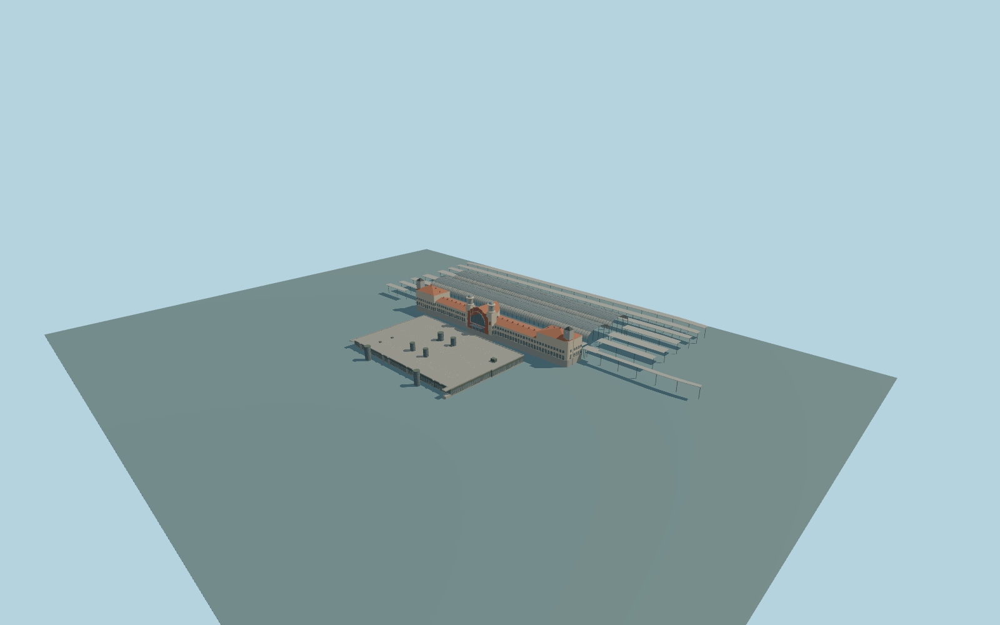

# Praha hlavní nádraží

Complete permanent Prague main-station passenger ensemble: modern western terminal with dark park-facing glass,roof parking/terrace,parapets andsix tall shafts;full historic Fanta building with both round central clock turrets,large arched glazed entrance,red-brick stepped gable,long wings,both outer roof/clock pavilions;two complete curved train sheds andall mapped extended canopy rows. Keep the road between terminals,open rail/platform spaces,park andindependent city/service buildings separate. Exterior only;no copied lettering,brands,coats of arms,figurative sculptures,people,trains or navigable underground/interior.

Rebuild: `node packages/worldgen/scripts/generate-praha-hlavni-nadrazi.mjs`;append `--check` for exact source bytes. Select import/LOD/placement with `--ids=praha_hlavni_nadrazi`. Detailed source and four browser tiers are separate ignored GLB outputs.

Complete permanent Prague main-station passenger ensemble: modern western terminal with dark park-facing glass,roof parking/terrace,parapets andsix tall shafts;full historic Fanta building with both round central clock turrets,large arched glazed entrance,red-brick stepped gable,long wings,both outer roof/clock pavilions;two complete curved train sheds andall mapped extended canopy rows. Keep the road between terminals,open rail/platform spaces,park andindependent city/service buildings separate. Exterior only;no copied lettering,brands,coats of arms,figurative sculptures,people,trains or navigable underground/interior.

Native heights are retained per physical family:modern7m deck,14/15m shafts,Fanta11m parent/15m wing ridges,25m end roofs/32m outer clocks,26m central gable/35m round turrets,20m shed crowns and6/8m platform roofs. Source modern floor+.65m andhistoric architectural grade+6m/floor+6.65m share one common outside-park datum,with foundations-10m. Roof curvature,grade transition,window/rib inventory andsmall absent-height details are explicit original photo-proportioned approximations. Map layers are not elevations;no per-part host offsets. Only actual closed lower floors receive masks;the road,cantilevers,roof parking,open sheds/platforms andcanopy gaps do not. One unchanged standard field sample outside the modern park entrance[0,-52],208.6560418m,defines commonY=0. Historic architectural grade+6m is explicit;native contact still needs render review.

Two adequate ordinary photographs inspected. Full historic/modern plans andnative height stacks are retained. Hidden openings,roof sections,fine ornament,parking-bay/panel/rib inventory,current works andexact thresholds/platform transitions remain approximate. Modern exact relation identity doesnot assert anexact tag onFanta/every roof family. Exact hidden windows,thresholds,roof section/rib inventory andcurrent works remain approximate. Physical-device timing andnumerical LODerrors remainunmeasured.

Seven existing shared256px graphs:stone_limestone,brick,stone_granite,metal_painted,tile_ceramic,window_grid andconcrete_plain. Eight merged semantic groups separate opaque metal roof sheet fromstructural metal;metric UVs andlinear colors,no private or embedded images. Skyline retainsboth complete terminal masses,four historic clocktowers,sixmodernshafts,both curved train sheds andall extended canopy roofs. Districtaddscoarsepanes;streetaddsrealrecessesandframes;close-upaddsroof/parapet/mullion/ribdetail. Masterseparatelyrefinescurves,framesandpanels. Windowframes use front ribbons overrealrecesses inbrowser tiers;master preserves volumetricframes. Fine details areabsent onshort nativewallreturns rather thanextending beyond theirbounds.

Original geometry:repository license. Map:© OpenStreetMap contributors,ODbL-1.0;Protomaps. Standard terrain:terrain-grid.json. Ordinary pictures stay local and are not redistributed or used as textures. Current acceptance:qa.json.
