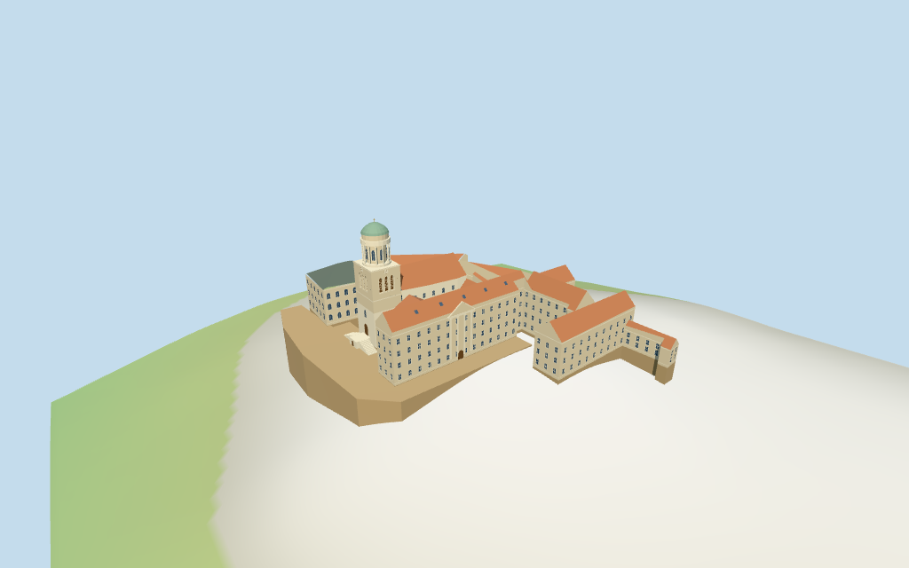

# pannonhalma_archabbey — Pannonhalma Archabbey: historic core review

Reviewed 2026-10-14 against current source/runtime bytes. Accepted for this medium-fi exterior and approximate geographic scope.

## Built result

Inspected all 11 final portable/source-terrain views. Individual mapped historic core includes cream monastic ranges, two roofless paved courtyards, red basilica/tile roofs, dark hipped western library, square clock/belfry tower, open round columned gallery, green copper dome/cross, adjoining gatehouse, selected classical front and split raised-entry steps. Removed the basilica gable/window overlap from the tower prism and raised the estimated level floor to clear the sampled courtyard hill crest.

Individual medium-fi exterior from two useful aerial/tower pictures and standard viewer PMTiles/DEM. No bespoke surveys, printed-plan tracing or LiDAR. No usable architectural height facts:22/29.5m main front,23/32m basilica,19/26m library,36.5m square clock stage,37.5..46m gallery,50.3..54.8m dome and56.4m crown are picture-led estimates. Selected window/clock/belfry rhythms, roof subdivision, retaining boundary and all court/step joins remain approximate. Exact sculpture, reliefs, clock numerals, interiors, vegetation and complete modern campus excluded. Physical phone/laptop measurements pending.

## Shared materials and placement

Inspected all 11 final shared-material/geographic views. Seven existing 256-square graphs provide lime plaster, raw limestone trim, ceramic tile, slate, standing-seam copper, weathered limestone foundations and plain wood. Metric UVs and linear tints; glass remains flat blue-gray. All seven graphs read once. Unload disposes model geometry and restores ground. The flat geographic fixture checks signed placement; native heightmap views check approximate hill contact. Diagnostic ground colors do not reconstruct actual landcover.

Six unioned current PMTiles controls identify the main monastic ranges, basilica, tower part, library, connecting block and adjoining gatehouse. Rigid signed facade alignment 0.2633327763154791rad preserves horizontal scale, western tower/library facing and both open courts; earlier exact-QID main-only outline is retained separately. StandardDEM datum 273.5957946197341m and estimated 0.8m floor clear the sampled 0.454m courtyard crest. Deep downslope foundations, photo-led terrace outline, paving and stair thresholds remain approximate. Separately mapped modern school, sports/visitor buildings and neighboring campus are excluded; no road replacement or certified walking claim.

Inspected all 27 final Earth-lighting views: Economy/High, noon/late, three distances, silhouette, six details, four matched levels and four transitions. Skyline retains mapped core/courts, library and clock-gallery-dome silhouette using mean tints/coarse facets. District adds shared textures, window rhythm, clocks and recessed belfry; street adds cornices, classical pilasters/pediment, gallery windows and selected skylights; closeup refines window frames, dome/columns, clock ticks/louvers and steps. Detail/profile changes remain visible. English-terrace neighbors are synthetic context.

## Browser budgets

| Level | Triangles | Bytes | Draws |
| --- | ---: | ---: | ---: |
| skyline | 931 | 95440 | 1 |
| district | 3456 | 330096 | 8 |
| street | 5324 | 507408 | 8 |
| closeup | 33623 | 3192984 | 8 |

Skyline plus district: **425536 bytes** of geometry. Source master: **4039468 bytes /33623 triangles**. No embedded images. Seven shared material graphs are cached separately; initial geometry excludes graph definitions/texture generation. Separate POSITION/NORMAL streams report equal CPU/GPU buffer totals. Physical phone/laptop timings remain pending.

## Verification

- Exact targeted source reproduction with --ids=pannonhalma_archabbey --check; current import/derivative and review hashes match.
- Six GLBs pass Khronos with zero errors,warnings or embedded images. All four authored levels meet triangle/draw/download limits.
- Six current map controls, rigid signed transform, retained earlier main-only outline, full core zone coverage and standardDEM grid match.
- 56 imported geometry probes pass: both courts roofless/paved, belfry recess and backing, clock/raised door, open gallery/supports and dome across applicable levels. Declared estimated crown height agrees across outputs; this is not a measurement of real height.
- The estimated floor clears the 1 m sampled courtyard crest; exact terrain/retaining/threshold fit remains approximate.
- All seven shared graphs read once; unload leaves zero live model geometries and restores ground.
- Source inventory/schema and frame/medium-fi readiness bindings pass.
- Scene validation and 30-tick simulation pass: sha256:cfff90d82988fa12af25c778f927175e3657c422f3db1fff4663f01017b3ae39.
- Inspected 49 current frames: 11 portable, 11 shared/placement, 27 medium-fi. Reports retain hashes,paths and cameras; bulk renders remain local/ignored.

Source hash: sha256:a4ce8a6d3647a27853447f55f4e478a4fc4efd0feee79769f988149aef881051. Runtime hash: sha256:af62bc9dcc43921693a77ef9a580d3ec91a8519f13361fcdc26d28a99fca88ba. Input hash: sha256:5236332fc124610c22e394d8dec33de2078d6c4d39af56dc8041ce9939a71bb6.

Commands: targeted generate/import/LOD scripts; capture-structure-models.mjs --ids=pannonhalma_archabbey --reflections --antialias --fit-shadows; capture-landmark-library.mjs --ids=pannonhalma_archabbey --reflections --adaptive-clipping --bounded-placement; capture-medium-fi.mjs --ids=pannonhalma_archabbey --reflections; molen validate; molen sim run --ticks 30 --hash. This uses the targeted authoring loop.

## Limits

- No retained published height facts or current PMTiles architectural heights. Main22m front eave/29.5m roof,23/32m basilica,19/26m library,15..21m other range eaves,36.5m square clock stage,37.5..46m colonnade,50.3..54.8m dome and56.4m overall crown are picture-led estimates. Ground datum follows standard viewerDEM; flat floor/terrace, retaining boundaries and all thresholds remain approximate. Six mapped controls retain the main ranges,basilica,tower,library,link and gatehouse; the two unioned courts stay open.
- Core exterior from two useful pictures and standard viewer PMTiles/DEM. NativeY0 follows273.595795m standardDEM; estimated level floor0.8m clears coarse core perimeter-22.83..-0.12m and sampled courtyard peak0.454m. Buildings and photo-led terrace use foundations following retained terrain; retaining outline,height stages,court/step joins remain approximate. No surveyed floors,parcel boundary or certified walking surfaces.
- Modern school,sports/visitor buildings,vegetation and neighboring campus are excluded. Selected window/clock/belfry/entry rhythms approximate pictures; no exact reliefs,clock numerals,sculpture,complete interiors,surveyed floor/roof plans,parcel boundary or certified walking surfaces. Courtyard paving and split stair joins approximate the hilltop terrace. Physical laptop/phone timings pending.
- Skyline uses mean tints/coarser octagonal dome and columns,solid belfry; district adds shared textures,window rhythm,clock hands and actual belfry recesses; street adds pilasters,framing/gallery windows and finer roofs; closeup refines dome/columns,clock ticks,louvers and steps. Detail/profile changes remain visible.

Readiness records acceptance for this stated exterior scope. The 1,000-candidate goal remains incomplete.
