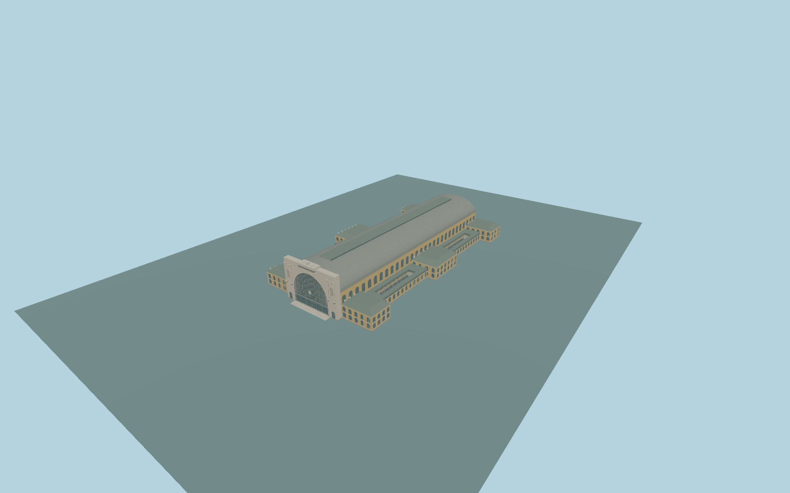

# Budapest Keleti railway station

Complete permanent Budapest Keleti passenger building: monumental pale classical west entrance with recessed arched glazing, clock, paired columns, niches and parapet; full long barrel-roof nave and raised pale-green rooflight; both front mansard pavilions, central and rear side pavilions, low yellow ranges and open courtyard spaces. Preserve the underground metro/plaza relation, independent city blocks, roads, rails and eastern approach ground. No copied lettering, brands, figurative statuary, people, trains or navigable interior.

Rebuild: `node packages/worldgen/scripts/generate-budapest-keleti-railway-station.mjs`;append `--check` for exact source bytes. Select import/LOD/placement with `--ids=budapest_keleti_railway_station`. Detailed source and four browser tiers are separate ignored GLB outputs.

Complete permanent Budapest Keleti passenger building: monumental pale classical west entrance with recessed arched glazing, clock, paired columns, niches and parapet; full long barrel-roof nave and raised pale-green rooflight; both front mansard pavilions, central and rear side pavilions, low yellow ranges and open courtyard spaces. Preserve the underground metro/plaza relation, independent city blocks, roads, rails and eastern approach ground. No copied lettering, brands, figurative statuary, people, trains or navigable interior.

Preserve native31.4m front,31m nave,14m pavilions and8m low ranges. Source nave eaves18.5m/crown31m,raised rooflight32m and original non-figurative crest34.4m are architectural controls. Closed occupied floor+.85m and foundation-6.5m share one unchanged host terrain datum. Side pavilions have two storeys; low ranges one storey. Four photo/inferred court voids stay open in roof, floor and ground masks. No per-part host offsets or invented metro-plaza floor. One common unchanged global-field sample[-100,4],114.10798140000001m,suppliesY=0. Exact nativecontact requires currentfield review. No per-part hostoffsets,blanket parent floor or artificial metroplaza.

Two adequate ordinary front/aerial pictures inspected. Major roof and facade families are observed. Current map generalizes the low side ranges as closed roof parts; source preserves the visible court voids instead. Four rectangular court controls approximate the two observed near-side courts and the corresponding unpictured opposite-side pair. Exact court outlines, hidden openings, rooflight inventory and present works remain unverified. No bespoke survey/archival research. Original exterioronly. Court positions are observed/inferred approximations within generalized lowroof parts,not an exact mapped court survey. The two metro-relation holes remain outside this model. Figuralstatuary is represented only by simple original crest forms;no copied sculptures orlettering. Physical-device timings andnumericalLODerrors remainunmeasured.

Six existing shared256px limestone,stucco,granite,paintedmetal,slate andwindow-grid graphs;seven mergedsemanticgroups because metalroof andstructuralmetal retain distinctslots. MetricUVs,linearcolors,no private/embeddedimages. Skyline keepswholehall,allpavilions andcourtopenings. Districtaddscoarsearchedglazing andcornices. Streetaddsrealrecesses,archmouldings androofribs. Close-upaddscolumns,archedmullions,dormers andmansardrails;master separatelyrefinescurves andwindowframes. LODerrorvalues areestimates.

Two unioned coverage-selector rings replace the same17stationcomponents. A10square-meter selector notch inside the main hall keeps overlapping underground metro tile1133 below98percent replacement coverage;station components remainabove98percent. The notch affects only map ownership,not model geometry or occupied-floor/terrain masks. Full underground metro relation620/1133 andall1132neighbors remainnative.

Original geometry:repository license. Map:© OpenStreetMap contributors,ODbL-1.0;Protomaps. Standard terrain:terrain-grid.json. Ordinary pictures stay local and are not redistributed or used as textures. Current acceptance:qa.json.
