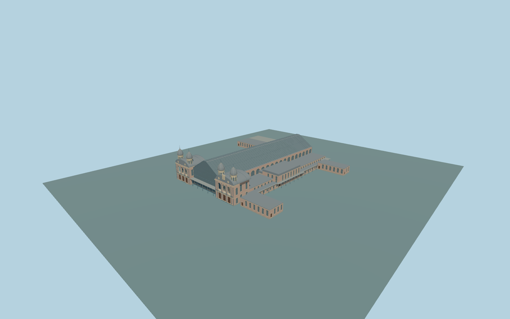

# Budapest-Nyugati railway station

Complete historic Budapest-Nyugati passenger-station exterior:four domed front towers,two ornate brick pavilions withupper arcaded galleries andclosed entrances,central glazed pitched train hall andopen track-end screen,full connected side ranges/rear returns,open coveredpassages andattached northwest passenger concourse. Keep original rails/platforms beyond thefront foyer,open courtyards,Westend shopping/parking/rooftop-park structures,detached service buildings andall other independent neighbors. No trains,logos,lettering,copied shop brands or navigable interiors.

Rebuild: `node packages/worldgen/scripts/generate-budapest-nyugati-railway-station.mjs`;append `--check` for exact source bytes. Select import/LOD/placement with `--ids=budapest_nyugati_railway_station`. Detailed source and four browser tiers are separate ignored GLB outputs.

Complete historic Budapest-Nyugati passenger-station exterior:four domed front towers,two ornate brick pavilions withupper arcaded galleries andclosed entrances,central glazed pitched train hall andopen track-end screen,full connected side ranges/rear returns,open coveredpassages andattached northwest passenger concourse. Keep original rails/platforms beyond thefront foyer,open courtyards,Westend shopping/parking/rooftop-park structures,detached service buildings andall other independent neighbors. No trains,logos,lettering,copied shop brands or navigable interiors.

Native values haveincomplete architecturalsemantics anddonot match thecomplete photographed tower/gable silhouette. Sourceeaves/pavilion18m,hall15.5m eaves/28.3m ridge,towerbody26.3m/dome32.8m/spire36.8m are explicit photo-proportioned approximations;low wingsfollowmapped5/8/11/14m heights. One unchanged standard host sample outside the street facade,local[-86,-18], 111.95428633333333m suppliesone commondatum. Level occupied floors+.85m andstructural foundation-6.3m;no sloped train hall,per-part hostoffsets orinvented outsideplaza. Native field falls4-5m towardtherear,so currentcontact mustbeinspected ratherthan assumed.

Two adequate ordinary pictures actually inspected, plus current standard PMTiles. No bespoke sources or further research needed before geometry. Hidden details and heights remain explicit medium-fi approximations. Full historic station andattached passengerconcourse only;Westend mall,park/parkingdecks anddetached southeastservicebuildings remainnative. Rear/sideopenings,roofservices,oculi,theleft pavilion gallery andhiddenreturninventory arecoherent originalmedium-fi approximations. No copiedsignage,brands,shopidentities,trams,streetwires,trains,people ornavigable interiors. Exact platform,tide-free urbanfoundation andthresholdlevels remainapproximate. Physical-device timings andnumericalLODerrors remainunmeasured.

Eight existing shared256px brick,limestone,granite,slate,painted-metal,window-grid,plain-wood andcorrugated-metal graphs;eight groups maximum. MetricUVs,linearcolors andzero private/embeddedimages. Skyline retainsallfourdomes,pavilions,pitchedhall,sidewings andopenpassages. District addscoarsearchedinventory,clockface androofstructure. Street addsactualdoor/windowrecesses,openbacked galleries,frames andbracing. Close-up addsfinerroofribs,balconyrails,domes andfullsidewindowinventory. Detailedmaster refinesactualcurvedprofiles separately. Straight roofribs are notneedlessly subdivided.

Occupied entrance floors are raised0.5m during this original review pass tostay clear ofthecoarse nativefrontage field. One common sourcefloor level,not per-part hostoffsets. Exact historical thresholds andbasement/rear gradesremainapproximate.

Original geometry:repository license. Map:© OpenStreetMap contributors,ODbL-1.0;Protomaps. Standard terrain:terrain-grid.json. Ordinary pictures stay local and are not redistributed or used as textures. Current acceptance:qa.json.
