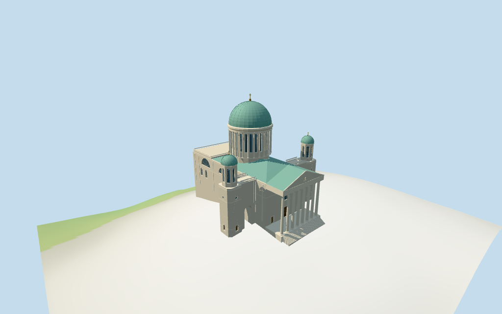

# esztergom_basilica — Esztergom Basilica review

Reviewed2026-10-15 against current source/runtime bytes. Accepted for medium-fi exterior and approximate geographic placement. Existing100m height fact/dome tag are retained; modeled exterior tip is an estimated90m above the entrance floor. Source measurement datum and exact host ground joins remain unresolved.

## Built result

Inspected all 11 current portable/source-terrain frames. Individual Esztergom Basilica has a broad pale masonry body, eight free-standing classical portico columns, deep clear portico/inset timber portals, broad entablature and triangular pediment. Two lateral wings have genuine open round arch passages and balustrades; square tower bases carry small oculi, octagonal upper stages with tall dark arched fields, green domes and crosses. The dominant central drum has 24 pale columns and recessed rectangular window bays below a heavy circular cornice and ribbed green copper dome/orb/cross. High side lunettes, lower paired round fields, pilasters, shallow copper roof and rear parapeted terrace distinguish the body. Fixed trim bands crossing tower doors and long stair triangles spilling the conservative footprint into the plaza. Shortened the initially over-tall drum against picture proportions. Fine capitals/reliefs/inscriptions and hidden/current roof details remain approximate.

Medium-fi exterior from three actually inspected Commons pictures:2012 aerial byGábor Bakó,2013 front byZairon and an older undated aerial attributed toCivertan (uploaded2006). No bespoke surveys/plans researched or reference pictures redistributed. Eight-column portico, open wing arches, paired smaller tower domes, high side lunettes/paired lower fields, colonnaded central drum and green dome are individually authored. Existing dimension facts and raw height tag are retained with explicit measurement-datum limits. The90m modeled exterior tip, other levels/internal divisions, rear terrace/current finish and ornament are picture estimates. Fine sculpture/relief subjects, capital carving, inscriptions and full interiors are simplified or excluded. Nearby castle/seminary/retaining walls are separate objects. Exact terrain joins and physical-device measurements remain pending.

## Shared materials and placement

Inspected all 11 current shared/geographic frames. Four existing cached 256-square coursed limestone, continuous limestone, oxidized copper and plain-wood graphs serve six merged groups; skyline is one draw. Metric UVs, linear pale-stone/green-copper/wood tints and flat architectural normals; glazing and muted gold accents use local PBR colors. No embedded images, unique facade maps or baked shadows. Each graph reads once; unloading disposes geometry and leaves zero live model geometries. Close views show the actual portico/passage air, inset portals, round side fields, octagonal tower stages, rectangular drum glazing between columns and copper seams/ribs. Signed top view retains the whole and dome control. Flat geographic diagnostic ground is not surveyed hilltop terrain.

Retained exact-QID way/77102132 (Q991832) matches current main35184449190964. Anchor[18.736478664,47.79909506], heading0.494588533929rad: native+X eastern eight-column portico, -X western rear, Z spans the lateral tower wings. Current whole24 vertices differs from earlier34; original multilingual identity and earlier control remain verbatim. Whole and dome component35185413897395 reproduce all44 raw vertices/tags rigidly without rescale. The dome height100 tag and existing Wikidata height100m/length120m/width40m facts remain intact. The mapped whole is about116.4m long/94.4m across including tower wings; central body is about43.8m wide. Measurement scope/datum is unspecified, so the40m width is not forced onto the whole. Picture proportions guide an estimated90m exterior tip above the entrance floor; the100m source fact/map tag are not asserted to measure that same plane. Crypt/basement-to-cross datum remains unresolved. Other heights/partitions and tower positions are explicit estimates. All30 viewer checks cover whole/dome and retain two neighboring buildings plus front plaza across six outputs. Standard viewer DEM datum156.867491m, floor0.8m, raw whole perimeter-13.18..0.22m; footings crossY=0 and extend below coarse terrain, while local eastern steps descend toward front samples. No source preview flattening or host DEM modification. Exact hilltop retaining-wall/ground contact, street/door joins, absolute altitude and walking remain unverified. No road replacement.

Inspected all 27 current Earth-lighting frames: Economy/High, noon/late, three distances, texture-free silhouette, six details, four matched whole LODs and four transitions. Skyline retains the eight-column portico, open wing passages, broad body, central drum/green dome and paired smaller caps at870 triangles. District adds shared surfaces,24 simpler drum columns, flat glazing/door fields and cornices at3275 triangles. Street adds actual recessed fields, dome ribs, pilasters and balustrades at15608 triangles; closeup/master refine curved profiles, frame facets and ribs at29430 triangles. All matched whole views include the envelope and estimated90m tip above the0.8m model floor. Small framing/capital and curved-facet detail changes intentionally by tier. Detail crops intentionally exclude other sections. Synthetic cottages and coarse terrain are fixtures; physical phone/laptop motion and timing remain pending.

## Browser budgets

| Level | Triangles | Bytes | Draws |
| --- | ---: | ---: | ---: |
| skyline | 870 | 89492 | 1 |
| district | 3275 | 319712 | 6 |
| street | 15608 | 1489880 | 6 |
| closeup | 29430 | 2876692 | 6 |

Initial skyline plus district: **409204 bytes** of geometry. Master: **3535260 bytes / 29430 triangles**. Four existing shared256-square graphs, zero embedded images. Bytes exclude graph definitions/texture generation. Split POSITION/NORMAL streams have equal CPU/GPU totals. Physical-device timing pending.

## Verification

- Targeted byte reproduction and current source/import/LOD/input/report bindings; source/recipe inventory/schema match.
- Six Khronos validations: zero errors/warnings/images. Four browser budgets pass.
-44 raw whole/dome vertices/tags, retained exact identity/multilingual control, dimension facts and standard DEM match.
- **1604 imported geometry probes** and **30 viewer footprint checks** pass.
- Shared graph read-once/unload and hash-bound geographic/medium-fi reviews pass.
- Scene validation and30-tick simulation: sha256:1dda97c8ae18b80027c272d60e154d2655acc1f817f3627c1b82a3457637b20c.
- Inspected **49 final current frames**:11 portable/source-terrain,11 shared/placement,27 medium-fi. Cameras/paths/hashes retained; bulk captures ignored.

Source hash:sha256:13a9e122c88bbf320d7fab02bbe5b2a84612d6d34fd4a5e2f185cb89fa650129. Runtime hash:sha256:47a20facbae394c06a706731437a32e694d6bb09f0fefd219eba6562ce0d7c7f. Input hash:sha256:e56e161e6f623fe887195450003163994e4ffb712e81abcfc3615cc69b37c926.

Commands: targeted generate/import/LOD/register-landmark-previews --ids=esztergom_basilica; generate-additional-landmarks.mjs --ids=esztergom_basilica --check; capture-structure-models.mjs --ids=esztergom_basilica --reflections --antialias --fit-shadows; capture-landmark-library.mjs --ids=esztergom_basilica --reflections --adaptive-clipping --bounded-placement; capture-medium-fi.mjs --ids=esztergom_basilica --reflections; molen validate; molen sim run --ticks30 --hash. Next routine full source checkpoint dubrovnik_cathedral–armenian_cathedral_of_the_holy_cross.

## Limits

- Retained exact-QID way/77102132/Q991832 matches current main35184449190964 (24 vertices rather than earlier34). Current dome component35185413897395 retains20 raw vertices and height100m. Both controls retain all44 vertices/tags by rigid rotation with no rescale. Native+X eastern eight-column portico, -X western rear and lateral towers sign retained heading0.494588533929rad. Existing Wikidata facts height100m, length120m and width40m remain verbatim; their measurement datum/scope is unspecified. Current mapped whole is about116.4m long/94.4m across including lateral tower wings, while central body is about43.8m wide. No artificial scaling forces the40m fact onto the whole envelope. The100m fact and dome tag are retained without forcing that measurement onto the entrance-floor datum. Picture proportions guide an estimated90m exterior tip above the model floor; crypt/basement-to-cross datum remains unresolved. Other heights and all internal partitions are picture estimates: main wall34m/shallow copper roof40m; portico columns1..30.5m, entablature34m/pediment43m; side links34m with open ground arches; tower base34m, octagonal belfry35..49m, green cap55m/tip58m; drum42..63m/cornice66m, green dome84m/orb86m/cross90m. Drum radius/center follows mapped component, with estimated24 exterior columns and recessed rectangular bays. Lower side paired arched fields, high lunettes, rear parapet/roof surfaces, pilasters and decoration are simplified. No survey/engineering accuracy claimed.
- Standard viewer DEM datum156.867491m; estimated floor0.8m, raw whole perimeter-13.18..0.22m. Footings crossY=0 and extend below retained coarse terrain. Local eastern steps descend toward coarse front samples. Exact hilltop retaining-wall/ground contacts, street/door joins, absolute altitude, height datum and walking remain unverified. No preview flattening, host DEM alteration or road replacement.
- Medium-fi exterior from three inspected2012/2013/undated older aerial/front pictures plus standard viewer PMTiles/DEM. Existing dimensions/map height retained; crypt/floor datum and exact measured scopes unverified. Other heights/internal partitions,hidden rear roof and current finishes are approximate. Fine Corinthian sculpture,reliefs,inscriptions,interiors and surveyed thresholds excluded or simplified. Nearby castle/seminary/retaining walls are separate objects. Physical phone/laptop timings pending.
- Skyline keeps eight-column portico,open lateral arches,central drum/green dome and paired smaller domes;small glazing/colonnade omitted. District adds shared surfaces,24 simplified drum columns/flat fields and simple cornices. Street adds actual recessed fields and dome ribs/pilasters/balustrades;closeup/master refine columns/opening frames and ribs. Synthetic cottages are fixtures.

Readiness accepts the reviewed exterior/approximate placement scope. Exact terrain contact and height datum remain unverified. The full1000-candidate goal remains incomplete.
