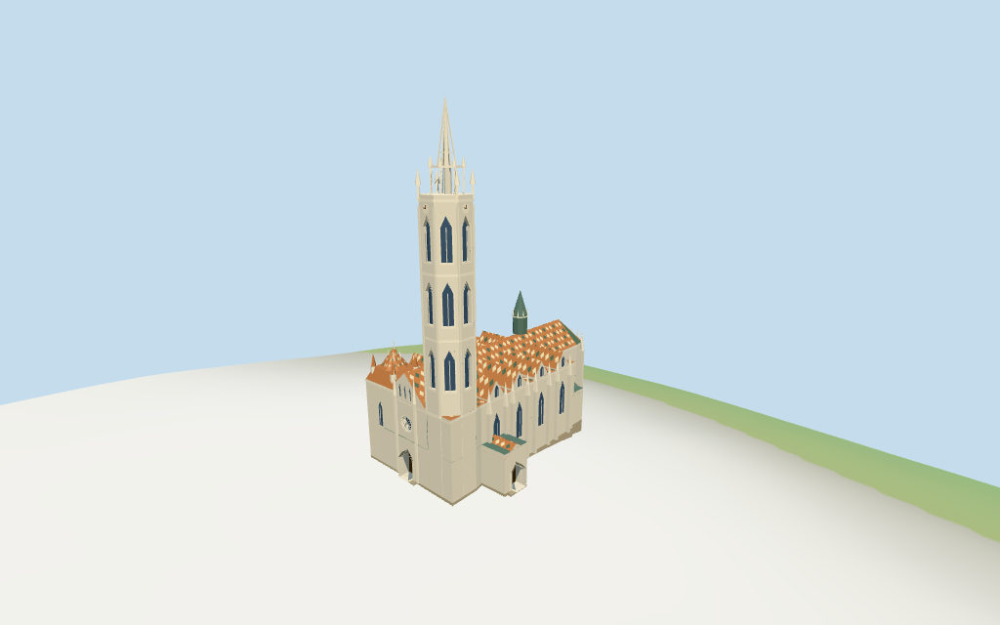

# Matthias Church

Matthias Church: unequal western towers with tall octagonal pointed belfry/open white spire and lower patterned Bela crown; repeated tiled cross-gables, long orange/green/cream patterned nave/apse roof, west rose/portal, projecting south/north entrance porches, dark ridge spire and buttressed polygonal east end.

## Evidence and reconstruction

Published dimensions and reconstructed details are separated in spec.json. Primary references:

- [Reference](https://commons.wikimedia.org/wiki/File:Matthias_Church_Budapest_Corrected.jpg)
- [Reference](https://commons.wikimedia.org/wiki/File:Buda_Castles-Matthias_Church.jpg)

Five existing256-square raw/weathered limestone,glazed tile,standing-seam metal and wood graphs. Roof motifs use palette vertex tints in one shared tile material; metric UVs,linear colors and flat blue-gray glass. No bespoke or embedded images.

## Model and axes

9,363 triangles; 28,089 vertices; 7 material groups; 1,127,848 bytes. Native bounds: -31.774, -4.912, -21.850 to 31.432, 77.870, 21.700. Source hash: `sha256:c7a96c46173df0285265f3ea2b180df27bb653b738169809103e1e7d84df1896`.

{"x":"east along nave toward polygonal apse","y":"up","z":"south toward tall tower/entrance porch"}

Standard viewerDEM datum172.285905m; estimated level floor1.3m clears sampled footprint peak0.901m and perimeter-4.56..0.84m. Foundations follow retained coarse terrain. Tower/roof-stage roles, entry landings, plaza joins and all thresholds remain approximate; no independent surveyed floor or certified walking surfaces.

## Reproduce

Run `node packages/worldgen/scripts/generate-additional-landmarks.mjs --ids=matthias_church` (or add `--check`). The generator preserves manually edited masters by checking their baseline hashes. Import through the standard authored-model workflow with optimization disabled; then capture all QA cameras, including shared-surface views.

## Pending work

- Current PMTiles supplies36 church-part controls with76.57m southern spire,60/65m upper tower/gallery stages,19/22/26/28m northern tower/roof,18/22/24m main roof,20/22m repeated cross-gables,35m ridge spire and10..20m low chapel/porch stages. These map values guide picture-led architectural roles rather than certify surveyed dimensions. Eaves, nested roof profiles, openings, ornament, patterned-tile motifs, interior subdivision and all thresholds remain approximate; retained height/width/length facts contain no published measurements.
- Standard viewerDEM datum172.285905m; estimated level floor1.3m clears sampled footprint peak0.901m and perimeter-4.56..0.84m. Foundations follow retained coarse terrain. Tower/roof-stage roles, entry landings, plaza joins and all thresholds remain approximate; no independent surveyed floor or certified walking surfaces.
- Selected rosette spokes,pointed belfry/portal hoods,open spire ribs,pinnacles and tile motifs are medium-fi approximations. Main central roof/conical apse and transverse eave extension to mapped outer walls are picture-led interpretations of nested map parts. Exact sculpture/fretwork,full interiors,Fisherman’s Bastion,Holy Trinity column,town/plaza and certified walking surfaces excluded. Physical phone/laptop timings remain pending.
- Skyline uses closed portals/coarse tower and spire masses,unpatterned mean-tinted roofs. District adds shared graphs,coarse colored roof motifs,west rose/portals and selected belfry panes. Street adds actual belfry apertures/open upper gallery/spire ribs,buttresses and gable details. Closeup refines roof motifs,window frames and selected pinnacles. Detail/profile changes remain visible.

This bundle follows the medium-fi standard. Medium-fi appearance and geographic fit are reviewed separately. Hash-bound visual acceptance is recorded separately after capture inspection.

## Additional geographic data

©OpenStreetMap contributors; Protomaps; Mapzen/USGS terrain tiles.
